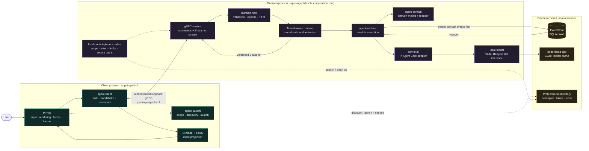
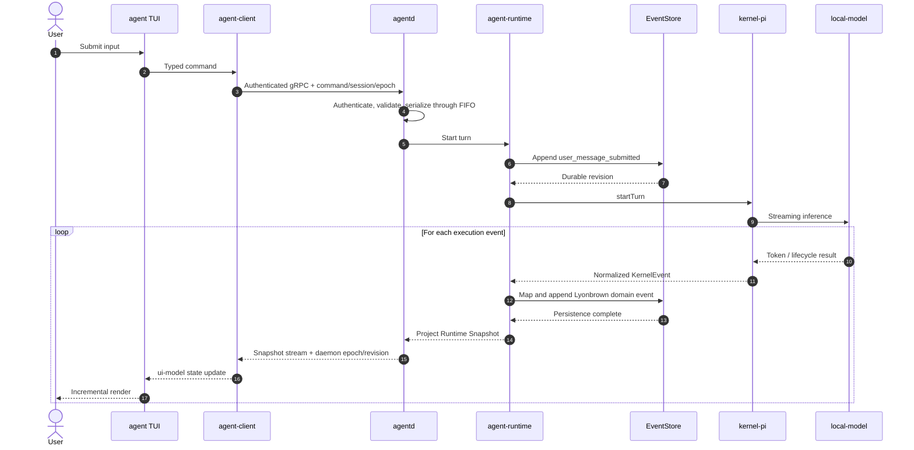

# Local gRPC Client/Server Architecture

Lyonbrown has one product topology. The diagram below reflects the current
Node.js / TypeScript production implementation. Solid lines are runtime data
flows; dashed lines are discovery, launch, and local security control flows.

## System overview

The daemon is the sole authority for sessions and execution. The TUI owns input,
rendering, locale, theme, and short-lived presentation preferences only. Closing
the TUI does not stop a turn or a model download already accepted by the daemon.

The current production composition has an empty tool registry, a default-deny
approval policy, a rejecting secret resolver, and no MCP connection. The diagram
therefore does not present tools or MCP as delivered capabilities. When added,
they remain owned by `agentd` and must not move into the TUI.

## Command and event loop

This order captures a non-bypassable rule: execution results become Lyonbrown
domain events and are committed to EventStore before they are projected into a
client Snapshot. Pi is the execution engine; EventStore is the durable source of
truth for session and execution state.

## Transport and discovery

The transport is local gRPC using generated protobuf bindings. The daemon
publishes a protected, scoped discovery descriptor only after its server is
ready. The client verifies descriptor ownership and scope, reads credentials
through the native capability boundary, performs a versioned handshake, and
subscribes to an authoritative snapshot stream.

Endpoint strings and bearer tokens never appear in command-line arguments,
logs, events, crash reports, or UI text. Authentication failure, identity
mismatch, malformed discovery data, and unsupported protocol versions fail
closed.

## Connection lifecycle

The TUI renders immediately in `connecting` state. Discovery, optional daemon
launch, authentication, handshake, and subscription run in the background.
Reconnect uses bounded backoff and accepts state only for the current daemon
epoch and monotonically newer revision. A stale snapshot may remain visible for
diagnosis, but mutating daemon actions stay disabled until fresh state arrives.

## Command model

Commands carry command identity, session identity, expected daemon/runtime/model
epochs where applicable, and bounded payloads. The daemon validates them before
durable append. Duplicate delivery is idempotent; stale epochs, invalid state,
oversized messages, and unauthorized actions are rejected without partial state.

The TUI supports start turn, cancel, steering, queued follow-up, approval, model
download/cancel/retry, and session/model selection only through this contract.
There is no direct Runtime call or embedded fallback.

## Model setup

Daemon startup and TUI startup never force a model download. Cache inspection is
background work. A missing model produces explicit setup state and disables only
model-dependent submission. In the background, the daemon recommends a model
from its fixed trusted catalog for the current hardware. The user may explicitly
confirm download, observe progress, cancel while allowed, retry a failure, or
exit. Probe failure falls back to the smallest trusted candidate and never starts
an automatic download.

The daemon owns download locks, byte limits, checksum verification, secure staging,
atomic activation, model epochs, and llama.cpp loading. The TUI renders the
versioned state and sends explicit commands; it never opens GGUF files.

## Failure and shutdown

Transport failures are sanitized and bounded. Stream cancellation and server
shutdown are deadline-bound so a dead client cannot retain daemon resources.
The client may restart independently and recover from the latest durable snapshot.
