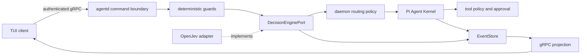

# System One pre-kernel decision layer

> Status: `open-jev@0.1.2` is selected and the port plus local provider adapter are in the
> repository. Daemon composition, protected weight download, and real-model acceptance remain
> incomplete, so default pre-kernel execution is not yet claimed.

## Target architecture

System One is the Lyonbrown capability; OpenJev is the current provider. Shared state and closed
`choice`, `score`, and `noul` questions produce validated probability distributions rather than
arbitrary generated text.

The order is deterministic input/authority guards, typed decision, daemon-owned routing policy, Pi
Kernel, then tool policy and approval. A model decision cannot grant authority, bypass approval, or
replace input budgets.

## Implemented boundary

- `@lyonbrown/decision-engine` defines Lyonbrown-owned question, answer, outcome, and lifecycle
  types;
- `open-jev@0.1.2` and `@huggingface/transformers@4.3.0` are exact-pinned;
- provider types stay inside the adapter and cannot enter gRPC, public EventStore schemas, or TUI;
- composition accepts only an already verified absolute local model path and disables Transformers
  remote model access and filesystem caching;
- state, question count, instructions, and options are bounded; answers must remain in the declared
  set, with finite `[0,1]` probabilities and a valid sum; failures become sanitized `undetermined`
  outcomes;
- OpenJev and Transformers load lazily on the first decision in a single-threaded Piscina worker
  with a bounded queue and V8 worker resource limits. Composition reports `configured`, not ready,
  before the model load succeeds. Disposal is idempotent and deadline-bounded, and AbortSignal
  cancellation terminates the corresponding worker instead of leaving an ONNX forward pass on the
  daemon main thread.

## Model and download policy

The initial target is the q4 `kev-0.6b` variant, roughly 340–380 MB. Production composition will not
use OpenJev's Hub downloader. Weights must reuse native secure storage with a pinned revision, file
manifest, SHA-256, byte ceiling, same-filesystem staging, and atomic activation under a separate
decision-model directory. Download is explicit, background work and never blocks daemon or ordinary
chat startup.

The model root is injected with the dotenv-compatible `LYONBROWN_DECISION_MODEL_ROOT` variable and
must be a fully qualified local path. Windows requires a drive-qualified path and rejects current-
drive roots, UNC paths, and device namespaces. Local development uses an uncommitted `.env.local`
on the `F:` drive; tests inject a dynamically resolved absolute path through dotenv instead of
embedding a drive or user directory in fixtures. A missing or invalid value leaves the provider
explicitly unavailable and never falls back to the home directory or system drive.

## Default-enable gate

- Windows x64 CPU baseline passes offline cache, corruption recovery, concurrency, cancellation
  isolation, and bounded shutdown;
- fixed Chinese and English fixtures report accuracy, calibration error, `undetermined` rate,
  P50/P95, and peak memory;
- question version, provider/model revision, probabilities, threshold, and adopted action are
  persisted before projection;
- built-artifact smoke passes cache reuse, decision, fallback, and cleanup with network and native
  compilation disabled;
- a missing or unverified model follows an explicit recorded Pi fallback while security-sensitive
  paths remain fail closed.

The next slice is protected background installation for decision weights plus decision-before-
kernel domain-event and recovery tests.
