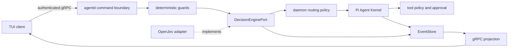

# System One pre-kernel decision layer

> Status: `open-jev@0.1.2`, daemon pre-kernel composition, protected weight installation, and a
> real Windows model smoke are implemented. System One runs before Pi when the configured model is
> installed and valid. Missing, corrupt, or failed providers persist a safe fallback before Pi.
> The adopted action is currently fixed to `continue_pi`; model classifications cannot change
> authority or routing yet.

## Target architecture

System One is the Lyonbrown capability; OpenJev is the current provider. Shared state and closed
`choice`, `score`, and `noul` questions produce validated probability distributions rather than
arbitrary generated text.

The order is deterministic input/authority guards, typed decision, daemon-owned routing policy, Pi
Kernel, then tool policy and approval. A model decision cannot grant authority, bypass approval, or
replace input budgets.

## Implemented boundary

- `@lyonbrown/decision-engine` defines Lyonbrown-owned question, answer, outcome, and lifecycle
  types;
- `open-jev@0.1.2` and `@huggingface/transformers@4.3.0` are exact-pinned;
- provider types stay inside the adapter and cannot enter gRPC, public EventStore schemas, or TUI;
- composition accepts only an already verified absolute local model path and disables Transformers
  remote model access and filesystem caching;
- state, question count, instructions, and options are bounded; answers must remain in the declared
  set, with finite `[0,1]` probabilities and a valid sum; failures become sanitized `undetermined`
  outcomes;
- OpenJev and Transformers load lazily on the first decision in a single-threaded Piscina worker
  with a bounded queue and V8 worker resource limits. Composition reports `configured`, not ready,
  before the model load succeeds. Disposal is idempotent and deadline-bounded, and AbortSignal
  cancellation terminates the corresponding worker instead of leaving an ONNX forward pass on the
  daemon main thread.

## Model and download policy

The initial target is the q4 `kev-0.6b` variant, roughly 340–380 MB. Production composition will not
use OpenJev's Hub downloader. Weights must reuse native secure storage with a pinned revision, file
manifest, SHA-256, byte ceiling, same-filesystem staging, and atomic activation under a separate
decision-model directory. Download is explicit and runs in a separate process, so it never blocks
daemon or ordinary chat startup. The repository provides `pnpm decision-model:install`; it builds
the required artifacts, uses the environment proxy, reports progress, and never writes weights
into the repository or uses OpenJev's implicit Hub cache.

The model root is injected with the dotenv-compatible `LYONBROWN_DECISION_MODEL_ROOT` variable and
must be a fully qualified local path. Windows requires a drive-qualified path and rejects current-
drive roots, UNC paths, and device namespaces. Local development uses an uncommitted `.env.local`
on the `F:` drive; tests inject a dynamically resolved absolute path through dotenv instead of
embedding a drive or user directory in fixtures. A missing or invalid value leaves the provider
explicitly unavailable and never falls back to the home directory or system drive.

## Default-enable gate

- Windows x64 CPU baseline passes offline cache, corruption recovery, concurrency, cancellation
  isolation, and bounded shutdown;
- fixed Chinese and English fixtures report accuracy, calibration error, `undetermined` rate,
  P50/P95, and peak memory;
- question version, provider/model revision, probabilities, threshold, and adopted action are
  persisted before projection;
- built-artifact smoke passes cache reuse, decision, fallback, and cleanup with network and native
  compilation disabled;
- a missing or unverified model follows an explicit recorded Pi fallback while security-sensitive
  paths remain fail closed.

## 2026-10-08 Windows x64 real smoke

The q4 manifest at revision `5a827091b3d58fe4fdfc02a5a5b2ce364047d678` completed a real
download, SHA-256 verification, atomic activation, offline cache reuse, anchored loading, bilingual
inference, and bounded disposal under `F:\Lyonbrown\models\decision`.
The black-box smoke creates the decision service through agentd's public production composition and
connects a real `AgentRuntime`, in-memory EventStore, and observable Pi Kernel instead of invoking
the model adapter directly. `pnpm smoke:real-decision` reported:

- both installation inspection and offline reuse returned `already_installed`;
- first lazy-load inference took about `13707.70 ms`; the next three took `109.96–164.45 ms`, with a
  four-sample P50 of `153.80 ms`;
- observed process peak RSS was `840,572,928` bytes;
- every run persisted `user_message_submitted → decision_recorded → run_started → run_completed`
  before projection and started Pi exactly once;
- all four fixtures returned complete validated answers; the Chinese change-and-test fixture was
  classified as `code-change`, while explanation fixtures still expose classification errors in
  both languages.

The implementation therefore passes the safety and availability smoke, but not yet the larger
bilingual accuracy and calibration gate. Until that benchmark passes, the daemon records the
decision and adopts `continue_pi`; it never uses the classification to relax authority, skip
approval, or select a higher-risk execution path. The next slice is TUI install/status projection
and a larger bilingual benchmark set.

## Independent daemon, real gRPC, and TUI black box

`pnpm smoke:real-tui` creates a disposable home under the dotenv-injected
`LYONBROWN_BLACKBOX_ROOT`, starts an independent `agentd` process from built artifacts, reads its
protected discovery descriptor, and performs authenticated loopback gRPC health, handshake, and
snapshot calls. It then starts the real CLI entry through Windows ConPTY instead of using an
in-memory terminal or fake launcher.

The 2026-10-08 local run returned `REAL_AGENTD_GRPC_TUI_SMOKE_OK`:

- the discovery PID matched the independent child process, gRPC health was `serving`, and the
  handshake server epoch and scope matched discovery;
- Pi TUI emitted real ANSI redraws, first rendered `Connecting`, and then rendered authenticated
  gRPC `Ready`;
- the TUI rendered the daemon-snapshot model setup projection and accepted installed-preferred,
  hardware-compatible, or conservative-fallback recommendations without automatically confirming
  or downloading a chat model;
- a real `Q` interaction exited model setup with CLI exit code `0`; the smoke closed the gRPC
  client, stopped the daemon, and removed its per-run F-drive scratch directory;
- discovery polling reopens, reads, and closes the secure directory on each attempt and performs a
  bounded retry for transient Windows `read_descriptor` conflicts during atomic publication.

This covers an independent daemon, the real transport, and real terminal rendering. It does not yet
cover Pi response text, tool approval, or cancellation after downloading the roughly 1 GiB chat
model; those remain follow-up process-level black-box scenarios.
