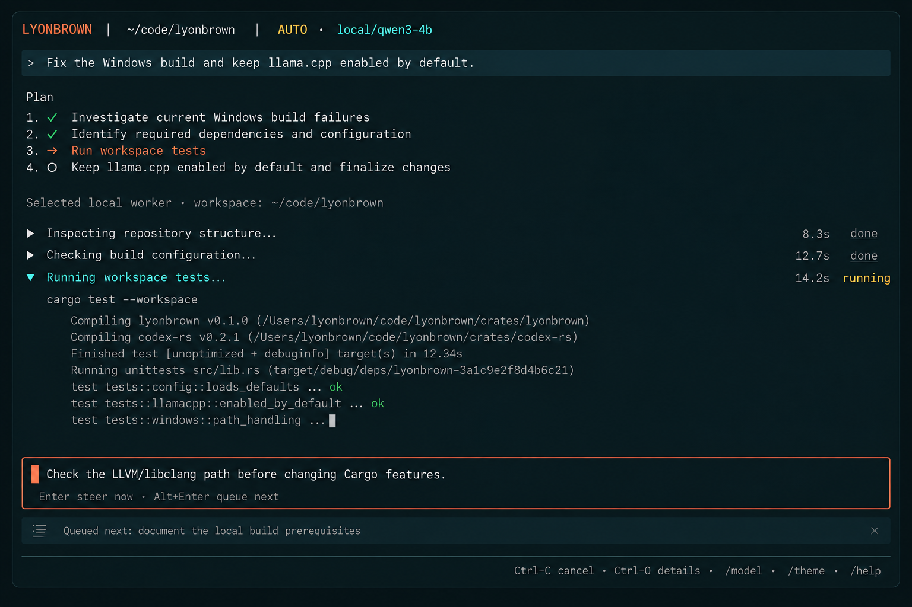
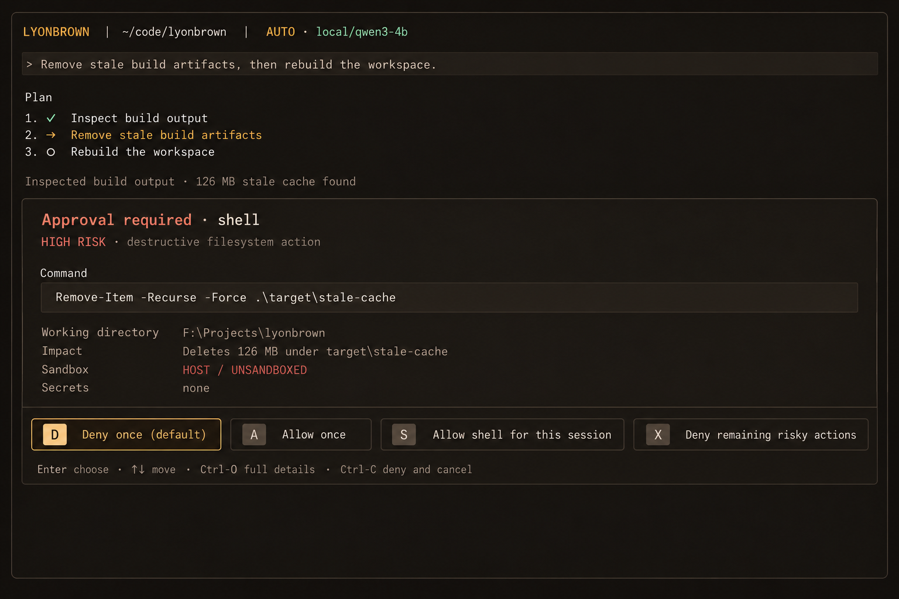
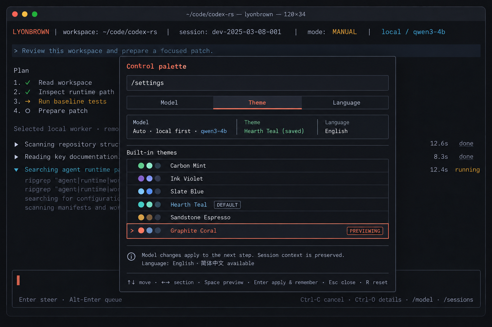
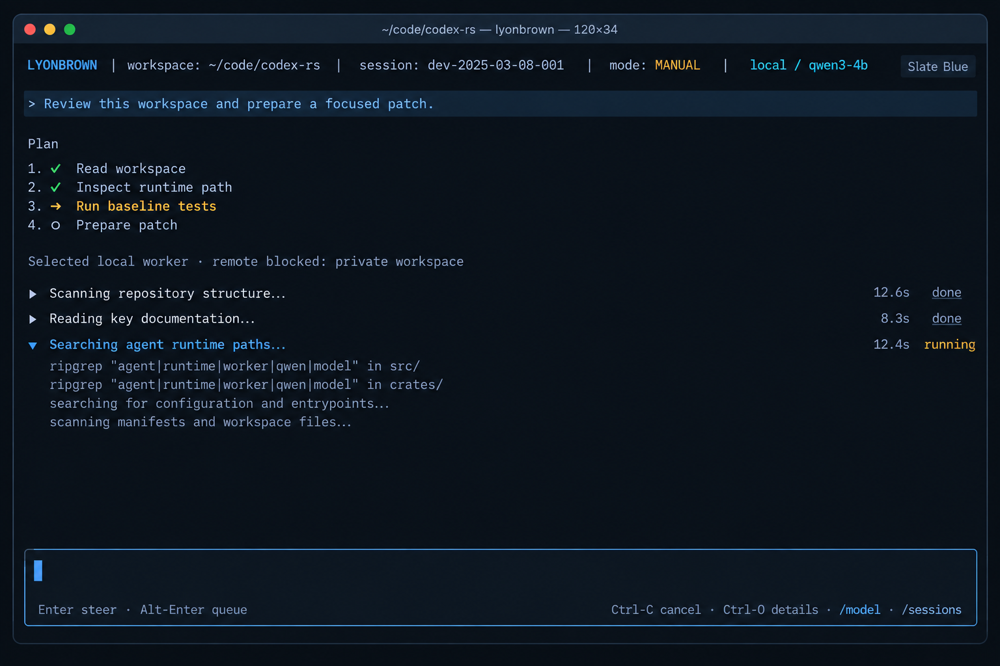
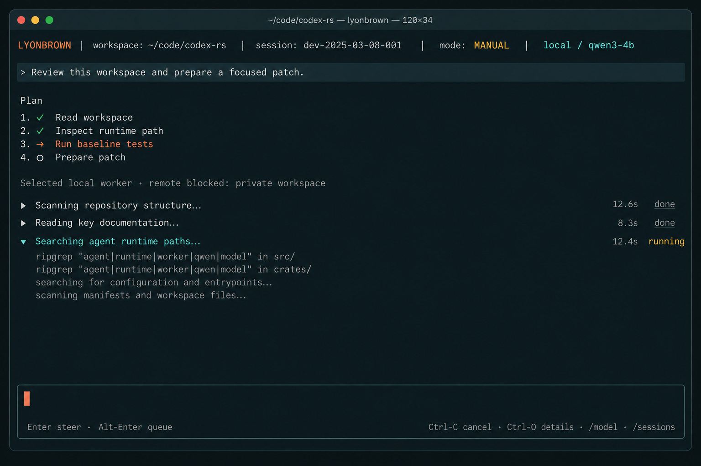
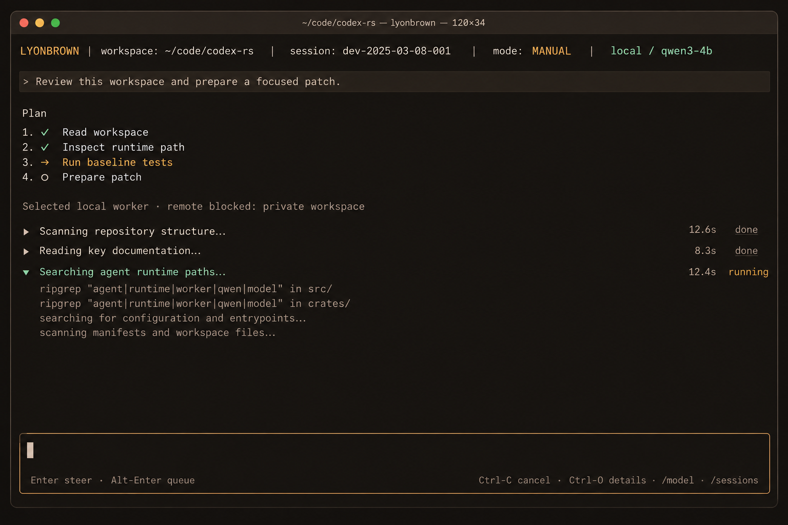

# TUI Visual and Interaction Baseline

> Status: Accepted
> Decision date: 2026-10-01
> Scope: M12 TUI productization and the GUI shared interaction contract
> Related plan: [Phase-Two Product and Interaction Plan](../plans/phase-two-product-plan.md)

## 1. Decision

The Lyonbrown TUI adopts the low-interface character of mature terminal agents without copying another product's brand:

- one scrollable conversation and activity stream is the default workspace;
- the Composer remains at the bottom and accepts input while work is running;
- Session, Model, Theme, Language, Help, and Inspector use temporary overlays;
- approvals remain inline with the active task instead of taking over the screen;
- `hearth-teal` is the default, with six persistent built-in themes;
- the initial UI locales are English and Simplified Chinese; commands, model IDs, paths, and shortcuts are not translated.

A permanent multi-column layout is no longer the TUI default. It compresses terminal content, interferes with native scrollback, and increases the cost of SSH, tmux, and narrow-terminal use. Details remain available through overlays or temporary full-screen views.

## 2. Information architecture

The default surface has four vertical regions:

```text
Context line        workspace · mode · model
Transcript          user intent · answer · grouped activity
Composer            input · focus · queue
Status line         cancel · details · commands
```

### 2.1 Context line

Only information needed for the current decision remains visible:

- workspace;
- `Auto` or the pinned Worker;
- local/remote locality;
- current model.

Session IDs, tokens, full routing rationale, and diagnostics are disclosed through Inspector.

### 2.2 Transcript

The Transcript carries conversation and step-grouped activity without rendering every low-level event as a chat message. Activities collapse to one line by default; the current activity can reveal its command and essential output.

### 2.3 Composer

The Composer remains the primary focus. Border and cursor express focus; accent color reinforces it but is never the only cue.

### 2.4 Overlay

An overlay is temporary context. It neither changes the Session nor clears the Composer:

- `/model`: model and routing policy;
- `/theme`: theme preview and persistence;
- `/language`: English/Simplified Chinese;
- `/sessions`: create, select, and resume;
- `/status`: Runtime and routing summary;
- `/help`: commands and shortcuts;
- `Ctrl-O`: current activity or approval details.

The implemented command surface uses one exact catalog, in this order:
`/model`, `/theme`, `/language`, `/sessions`, `/new`, `/resume`, `/status`,
`/queue`, `/help`, and `/quit`. `Ctrl-P` opens its searchable palette from the
conversation surface, `?` opens help only when the Composer is empty, and
`/help` opens the same help surface. `F2` remains global and changes locale
without opening an overlay.

Today `/language`, `/queue <message>`, `/help`, and `/quit` are executable.
`/model`, `/theme`, `/sessions`, `/new`, `/resume`, and `/status` are visible
but explicitly disabled until their real surfaces exist. `/queue` is likewise
disabled inside the palette because activation cannot provide its required
message; its slash form remains available. Unknown slash input is intercepted
locally with a localized hint and is never submitted as a prompt.

Outside Model Setup, Escape closes only the top overlay or clears selection; it
does not exit the TUI. Model Setup is the deliberate exception described below:
`Esc` exits from `Required`, `Failed`, or `Cancelled`, and cancels an active
phase only when `Cancel` is allowed.

### 2.5 First-run model setup

Running `agent` enters the TUI before any model transfer begins. When the
daemon-owned model is unavailable, the implemented setup surface presents its
source, current phase, allowed action, failure details, model ID, estimated
size, and operation ID where applicable. It covers `Required`,
`WaitingForLock`, `Checking`, `Downloading`, `Verifying`, `Installing`,
`Activating`, `Ready`, `Cancelled`, and `Failed` without inventing client-only
phases.

For a managed preset in `Required`, the user has two explicit outcomes:

```text
Local model  qwen3-1.7b-q4_k_m
Recommended default · 1.03 GiB · download only after confirmation

████████████████░░░░░░░░░░░░░░░░  512 MiB / 1.03 GiB  50%

Enter/D  Download     Q/Esc  Exit without downloading
```

Confirmation starts a daemon task while the TUI remains responsive. Actions
are derived only from Snapshot `allowed_actions`: `Enter`/`D` starts Download,
`Enter`/`D`/`R` starts Retry after `Failed` or `Cancelled`, and `C`/`Esc`
cancels a cancellable active phase using its current `operation_id`.
`Installing` and `Activating` are visible but non-cancellable. `Q` exits from
any setup phase; `Esc` exits from `Required`, `Cancelled`, and `Failed` rather
than starting network traffic. A missing configured path never offers Download
or Retry.

Known totals render bytes, total bytes, percentage, and a width-aware progress
bar. Unknown totals render an indeterminate marker and downloaded bytes. Narrow
terminals progressively compact the same information instead of hiding setup.
While a setup RPC is pending, duplicate actions are disabled. With no setup RPC
pending, an exit-capable `Q` or `Esc` exits immediately. If Download, Retry, or
Cancel is already pending, a permitted `Q`/`Esc` exit request waits for that
existing command receipt instead of sending a second command; a failed command
remains on screen instead of silently closing. Snapshot failures and command
failures remain visible until the setup state advances.

The setup surface is rendered in English or Simplified Chinese and uses the
same semantic tokens across all six built-in themes. Model IDs, operation IDs,
paths, and shortcuts are never translated. A stale Snapshot remains visible
for diagnosis, but daemon actions such as Download, Retry, and Cancel are
disabled until fresh state for the accepted server epoch arrives. Local `Q`
exit and the global `F2` language toggle remain available. Exiting the client
never cancels a download already accepted by the daemon; cancellation always
requires the explicit control.
Verification remains a separate visible phase, and the Runtime never loads an
unverified file.

### 2.6 Shared GUI model-setup surface

The GUI consumes the same setup projection and commands. Its setup card sits
between the conversation and Composer, while the Runtime rail shows the actual
phase and known or unknown progress. The top bar switches all client copy
between English and Simplified Chinese without translating identifiers. Stale
setup state remains readable, but Download, Retry, and Cancel are disabled
until a fresh Snapshot is accepted. The GUI also permits only one pending setup
command and keeps failure details visible.

### 2.7 Snapshot-backed Activity Inspector

The implemented TUI Inspector is a read-only view of activity already present
in the last accepted `RuntimeSnapshot`; it neither issues a daemon command nor
reconstructs events that the Snapshot does not contain. Exact `Ctrl-O` opens or
closes it from the conversation surface and replaces another ordinary overlay.
Model Setup and Approval retain higher input priority and close the Inspector
when they arrive.

The list preserves snapshot order and addresses every row by stable
`turn_id + step_id` rather than by its display index. It initially follows the
latest step. Moving to an older row pins that target across accepted Snapshot
updates; selecting the latest row resumes follow mode. If a pinned target
disappears, selection safely falls back to the latest row and resets detail
scroll. A Session or daemon-epoch change closes the Inspector and clears the old
selection, so cached details cannot cross those boundaries.

The detail pane exposes only available Snapshot evidence: route and fallback
reasons, phase, turn/step IDs, context counts, token usage including cache reads,
assistant output, tool arguments and state, approval identity when present,
tool result/output/error/duration and invocation IDs, and step outcome. Dynamic
text and JSON are terminal-sanitized. Per-field, JSON depth/item/character,
collection, line-count, and total-character budgets truncate hostile or very
large payloads. Formatted detail is cached by projection generation, selected
target, and locale; repeated rendering does not repeatedly serialize it.

The title always identifies the projection as `FRESH` or `STALE CACHED` (with a
localized equivalent). A disconnect keeps the last accepted evidence readable.
Only a matching daemon epoch and a newer accepted revision can change the remote
projection; repeated revisions or epoch-mismatched snapshots cannot partially
update conversation, approval, or Inspector state.

The responsive modes are intentional and bilingual:

- `90×20` and larger uses side-by-side list and detail panes;
- `52×12` uses vertically stacked panes;
- `30×8` shows one pane at a time, with Enter/Right/Tab entering detail and
  Left/Shift-Tab returning to the list.

List and detail scrolling support arrows, Page Up/Down, and bounded selection;
detail additionally supports Home/End. This MVP is not a complete event trace.
It has no event timestamps, strict event history, historical `ToolPreview` or
capability records, or complete diagnostics. Clipboard copy is not implemented;
terminal-native selection remains the available copy path.

## 3. Core interactions

### 3.1 Live steering and queueing



The running Composer exposes two explicit intents:

| Input | Meaning | Runtime effect |
|---|---|---|
| `Enter` | Steer the current turn now | Emits `SteerCurrentTurn` and injects at the next safe boundary |
| `Alt-Enter` | Queue for the next step | Emits `QueueFollowUp` without interrupting the active tool |
| `Ctrl-C` | Cancel the current turn | First press requests cancellation; second press force-stops |
| `Ctrl-O` | Inspect details | Opens the current activity Inspector without changing execution |

Queued text appears beneath the Composer and can be removed or edited. The UI spells out “steer now” and “queue next”; shortcut hints alone are insufficient.

When a terminal cannot distinguish `Alt-Enter`, `/queue <text>` is the equivalent path. Multiline input uses configurable `Ctrl-J` and does not consume steering or queueing semantics.

### 3.2 Inline tool approval



Approval is driven by typed `ToolPreview` data and always presents:

- tool and risk level;
- complete command or action;
- working directory and target;
- impact scope;
- `host/unsandboxed` or the concrete sandbox backend;
- required Secret names, never Secret values.

Actions have stable order and meaning:

1. Deny once (default focus);
2. Allow once;
3. Allow this tool for session;
4. Deny remaining risky actions.

Window close, client disconnect, timeout, or an unrenderable preview all fail
closed. During approval, the first `Ctrl-C` attempts Deny once and then always
attempts turn cancellation, even if the deny receipt fails. After cancellation
succeeds, a second `Ctrl-C` sends Force stop and exits the client if the
approval is still active. Model Setup and Approval consume input before
palette/help handling; their arrival closes an existing overlay so it cannot
reappear after the safety-critical state ends.

### 3.3 Model, theme, and language control palette



The control palette is a temporary overlay with keyboard-reachable Model, Theme, and Language sections:

- model changes apply from the next step;
- Session context and working memory are not reset by a model change;
- themes preview immediately; `Enter` applies and remembers, while Escape restores the saved theme;
- language changes redraw client copy immediately without rewriting transcript content;
- current, saved, and previewed values remain distinguishable.

The complete palette, preview, and preference-persistence behavior above remains
part of M12. The implemented language slice already selects a startup locale
from the system and provides the global `F2` toggle plus local `/language`
commands; it does not yet claim the complete persisted Language overlay.

Theme and language are client preferences. A Session model pin is shared application state. Provider credentials and model-install state belong to Runtime/configuration state. They must not share an untyped settings map.

## 4. Input state machine

| Current state | `Enter` | `Alt-Enter` | `Esc` | `Ctrl-C` |
|---|---|---|---|---|
| Ready | Submit a new turn | Queue a follow-up after submission | Clear selection/close overlay | Clear input; next press asks to exit |
| Streaming / RunningTool | Steer now | Queue next | Close overlay | Cancel turn |
| AwaitingApproval | Invoke focused action | No-op | Deny once | First: Deny once and cancel; second: Force stop and exit |
| Overlay | Apply/enter | Overlay-specific | Close overlay | Close overlay; next press cancels turn |
| Cancelling | No-op | No-op | No-op | Force-stop |

Every keyboard action first becomes a typed UI intent, then maps to an `AgentCommand`. Widgets never manipulate the Kernel directly.

## 5. Built-in themes

The default is `hearth-teal`. Every theme implements the same semantic tokens; components never hard-code a theme's literal colors.

| ID | Display name | Background | Primary accent | Secondary accent |
|---|---|---:|---:|---:|
| `carbon-mint` | Carbon Mint | `#090C10` | `#5EEAD4` | `#A5B4FC` |
| `ink-violet` | Ink Violet | `#0C0B10` | `#A78BFA` | `#7DD3FC` |
| `slate-blue` | Slate Blue | `#0A0F16` | `#60A5FA` | `#67E8F9` |
| `hearth-teal` | Hearth Teal (default) | `#0B1113` | `#E07A5F` | `#74C7B8` |
| `sandstone-espresso` | Sandstone Espresso | `#100E0C` | `#D4A373` | `#8FB996` |
| `graphite-coral` | Graphite Coral | `#101114` | `#F28C70` | `#82A7C9` |

### 5.1 Theme previews

| Carbon Mint | Ink Violet |
|---|---|
|  |  |

| Slate Blue | Hearth Teal |
|---|---|
|  |  |

| Sandstone Espresso | Graphite Coral |
|---|---|
|  |  |

### 5.2 Semantic tokens

Each theme provides at least:

```text
background
surface.raised
surface.active
text.primary
text.secondary
text.faint
accent.primary
accent.secondary
status.success
status.warning
status.danger
border.default
focus.ring
```

Every status also has text or a symbol. Success, warning, and danger are not conveyed by green, yellow, or red alone.

### 5.3 Complete token values

Values are ordered as `background / raised / active`, `primary / secondary / faint text`, `primary / secondary accent`, `success / warning / danger`, and `border`:

- `carbon-mint`: `#090C10 #121820 #18212B`; `#E8EDF2 #9AA5B1 #647080`; `#5EEAD4 #A5B4FC`; `#4ADE80 #FBBF24 #FB7185`; `#273240`.
- `ink-violet`: `#0C0B10 #16141D #1D1928`; `#F0EDF5 #A39CAC #6F687A`; `#A78BFA #7DD3FC`; `#5EEAD4 #F6C453 #FB7185`; `#332D40`.
- `slate-blue`: `#0A0F16 #111A24 #182433`; `#E6EDF5 #98A6B8 #64748B`; `#60A5FA #67E8F9`; `#34D399 #F5B942 #F87171`; `#2B3A4D`.
- `hearth-teal`: `#0B1113 #122024 #182A2F`; `#EAE7DF #A8A39A #716D66`; `#E07A5F #74C7B8`; `#6FCF97 #E9B949 #E76F76`; `#2A3A3D`.
- `sandstone-espresso`: `#100E0C #1A1713 #241F19`; `#EEE9E0 #A9A093 #70685E`; `#D4A373 #8FB996`; `#7BC8A4 #E8B44F #E27D75`; `#3A3229`.
- `graphite-coral`: `#101114 #191A1F #22242B`; `#ECEEF2 #9DA3AE #666C78`; `#F28C70 #82A7C9`; `#74C69D #F0B95B #EF6F78`; `#30333D`.

`focus.ring` defaults to `accent.primary`. If contrast testing later fails, only the theme definition may override it; widgets do not apply local color patches.

## 6. Localization rules

- Initial locales are `en-US` and `zh-CN`. At startup, system tags such as
  `zh-CN`, `zh_CN`, and `zh-Hans` select `zh-CN`; unknown or unavailable tags
  fall back to `en-US`.
- Unmodified `F2` switches client copy immediately from model setup, approval,
  or the normal conversation surface.
- `/language` toggles the current locale; `/language en-US` and
  `/language zh-CN` select it explicitly. These are local client commands: they
  do not contact the daemon or alter transcript or Session state. An invalid
  argument displays the `/language [en-US|zh-CN]` usage in the current language.
- Palette titles, search/empty/disabled states, help shortcuts, command labels,
  and unknown-command feedback are available in both locales. `F2` also works
  while Model Setup, Approval, or an overlay has input priority.
- Persisting the selected locale and exposing it through the complete control
  palette remain M12 work.
- Slash commands, config keys, model IDs, provider IDs, shell commands, paths, and shortcuts retain stable English forms.
- Titles, statuses, help, risk explanations, actions, and empty states are localized.
- Existing user/model transcript content remains in its original language; only client chrome is re-localized.
- Chinese editing operates on Unicode graphemes and terminal cells; one Unicode scalar is not assumed to occupy one cell.
- Copy length cannot determine layout correctness; 30×8, 52×12, and 90+ widths need English and Chinese snapshots.

## 7. Responsive and accessible behavior

- `90+` columns: full transcript, Composer, and status hints; overlays use a bounded width.
- `52–89` columns: shorten the context line and let overlays consume available width.
- `30–51` columns: retain only task, critical status, and a single action line; details may temporarily fill the screen.
- `<30` columns or `<8` rows: show a recoverable terminal-too-small message and never panic.
- Focus is not color-only; selected rows include a leading marker and a text label.
- Preserve terminal-native selection/copy and avoid forcing alternate-screen behavior that destroys scrollback.
- Dynamic output keeps a stable anchor so streaming tokens do not move the Composer.

The implemented palette, help, and Activity Inspector render in English and
Chinese at 30×8, 52×12, and 90×20. Palette/help use the available screen at the
first two sizes and a centered bounded overlay when wide; the Inspector uses
single-pane, stacked, and side-by-side layouts respectively. These tests do not
imply completion of the still-missing selector surfaces.

## 8. Implementation boundaries

Recommended ownership:

| Capability | Owner |
|---|---|
| `Theme`, tokens, and Ratatui style mapping | TUI client |
| `Locale`, message catalog, and key hints | TUI client, with shared locale IDs |
| `UiPreferences` persistence | config/client preference storage |
| `SteerCurrentTurn`, `QueueFollowUp` | typed `agent-app` commands |
| `ApprovalView`, `ToolPreview` | `agent-app` / `agent-tool` |
| Session model pin and RoutingDecision | `agent-app` / `agent-model` |

`UiPreferences` contains at least:

```text
theme_id
locale
reduced_motion
```

Unknown themes or locales fall back to `hearth-teal` and system/English rather than preventing startup.

## 9. Acceptance checklist

- All three baseline interactions have English and Simplified Chinese render tests.
- All six themes cover Ready, Running, Approval, Error, and Overlay states.
- Theme/language changes do not restart Runtime or mutate Session state.
- Model changes preserve context and affect only the next step.
- Steering, queueing, cancellation, and force-stop map to distinct testable commands.
- Approval defaults to deny and fully exposes command, directory, impact, and sandbox state.
- Resize, Unicode/CJK, scrollback, copy, and long output do not panic.
- Every palette passes contrast checks and no status relies on color alone.
