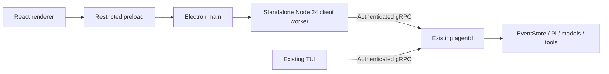

Desktop is an Electron client on the existing C/S architecture, reusing daemon-owned Runtime, models, and tools. This page defines connection, process isolation, and basic interactions; installers, updates, and final interaction design are outside its scope.

## Process ownership



React, TanStack Query and CSS Modules own renderer presentation only. Preload exposes only
`getState`, `onState`, `act` and `reconnect`; no authentication token, generic IPC or Node API.
Main verifies the owned webContents, top-level frame and exact page URL.

The owned Node 24 worker reuses the public launcher composition and authenticated gRPC client.
It owns no Runtime, models, tools or EventStore. Windows native path verification crashed under
Electron's N-API runtime during a real test, so client discovery runs in standalone Node instead
of weakening the native security checks or coupling native dependencies to Electron's ABI.

Zod validates bounded worker IPC. Snapshots contain serializable view models, and intermediate
in-flight frames are coalesced. Every connection rotates its mutation token, fenced with the
snapshot revision. Disconnection retains conversation display but disables mutations. Explicit
reconnect can recreate an exited worker. Window shutdown closes only its client/worker, never
the shared daemon.

Renderer sandbox, context isolation and web security are enabled; Node integration, permissions,
new windows and navigation are denied. Production CSP disallows inline scripts. Development
uses a per-response random nonce for React Fast Refresh and Vite styles. Hand-written source
is TypeScript ESM; the sandboxed preload's CJS is a generated build artifact.

## Development

From the repository root:

```text
pnpm install --frozen-lockfile
pnpm dev:desktop
```

moon owns dependency builds and electron-vite development. Existing TUI `pnpm dev` is unchanged.
The launcher reuses the daemon for the same workspace/configuration fingerprint, or starts it
when missing unless autostart is disabled.

The maintained dotenv loader reads `.env.local` then `.env` without overriding process variables:

| Variable                            | Purpose                                                        |
| ----------------------------------- | -------------------------------------------------------------- |
| `LYONBROWN_DESKTOP_WORKSPACE`       | Absolute workspace; defaults to this repository in development |
| `LYONBROWN_DESKTOP_HOME`            | Absolute control-plane home; defaults to the user's home       |
| `LYONBROWN_DESKTOP_NODE_EXECUTABLE` | Standalone Node 24; defaults to PATH `node`, never Electron    |
| `LYONBROWN_DESKTOP_AUTOSTART`       | `true` / `false`; defaults to `true`                           |
| `LYONBROWN_LOCAL_MODEL_ROOT`        | Daemon-owned chat model storage                                |
| `LYONBROWN_DECISION_MODEL_ROOT`     | Daemon-owned decision model storage                            |
| `LYONBROWN_BLACKBOX_ROOT`           | Scratch directory for local acceptance only                    |

Local tests keep model storage on F: through dotenv, not hard-coded paths. Desktop creates no
separate model cache. Axios/HTTP is deliberately absent: renderer requests use restricted IPC
and the worker uses the established gRPC client.

## Interaction and verification

Interactions include connection/retry, messages, send/cancel, once-only approval/denial,
chat and optional decision-model status/progress and explicit download/retry/cancel, plus
English/Chinese labels. Submitted turns awaiting the decision stage also block duplicate sends.
Backend state and authorization remain authoritative.

```text
pnpm smoke:real-desktop
pnpm smoke:real-desktop --dev
```

Both commands start an independent agentd and real Electron window, use authenticated gRPC and
existing model caches for a no-tools chat, verify language switching, renderer Node isolation and
disconnected read-only behavior, then clean up the owned processes and scratch directory.
They never automatically download a model. Ignored screenshots are written to
`output/playwright/desktop-en.png` and `desktop-zh.png`.

Vitest covers projection/actions, IPC schemas, sender/input validation, worker backpressure and
lifecycle, and React interaction, with an 85% aggregate line gate. Thin process entries,
environment loading and process-spawn composition are excluded from that unit denominator and
verified separately by the real black-box tests.

Session navigation, persisted themes, full settings/approval detail, Activity Inspector, multi-window/workspace switching, and bundled Node/agentd/native assets require separate decisions. See the [Roadmap](/en/plans/roadmap/) and [Release Artifacts](/en/reference/release-artifacts/) for release acceptance scope.
