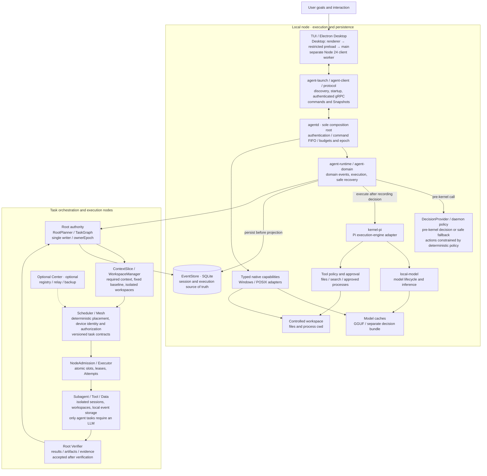
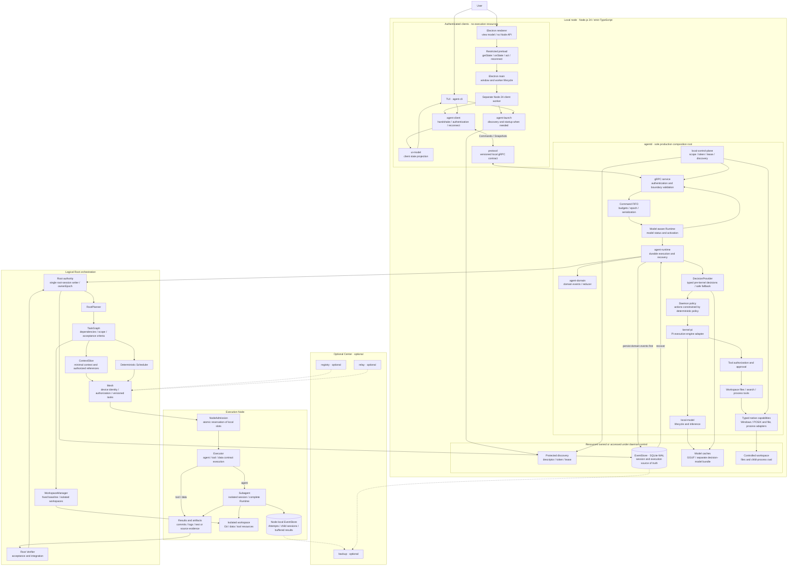
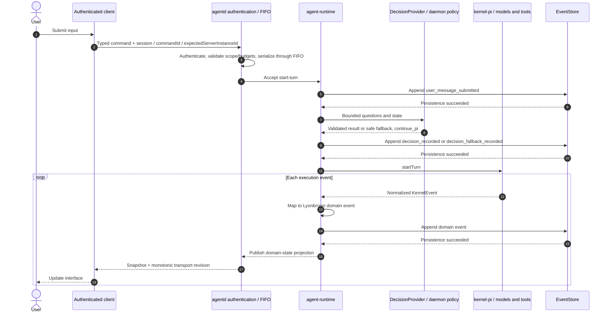
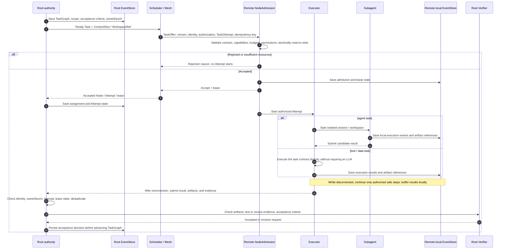

Lyonbrown consists of authenticated clients, a node service called `agentd`, and a task orchestration layer. Clients handle interaction, `agentd` manages execution and persistence on its Node, and Root splits tasks, manages dependencies, and accepts results. Tasks can run on the local Node or another Node; standalone operation and direct node-to-node connections do not depend on Center.

This page describes module responsibilities, data flow, and write authority. The product uses Node.js 24 and TypeScript with `strict` mode enabled.

See [local gRPC C/S](/en/architecture/grpc-client-server/), [composition root](/en/architecture/composition-root/), and [Electron Desktop](/en/architecture/electron-desktop/) for startup, authentication, and client boundaries.

## System overview

The diagrams group local execution, task orchestration, and execution nodes by responsibility. Root is a logical role that can dispatch to its own Node or another Node; these groups do not prescribe packages, microservices, or deployment directories. Dashed lines indicate only optional Center connections.

Expand the complete module diagram (44 nodes)

Client output paths are simplified in the overview: the daemon's Snapshot stream returns to `agent-client`. The TUI renders through `ui-model`; Desktop receives state through its worker, main process, and restricted preload. Electron main manages windows and the separate Node 24 worker. That worker reuses the public launcher/client interfaces for native discovery and authentication; the renderer does not load the native backend.

`agentd` is the sole composition root within a Node. It owns the lifecycle of the Runtime, models, tools, approvals, MCP connections, and EventStore. Secret and Skills integration follows daemon authorization policy. Third-party Pi and OpenJev types stop at adapters and do not enter public protocols or client view models. Closing a client does not cancel execution already accepted by the daemon.

## Module responsibilities

### Node execution and clients

| Module and source location                                                                       | Input → output                                                                             | Ownership and permission boundary                                                                                                                                                                 |
| ------------------------------------------------------------------------------------------------ | ------------------------------------------------------------------------------------------ | ------------------------------------------------------------------------------------------------------------------------------------------------------------------------------------------------- |
| `apps/agent-cli`, `packages/ui-model`                                                            | User actions, Snapshots → commands, terminal projection                                    | Client; owns neither Runtime nor database.                                                                                                                                                        |
| `apps/agent-desktop/src/{renderer,preload,main}`                                                 | UI actions, restricted IPC, worker state → renderer view model                             | Renderer has no Node API or token. Main manages a separate Node 24 client worker, which reuses public launcher/client interfaces.                                                                 |
| `packages/agent-launch`, `agent-client`, `protocol`                                              | Workspace scope, discovery, commands → daemon connection, versioned Snapshots              | Launcher starts the daemon when needed. Client authenticates with credentials without exposing them to the presentation layer. Local gRPC and node-to-node task contracts are managed separately. |
| `apps/agentd/node-src/composition.ts`, `production-runtime.ts`, `production-kernel.ts`           | Configuration, scope, model lease → Runtime, Kernel, tools, gRPC composition               | Sole production composition root; creates and closes owned resources.                                                                                                                             |
| `apps/agentd/node-src/runtime-command-serial-queue.ts`, `packages/agent-runtime`, `agent-domain` | Validated commands, KernelEvents → domain events, recovered state, Snapshots               | Command FIFO and Runtime persistence enforce their respective ordering rules. Model decisions cannot replace deterministic checks.                                                                |
| `packages/kernel-pi`, `local-model`, `decision-engine`                                           | Model inputs, closed questions, tool steps → normalized execution results, typed decisions | Daemon owns lifecycle. Persist a decision or fallback before continuing Pi.                                                                                                                       |
| `apps/agentd/node-src/{workspace-tools,approval-gate}.ts`                                        | Scoped tool requests, user approvals → file/process results, approval events               | File tools enforce workspace boundaries. `process_execute` requires high-risk approval and runs with host-user privileges; it is not an OS sandbox.                                               |
| `packages/local-control-plane`, `control-plane-native`, `event-store`                            | Native requests, domain events → protected discovery/locks/model storage, SQLite events    | Windows/POSIX differences stay in adapters. File tools also reuse `@openclaw/fs-safe`; system adapters handle process cleanup.                                                                    |

### Task orchestration and node collaboration

| Logical module                                   | Input → output                                                                                        | Authority boundary                                                                                                                                                           |
| ------------------------------------------------ | ----------------------------------------------------------------------------------------------------- | ---------------------------------------------------------------------------------------------------------------------------------------------------------------------------- |
| RootPlanner / TaskGraph                          | Goal, baseline, constraints → Tasks with dependencies, scope, budgets, acceptance criteria            | Root manages the plan; dependent Tasks cannot become schedulable before prerequisites are met.                                                                               |
| ContextSlice / WorkspaceManager                  | Task, authorized references → minimal context, isolated workspace, artifact references                | Send only required content. Coding uses a fixed baseline and an independent clone/worktree, without a shared writable directory.                                             |
| Deterministic Scheduler / NodeAdmission          | Ready Task, node capabilities and load → Offer, atomic acceptance, lease                              | Scheduler selects candidates deterministically. The receiving Node checks authorization and reserves its own resources.                                                      |
| Mesh / versioned task contracts                  | Candidate addresses, identity, authorization, task messages → trusted connection, verifiable messages | Discovery does not grant membership; membership does not grant execution permission. Local gRPC tokens cannot simply become Mesh authorization.                              |
| Executor / Subagent / Root Verifier              | Task, ContextSlice, authorization → submitted result and evidence → acceptance or revision request    | Child sessions and workspaces are isolated. Agent tasks use a complete Runtime; tool/data tasks can execute their contracts directly. Only Root acceptance completes a Task. |
| Replication / explicit handoff / optional Center | Authorized events, snapshots, artifacts → replicas or explicit authority transfer                     | Replicas are not writers. Center can provide registry, relay, and backup without determining the default topology.                                                           |

## Single-node commands, execution, and persistence

Single-node execution persists domain events before publishing projections. Initialization and model status can also generate Snapshots; execution results must pass through EventStore before publication.

Daemon-owned deterministic policy and approval gates control tools. When approval is required, the client displays the request and submits the user's decision. Denials also enter domain events; a model cannot expand its permissions. If an EventStore append fails, the Runtime does not project that execution result as success. Snapshot transport revisions and durable event revisions serve separate purposes and are not interchangeable.

Recovery reconstructs domain state and safely resumable history from EventStore. Pi's internal state is not a second authoritative store.

## Task dispatch and cross-node execution

A Node provides physical execution resources. An Agent is a logical execution entity. A Run is one execution of a root goal. A Task is a stable work item; an Attempt is one actual execution of that Task. Retrying creates a new `attemptId`, without recreating the root session or overwriting earlier evidence. The Executor handles `ExecutionKind = agent | tool | data`: agent tasks start a Subagent, while deterministic tool/data work does not require an LLM. All results still require Root verification.

Node-to-node task contracts require versioning and explicit message fields, failure windows, retransmission, and cancellation semantics. The message names in the diagram explain contract responsibilities.

Each Node writes only its local EventStore. Subagents do not directly write the Root Session, and machines do not share one SQLite file. Coding returns commits, patches, and test logs; data tasks return schemas, shards, sources, and checksums. Root sends the necessary ContextSlice without copying its entire conversation, credentials, or all workspace files by default.

Lease expiry does not establish that an old Attempt has stopped or that external side effects have not occurred. Reassignment uses a new Attempt, with retries governed by side-effect idempotency or human review. Results from obsolete authority or invalid Attempts cannot be accepted directly. A disconnected Node preserves results and retransmits them with Task, Attempt, and event identifiers for deduplication. Steps requiring a new Root decision, uncertain authorization, or uncertain side-effect safety pause.

`ownerEpoch` versions root-session write authority and increases through explicit handoff. The local daemon epoch is represented by the protocol field `serverInstanceId` for handshake; commands must provide a matching `expectedServerInstanceId`. A daemon restart is not a transfer of Root authority, and these fields cannot be reused for each other. The originating Node holds Root authority by default. A new Node may continue root-session writes only after state synchronization, target confirmation, and handoff commit. Disconnection or failure to discover the previous Node does not trigger automatic takeover.

Mesh handles secure transport, device identity, and task authorization. Adapters select the underlying transport and LAN/VPN candidate-discovery mechanism. Discovering a Node does not establish trust, and connecting does not grant execution permission. Center can provide registry, relay, and backup, without becoming a prerequisite for standalone startup or direct node-to-node operation.

## Cross-platform capabilities and runtime constraints

Typed capability interfaces provide files, paths, permissions, locks, processes, model storage, and workspace operations. Windows, macOS, and Linux share input/output, authorization, cancellation, timeout, and error semantics. Platform adapters contain system differences and explicitly report missing capabilities.

Windows native share-deny and POSIX advisory locks use different mechanisms. POSIX locks coordinate this adapter's operations; they do not promise to prevent writes by a malicious process running as the same OS user. Process tools run with host-user privileges; approvals and workspace checks do not form an OS sandbox.

Background business scheduling that needs restart durability and retry state requires a job port and a maintained persistent queue or workflow implementation. Native timers and temporary EventStore tables must not become schedulers.

See the [System One decision layer](/en/architecture/system-one-decision-layer/) and related architecture pages for task-model, context, and recovery policies. The [roadmap](/en/plans/roadmap/) and [release artifacts](/en/reference/release-artifacts/) cover delivery order and runtime acceptance records.
