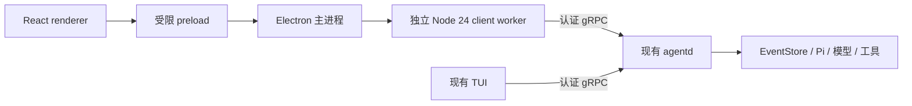

Desktop 是基于现有 C/S 架构设计的 Electron 客户端，复用 daemon 的 Runtime、模型和工具。本文定义连接、进程隔离与基本交互，不包括安装包、自动更新或完整界面设计。

## 进程与所有权



- Renderer 使用 React、TanStack Query 和 CSS Modules，只处理 view model 与交互。
- Preload 只暴露 `getState`、`onState`、`act`、`reconnect`，不暴露 token、通用 IPC、文件系统或 Node API。主进程校验 owned webContents、顶层 frame 和精确页面 URL。
- 主进程管理窗口与 client worker。worker 复用公开的 `agent-launch/composition` 和 `agent-client`，负责安全发现、握手和 gRPC 订阅，不拥有任何 Runtime 或模型。
- Windows 原生路径校验在 Electron 运行时中曾触发 N-API 崩溃，因此放在独立 Node 24 worker，避免 Electron/native ABI 耦合；不降低原生路径安全检查。
- IPC 使用 Zod 验证的有界契约，snapshot 移除 BigInt 与运输/认证信息，并合并正在发送的中间帧。每次连接生成独立操作令牌，组合 snapshot revision 后校验所有 mutation。
- 关闭窗口只关闭该 client/worker，不停止共享 daemon。worker 退出后，显式重连可以重建；断线保留会话展示并禁止 mutation。

Electron renderer 固定启用 sandbox、context isolation 和 web security，并禁用 node integration、窗口打开、外部导航及权限请求。生产 CSP 不允许 inline script；开发模式使用逐响应随机 nonce 兼容 React Fast Refresh 与 Vite CSS 更新。源码保持 TypeScript ESM；sandbox preload 的 CJS 是构建产物，不是手写 JS 兼容路径。

## 开发与配置

从仓库根目录执行：

```text
pnpm install --frozen-lockfile
pnpm dev:desktop
```

`dev:desktop` 通过 moon 编排内部依赖构建与 electron-vite 开发流程；TUI 的 `pnpm dev` 保持不变。Desktop 优先复用同工作区、同配置指纹的 daemon，缺失时默认由 launcher 启动。

进程配置复用成熟 dotenv loader，显式系统环境优先于 `.env.local` 和 `.env`：

| 变量                                | 用途                                                   |
| ----------------------------------- | ------------------------------------------------------ |
| `LYONBROWN_DESKTOP_WORKSPACE`       | 绝对工作区路径；开发时默认本仓库                       |
| `LYONBROWN_DESKTOP_HOME`            | 绝对 control-plane home；默认当前用户 home             |
| `LYONBROWN_DESKTOP_NODE_EXECUTABLE` | 独立 Node 24；默认 PATH 上的 `node`，不能指向 Electron |
| `LYONBROWN_DESKTOP_AUTOSTART`       | `true` / `false`；默认 `true`                          |
| `LYONBROWN_LOCAL_MODEL_ROOT`        | 由 daemon 持有的聊天模型存储                           |
| `LYONBROWN_DECISION_MODEL_ROOT`     | 由 daemon 持有的决策模型存储                           |
| `LYONBROWN_BLACKBOX_ROOT`           | 本机黑盒临时目录，仅验收脚本使用                       |

本机模型目录继续从 dotenv 注入 F 盘路径，不在 Desktop 中硬编码或另建模型缓存。HTTP/Axios 不参与该 backend 链路；renderer 请求经受限 IPC，worker 使用现有 gRPC。

## 交互与验收

交互包括连接/重连、会话消息、发送/取消、一次性允许/拒绝审批、聊天和可选决策模型的安装进度与显式下载/重试/取消，以及中英文界面标签。已提交但尚在决策阶段的 turn 同样视为活跃执行，禁止重复提交。模型和审批仍以 daemon 的状态与授权为准。

```text
pnpm smoke:real-desktop
pnpm smoke:real-desktop --dev
```

两条命令均启动独立 agentd，用真实认证 gRPC 和 Electron 窗口验收，复用已有模型缓存，执行不调用工具的真实聊天，检查中英文、renderer Node API 隔离与断线只读，最后释放测试窗口、worker、daemon 与所属临时目录。不会自动下载模型。截图保存在 Git 忽略的 `output/playwright/desktop-en.png` 与 `desktop-zh.png`。

Vitest 覆盖投影、操作、IPC schema、sender、输入限制、worker 背压/生命周期和 React 交互，配置 85% aggregate line coverage 门禁。薄 main/preload/renderer/worker 入口、环境 loader 与进程启动 composition 不计入该单元覆盖率分母，由上述真实黑盒单独验证。

会话导航、主题持久化、完整设置页与审批详情、Activity Inspector、多窗口、workspace 切换及打包时的 Node/agentd/native assets 分发需另行决策。发布验收范围见[迭代路线](/zh/plans/roadmap/)和[发布制品](/zh/reference/release-artifacts/)。
