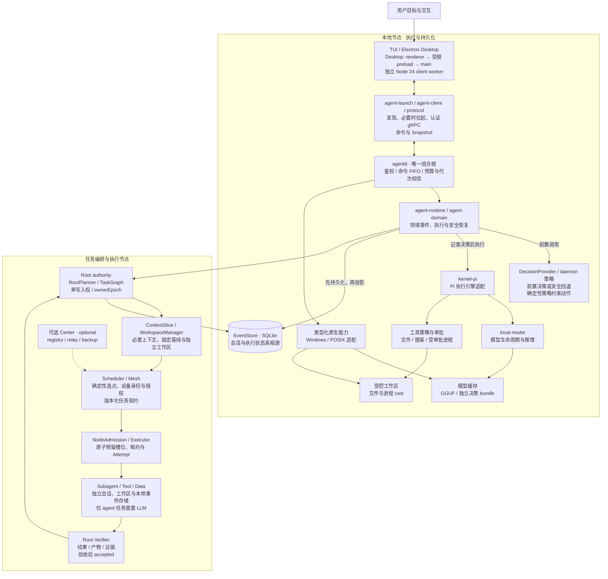
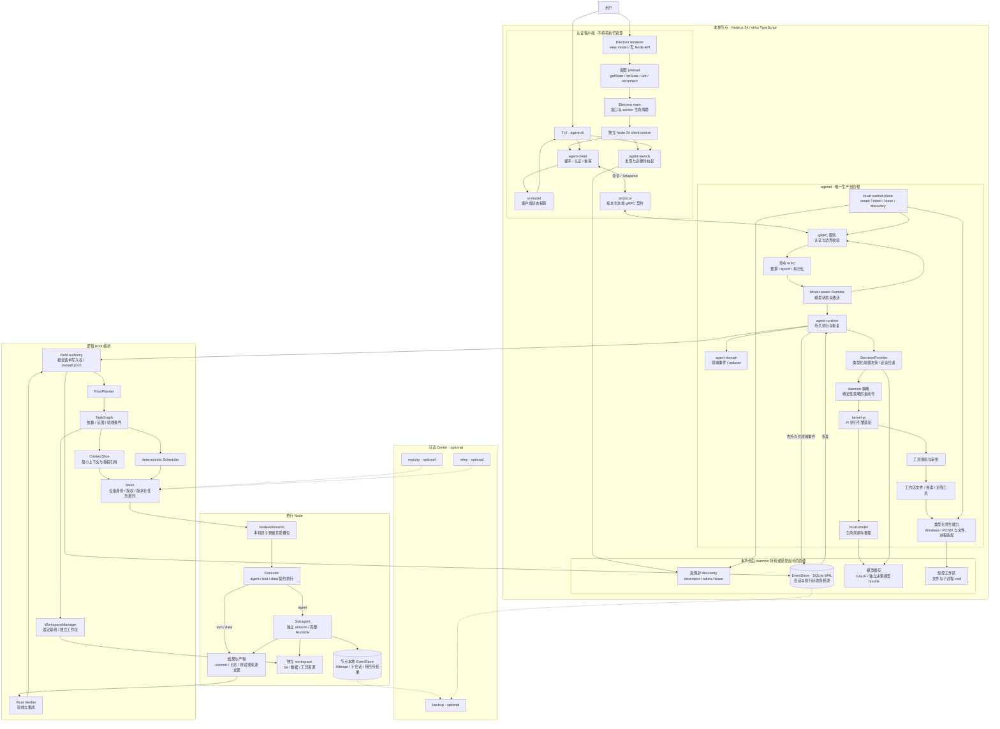
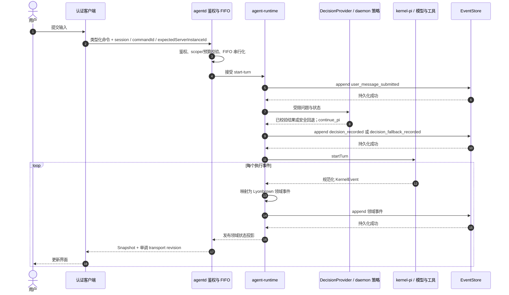
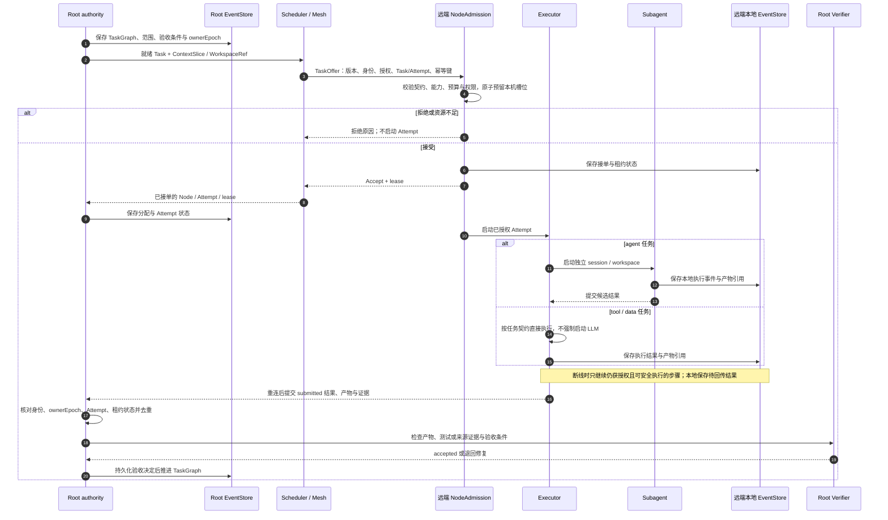

Lyonbrown 由认证客户端、节点服务 `agentd` 和任务编排层组成。客户端负责交互，`agentd` 管理本节点的执行与持久化，Root 负责拆分任务、管理依赖并验收结果。任务可在本节点或其他 Node 上执行；单机运行与节点直连均不依赖 Center。

本页说明各模块的职责、数据流和写入权限。产品主线采用 Node.js 24 与启用 `strict` 模式的 TypeScript。

启动、认证与客户端边界见[本地 gRPC C/S](/zh/architecture/grpc-client-server/)、[组合根](/zh/architecture/composition-root/)和[Electron Desktop](/zh/architecture/electron-desktop/)。

## 总体关系

下图按本地执行、任务编排和执行节点划分职责。Root 是逻辑角色，可将任务派给本节点或其他节点；分组不规定 package、微服务或部署目录。虚线仅表示可选 Center 的连接。

展开完整模块关系（44 个节点）

上图中的客户端输出线作了简化：daemon 的 Snapshot stream 回到 `agent-client`；TUI 经 `ui-model` 渲染，Desktop 经 worker、main 与受限 preload 回到 renderer。Desktop main 管理窗口和 worker，由独立 Node 24 worker 复用 launcher/client 完成原生发现与认证，不把 native backend 装进 renderer。

`agentd` 是节点内的唯一组合根，持有 Runtime、模型、工具、审批、MCP 连接和 EventStore 的生命周期。Secret 与 Skills 接入受 daemon 的授权策略约束。Pi、OpenJev 等第三方类型止于适配层，不进入公共协议或客户端 view model。关闭客户端不等于取消 daemon 已接受的执行。

## 模块职责

### 节点执行与客户端

| 模块与代码位置                                                                                   | 输入 → 输出                                                    | 所有权与权限边界                                                                                           |
| ------------------------------------------------------------------------------------------------ | -------------------------------------------------------------- | ---------------------------------------------------------------------------------------------------------- |
| `apps/agent-cli`、`packages/ui-model`                                                            | 用户操作、Snapshot → 命令、终端投影                            | Client；不持有 Runtime 或数据库。                                                                          |
| `apps/agent-desktop/src/{renderer,preload,main}`                                                 | UI action、受限 IPC、worker 状态 → renderer view model         | Renderer 无 Node API/token；main 管理独立 Node 24 client worker，worker 复用公开 launcher/client。         |
| `packages/agent-launch`、`agent-client`、`protocol`                                              | workspace scope、发现信息、命令 → daemon 连接与版本化 Snapshot | Launcher 负责必要时启动；client 使用凭据认证，凭据不暴露给展示层；本地 gRPC 契约与节点间任务契约分别管理。 |
| `apps/agentd/node-src/composition.ts`、`production-runtime.ts`、`production-kernel.ts`           | 配置、scope、模型 lease → Runtime、Kernel、工具与 gRPC 组合    | 唯一生产组合根；负责资源创建与关闭。                                                                       |
| `apps/agentd/node-src/runtime-command-serial-queue.ts`、`packages/agent-runtime`、`agent-domain` | 校验后的命令、KernelEvent → 领域事件、恢复状态与 Snapshot      | 命令 FIFO 与 Runtime 持久化分别承担自己的顺序约束；不能用模型决策替代确定性校验。                          |
| `packages/kernel-pi`、`local-model`、`decision-engine`                                           | 模型输入、封闭问题、工具步骤 → 规范化执行结果、类型化决策      | Daemon 拥有生命周期；决策结果或回退先落库，再继续 Pi。                                                     |
| `apps/agentd/node-src/{workspace-tools,approval-gate}.ts`                                        | 有范围的工具请求、用户审批 → 文件/进程结果、审批事件           | 文件工具有工作区边界；`process_execute` 需高风险审批，以主机用户权限运行，不是 OS 沙箱。                   |
| `packages/local-control-plane`、`control-plane-native`、`event-store`                            | 原生能力请求、领域事件 → 安全发现/锁/模型存储、SQLite 事件     | Windows/POSIX 差异集中在适配层；文件工具另复用 `@openclaw/fs-safe`，进程由系统适配清理。                   |

### 任务编排与节点协作

| 逻辑模块                                | 输入 → 输出                                                       | 权威边界                                                                                                   |
| --------------------------------------- | ----------------------------------------------------------------- | ---------------------------------------------------------------------------------------------------------- |
| RootPlanner / TaskGraph                 | 用户目标、基线、约束 → 带依赖、范围、预算和验收条件的 Task        | Root 管理计划；有依赖的任务不能提前进入可调度状态。                                                        |
| ContextSlice / WorkspaceManager         | 任务与受授权引用 → 最小上下文、独立工作区与产物引用               | 子任务只获得所需内容；Coding 使用固定基线和独立 clone/worktree，不共享可写目录。                           |
| deterministic Scheduler / NodeAdmission | 就绪 Task、节点能力与负载 → Offer、原子接单与租约                 | Scheduler 确定性选候选节点；接收 Node 自行校验权限并预留本机资源。                                         |
| Mesh / 版本化任务契约                   | 候选地址、身份、授权、任务消息 → 可信连接与可核对消息             | 发现不代表已加入，加入不代表获执行权限；本地 gRPC/token 不能直接充当 Mesh 授权。                           |
| Executor / Subagent / Root Verifier     | Task、ContextSlice、授权 → submitted 结果与证据 → accepted 或退回 | 子会话和工作区独立；agent 任务使用完整 Runtime；tool/data 可按契约直接执行；只有 Root 验收后任务才算完成。 |
| 复制 / 主动交接 / 可选 Center           | 已授权事件、快照与产物 → 副本或明确的权威转移                     | 副本不是写入者；Center 可提供 registry、relay、backup，但不决定默认运行拓扑。                              |

## 单机命令、执行与持久化

单机执行以「先持久化领域事件，再发布投影」为顺序约束。初始化与模型状态变化也可生成 Snapshot；执行结果必须经过 EventStore 后才能发布。

工具请求由 daemon 的确定性策略与审批门控制。需要审批时，客户端只显示请求并提交用户决定；拒绝决定同样进入领域事件，模型不能扩大授权。EventStore 写入失败时，Runtime 不把该执行结果投影为成功状态。客户端 Snapshot 的 transport revision 与持久事件 revision 各有用途，不能互换。

恢复从 EventStore 重建领域状态与可安全续接的历史，Pi 内部状态不是第二个权威存储。

## 任务分派与跨节点执行

Node 是承载资源的物理执行节点；Agent 是逻辑执行实体；Run 是根目标的一次执行；Task 是稳定工作单元；Attempt 是 Task 的一次实际尝试。重试创建新 `attemptId`，不重建根会话，也不覆盖旧尝试的证据。Executor 按 `ExecutionKind = agent | tool | data` 执行：只有 agent 任务需要启动 Subagent，确定的 tool/data 工作不强制调用 LLM，但都必须接受 Root 验收。

节点间任务契约需要版本化，并明确消息字段、失败窗口、重传和取消语义。图中的消息名用于说明契约职责。

每个 Node 只写自己的本地 EventStore；Subagent 不直接写 Root Session，也不与其他机器共享 SQLite 文件。Coding 的产物以 commit、补丁及测试日志交付；数据任务返回 Schema、数据分片、来源与校验信息。Root 只向子任务发送必要 ContextSlice，不默认复制完整对话、凭据或所有工作文件。

租约到期不能证明旧 Attempt 已停止，更不能证明外部副作用未发生。重新派发使用新 Attempt，并按副作用的幂等条件或人工复核决定是否重试；旧权威或失效尝试的提交不能直接验收。断线 Node 保存结果，恢复后按任务、尝试与事件标识去重回传；需要新的 Root 决策、无法确认授权或副作用安全性时暂停。

`ownerEpoch` 表示根会话写入权的版本，随明确交接递增。本地 daemon 代次由协议字段 `serverInstanceId` 表达，用于握手；命令中的 `expectedServerInstanceId` 必须与它匹配。daemon 重启不等于 Root 权威转移，二者不能复用。默认由发起节点持有 Root 权威；只有完成状态同步、目标确认和交接提交后，新节点才能继续根会话写入。断线或发现不到旧节点不触发自动接管。

Mesh 的职责是安全传输、设备身份与任务授权；底层传输和 LAN/VPN 候选发现机制由适配层选择。发现节点不等于建立信任，建立连接也不等于获得执行授权。Center 可提供 registry、relay 和 backup，但不能成为单机启动或节点直连的硬依赖。

## 跨平台能力与运行约束

文件、路径、权限、锁、进程、模型存储和工作区操作通过类型化能力接口提供。Windows、macOS、Linux 共用输入输出、授权、取消、超时和错误语义；系统差异集中在平台适配层，缺失能力必须明确报告。

Windows 原生 share-deny 与 POSIX advisory lock 使用不同机制。POSIX 锁协调本适配器的并发操作，不承诺阻止同一 OS 用户下恶意进程的写入。进程工具以主机用户权限运行；审批与工作区检查不构成 OS 沙箱。

后台业务调度若需要跨重启和重试状态，应先定义 job port，再选择受维护的持久化队列或工作流实现；不把原生 timer 或 EventStore 临时表当成调度器。

任务模型、上下文与恢复策略详见 [System One 决策层](/zh/architecture/system-one-decision-layer/)及相关架构页面；交付顺序与运行验收记录见[迭代路线](/zh/plans/roadmap/)和[发布制品](/zh/reference/release-artifacts/)。
