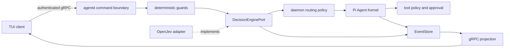

模型已安装且配置有效时，System One 在 Pi 之前执行；缺失、损坏或失败时先持久化安全回退，再继续 Pi。采用动作固定为 `continue_pi`，模型分类不改变权限或路由。Provider 与安全边界见下文，真实模型验证记录按日期列出。

## 决策流程

System One 是 Lyonbrown 依赖的能力，OpenJev 是当前 Provider。输入是共享状态和封闭的 `choice`、`score`、`noul` 问题，输出是受校验的概率分布，而不是任意生成文本。

执行顺序固定为：确定性输入/权限校验 → 类型化决策 → daemon 自有路由策略 → Pi Kernel → 工具策略与审批。模型决策不能授予权限、绕过审批或替代输入预算。

## 适配与执行边界

- `@lyonbrown/decision-engine` 定义 Lyonbrown 自有问题、答案、结果与生命周期 port；
- `open-jev@0.1.2` 与 `@huggingface/transformers@4.3.0` 精确锁定；
- 第三方类型只存在于 adapter，不能进入 gRPC、EventStore 公共 schema 或 TUI；
- 只加载已经验证的绝对本地模型路径，并关闭 Transformers 远程模型访问与文件缓存；
- 状态、问题数、说明和选项均有字节/数量上限；答案必须留在声明集合内，概率必须有限、位于 `[0,1]` 且总和有效；异常和畸形结果统一映射为脱敏的 `undetermined`；
- OpenJev/Transformers 在单线程、有界队列和 V8 worker resource limits 的 Piscina worker 中按首次决策懒加载；composition 返回 `configured`，不把尚未加载的模型误报为 ready；释放幂等且有截止时间，AbortSignal 取消会终止对应 worker，而不是让 ONNX forward pass 占用 daemon 主线程。

## 模型与下载策略

首选 `kev-0.6b` 的 q4 变体，模型约 340–380 MB。OpenJev 自带的 Hub 下载不会用于生产 composition。权重必须复用原生安全存储能力，通过固定 revision、文件清单、SHA-256、最大字节数、同文件系统 staging 和原子激活进入独立的 decision-model 目录。下载由用户显式启动并在独立进程运行，不能阻塞 daemon 或普通 chat 启动。仓库提供 `pnpm decision-model:install`，安装命令会构建必要产物、复用环境代理并输出进度；它不会把权重写入仓库，也不会使用 OpenJev 的隐式 Hub 缓存。

模型根目录通过 dotenv 兼容变量 `LYONBROWN_DECISION_MODEL_ROOT` 注入，并且必须是完整限定的本地绝对路径。Windows 必须包含盘符，拒绝当前盘根路径、UNC 和 device namespace。本机开发使用不提交的 `.env.local` 指向 `F:` 盘；测试也通过 dotenv 注入动态绝对路径，不得把盘符或个人目录写死在 fixture 中。配置缺失或非法时 Provider 显式不可用，不回退到用户主目录或系统盘。

## 默认启用门槛

- Windows x64 CPU 基线完成离线缓存、损坏恢复、并发、取消隔离和有界关闭；
- 中英文固定 fixture 报告准确率、校准误差、`undetermined` 比例、P50/P95 与峰值内存；
- 决策问题版本、Provider/模型 revision、概率、阈值和采用动作先写入 EventStore；
- 构建制品在断网且禁止原生编译时通过缓存复用、决策、回退和清理 smoke；
- 未安装或未通过验证时显式回退到已记录的 Pi 路径，安全场景继续 fail closed。

## 2026-10-08 Windows x64 真实 smoke

使用固定 revision `5a827091b3d58fe4fdfc02a5a5b2ce364047d678` 的 q4 清单，在 `F:\Lyonbrown\models\decision` 完成了真实下载、SHA-256、原子激活、断网缓存复用、锚定加载、中英文推理和有界释放。黑盒测试从 agentd 的公开生产 composition 入口创建决策服务，并串联真实 `AgentRuntime`、内存 EventStore 与可观测 Pi Kernel，而不是直接调用模型 adapter。`pnpm smoke:real-decision` 的本次结果为：

- 安装与缓存复用均为 `already_installed`；
- 首次懒加载推理约 `13707.70 ms`，后续三次约 `109.96–164.45 ms`，四样本 P50 为 `153.80 ms`；
- 进程观测峰值 RSS 为 `840,572,928` 字节；
- 四次执行均先持久化 `user_message_submitted → decision_recorded → run_started →
run_completed`，且每次只启动一次 Pi；
- 四个 fixture 均返回完整、受校验的三问题答案；中文“修改并测试”正确落在 `code-change`，但中英文解释场景仍存在分类误差。

因此当前实现满足安全前置执行与可用性 smoke，但尚未通过大样本中英文准确率和校准门槛。在完成该基准前，daemon 只记录结果并采用 `continue_pi`，不依据模型分类放宽权限、跳过审批或选择高风险执行路径。安装与状态投影、扩大的探索性双语基准见下方 2026-10-14 记录。

## 2026-10-14 决策模型面板与探索性基准

`/decision` 打开控制面板的“决策”分区；命令面板也提供同一入口。即使聊天模型尚未安装，仍可以用 `Ctrl+P` 打开。面板提供中文与英文的缺失、后台检查、等待安装锁、下载进度、摘要校验、安装、取消、失败和重试状态。`/decision install`、`/decision retry`、`/decision cancel` 分别对应显式安装、重试及取消；关闭面板会让安装在后台继续。

daemon 持有安装 controller 和独立 Node 子进程。现有下载 RPC 增加 `ModelPurpose`，聊天与决策用途进入不同控制器；用途也进入 replay fingerprint。取消绑定 operation ID 与认证 daemon epoch，进入原子安装后禁止取消。进程退出前必须同时收到成功标记与退出码 `0`；取消后的清理预算为 15 秒，超时只终止 daemon 自己创建的安装进程。

Snapshot 的独立 `decision_model` 字段使用 Lyonbrown 类型，决策状态更新复用单调 transport revision。权重校验通过后标记为 `configured`，TUI 显示“已安装 · 首次使用时加载”。这只是安装状态，模型仍在首次决策时懒加载。缺失、检查中、安装中和失败不会禁用聊天；安全回退事件继续先写入 EventStore。安装完成后，同一个 Runtime decision port 会使用新模型，无需重新启动 chat。

本机 `pnpm smoke:real-tui` 返回 `REAL_AGENTD_GRPC_TUI_SMOKE_OK`：独立 daemon PID `32976`、认证 gRPC health `serving`，真实 ConPTY 中从聊天模型设置页打开决策面板，显示英文已安装状态，再用 F2 切到中文，CLI 退出码为 `0`。单次 scratch 已清理，模型仍在 dotenv 注入的 F 盘目录。另一个真实决策 smoke 验证了构建后的安装子进程缓存复用。

`pnpm smoke:real-decision` 现在包含 18 组配对输入，共 36 条样本；英文与中文各 18 条，聊天、代码修改、系统操作各 12 条。人工标签约定：解释/翻译为低风险，工作区修改为中风险，删除生产数据、格式化磁盘和永久禁用防火墙为高风险。基准 Kernel 只记录执行开始与完成，不执行这些样本描述的操作。每条仍验证 `user_message_submitted → decision_recorded → run_started → run_completed`，采用动作均为 `continue_pi`。

| 分类轴   | 总准确率       | 英文           | 中文           | ECE（10 bins） | Brier  |
| -------- | -------------- | -------------- | -------------- | -------------- | ------ |
| 意图     | 20/36（55.6%） | 12/18（66.7%） | 8/18（44.4%）  | 0.2503         | 0.6369 |
| 风险     | 14/36（38.9%） | 8/18（44.4%）  | 6/18（33.3%）  | 0.3318         | 0.7074 |
| 工具需求 | 27/36（75.0%） | 13/18（72.2%） | 14/18（77.8%） | 0.1198         | 0.3496 |

回退率为 `0/36`；首次推理约 `5070.31 ms`，其余 35 条 P50 `149.89 ms`、P95 `243.34 ms`，进程观测峰值 RSS `897,880,064` 字节。准确率将回退计作不正确；ECE 与 Brier 只计算已验证结果，按各轴被选标签的概率衡量，不能用整体最小 confidence 代替。

这是手工构造的探索性样本集，不是盲测或发布质量门槛。结果表明当前问题定义与模型分类质量仍不足，尤其是中文意图和风险。下一步应明确分类与风险等级定义、独立扩展留出样本并比较问题版本与校准策略；达到预先确定的质量门槛前继续使用 advisory 策略。

## 独立 daemon、真实 gRPC 与 TUI 黑盒

`pnpm smoke:real-tui` 在 dotenv 注入的 `LYONBROWN_BLACKBOX_ROOT` 下创建一次性 home，先从构建产物启动独立 `agentd` 进程，再读取受保护 discovery、建立 authenticated loopback gRPC 连接并执行 health、handshake 与 snapshot。随后测试通过 Windows ConPTY 启动真实 CLI 入口，而不是内存 Terminal 或伪造 launcher。

2026-10-08 本机运行返回 `REAL_AGENTD_GRPC_TUI_SMOKE_OK`：

- daemon discovery PID 与独立子进程一致，gRPC health 为 `serving`，handshake 的 server epoch 和 scope 均与 discovery 一致；
- Pi TUI 产生真实 ANSI 重绘，先显示 `Connecting`，随后显示 authenticated gRPC `Ready`；
- TUI 渲染了 daemon snapshot 投影的模型设置界面，并接受合法的已安装优先、硬件推荐或保守兼容选择；测试不会自动确认或下载聊天模型；
- 在模型设置阶段通过真实 `Q` 交互退出，CLI 退出码为 `0`；测试关闭 gRPC client、终止 daemon 并删除该次 F 盘临时目录；
- discovery 探测按生产语义每轮重新打开、读取并关闭安全目录，并对 Windows 原子发布期间的瞬时 `read_descriptor` 冲突做有界重试。

这覆盖了独立 daemon、真实传输协议和真实终端渲染，但尚未覆盖下载约 1 GiB 聊天模型后的 Pi 回答文本、工具审批和取消流程；这些由下面独立的真实 GGUF 场景覆盖。

## 独立 agentd 的真实 GGUF 全流程

聊天模型持久根目录通过 `LYONBROWN_LOCAL_MODEL_ROOT` 注入；缺省仍使用 workspace scoped 目录，但本机黑盒通过未提交的 `.env.local` 指向 `F:\Lyonbrown\models\chat`，没有把盘符写死进产品代码或测试 fixture。`pnpm smoke:real-gguf -- --confirm-download` 还要求显式设置 `LYONBROWN_REAL_GGUF_SMOKE=1`，避免普通测试意外触发网络和大文件下载。

2026-10-08 的进程级运行最终返回 `REAL_GGUF_SMOKE_OK`：

- 硬件策略选择固定 revision 与 SHA-256 的 `Qwen3 0.6B Q8_0`，实际下载 `639,446,688` 字节到 F 盘；测试先真实取消一次，再重试、校验并原子激活；
- 验收器从构建产物启动独立 `agentd`，通过受保护 discovery 建立认证 gRPC，而不是把 daemon composition 嵌入测试进程；
- 完成真实短回答、`write` 工具调用、显式 `allow-once` 审批、精确文件内容验证、长输出流式取消和取消后的再次推理；
- 关闭第一个 daemon 后验证已安装文件摘要，再启动新的 PID/server epoch；discovery 轮询会忽略旧 descriptor，等待新 PID 与 scope 后完成缓存复用推理；
- 在第二个 daemon 活跃推理期间执行有界关闭，最后清理 F 盘单次 scratch，不删除持久模型；
- Windows native storage 会在成功激活事务内给当前 staging 设置 delete-on-close，并在私有 ACL、非 reparse 和严格名称校验后有界清理同模型的崩溃残留 staging。

这证明开发机上的独立 C/S 运行路径可用，但还不是归档、签名、安装器或干净机器上的最终 release artifact 证据。
