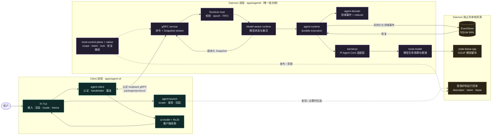
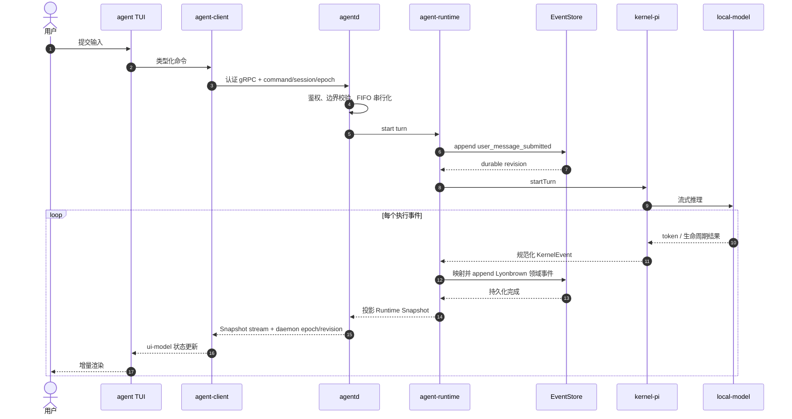

# 本地 gRPC Client/Server 架构

Lyonbrown 只有一种产品拓扑。下图以当前 Node.js / TypeScript 生产实现为准；实线表示
运行时数据流，虚线表示发现、拉起和本地安全控制流。

## 系统全景

daemon 是 Session 与执行状态的唯一权威。TUI 只持有输入、渲染、locale、主题和
短期展示偏好。关闭 TUI 不会停止 daemon 已接受的 turn 或模型下载。

当前生产组合已接入受工作区约束的文件工具和显式审批；Secret resolver 仍为拒绝式
实现，并且尚未连接 MCP。工具、审批与未来 MCP 都归 `agentd` 所有，不能下沉到 TUI。

## 命令与事件闭环

这个顺序体现一条不可绕过的约束：执行结果必须先转换为 Lyonbrown 领域事件并成功
写入 EventStore，随后才能投影为客户端 Snapshot。Pi 是执行引擎，EventStore 才是
Session 与执行状态的持久真相源。

## 传输与发现

传输使用本地 gRPC 与生成的 protobuf binding。daemon 只有在 server 可用后才发布
受保护、带 scope 的发现描述符。client 校验描述符所有权与 scope，通过原生能力边界
读取凭据，执行版本化 handshake，再订阅权威 Snapshot stream。

endpoint 字符串与 bearer token 不得进入命令行参数、日志、事件、崩溃报告或 UI。
认证失败、身份不匹配、发现数据畸形和协议版本不支持都 fail closed。

## 连接生命周期

TUI 立即以 `connecting` 状态渲染；发现、可选 daemon 启动、认证、handshake 和订阅
在后台进行。重连使用有界退避，只接受当前 daemon epoch 且 revision 单调更新的状态。
stale Snapshot 可以继续显示供诊断，但在 fresh state 到达前禁止会修改 daemon 的操作。

## 命令模型

命令携带命令 ID、Session ID，以及适用时预期的 daemon/runtime/model epoch 和有界
payload。daemon 在 durable append 前完成校验。重复投递保持幂等；旧 epoch、非法
状态、超大消息与未授权操作会被拒绝且不能留下部分状态。

TUI 只能通过这一契约执行 start turn、cancel、steering、follow-up queue、审批、
模型下载/取消/重试和 Session/模型选择，不得直接调用 Runtime，也没有 embedded 回退。

## 模型设置

daemon 与 TUI 启动都不会强制下载模型；缓存检查在后台运行。模型缺失时产生显式
setup 状态，只禁用依赖模型的提交。daemon 从固定可信目录中后台推荐适合当前硬件的
模型；用户可以显式确认下载、查看进度、在允许阶段取消、失败后重试或直接退出。
硬件探测失败时回退到最小可信候选，不会触发自动下载。

下载锁、字节上限、checksum 校验、安全 staging、原子激活、模型 epoch 与 llama.cpp
加载都由 daemon 持有。TUI 只渲染版本化状态并发送显式命令，绝不打开 GGUF 文件。

## 失败与关闭

传输错误必须脱敏并限制大小。stream 取消与 server 关闭有明确 deadline，失效 client
不能长期占用 daemon 资源。client 可以独立重启，并从最新 durable Snapshot 恢复。
