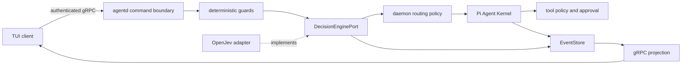

# System One 前置决策层

> 状态：已选择 `open-jev@0.1.2`，端口与本地 Provider adapter 已进入仓库；daemon
> 组合、受保护权重下载和真实模型验收仍未完成，因此当前不能宣称默认前置执行已开启。

## 目标架构

System One 是 Lyonbrown 依赖的能力，OpenJev 是当前 Provider。输入是共享状态和封闭的
`choice`、`score`、`noul` 问题，输出是受校验的概率分布，而不是任意生成文本。

执行顺序固定为：确定性输入/权限校验 → 类型化决策 → daemon 自有路由策略 → Pi
Kernel → 工具策略与审批。模型决策不能授予权限、绕过审批或替代输入预算。

## 已落地边界

- `@lyonbrown/decision-engine` 定义 Lyonbrown 自有问题、答案、结果与生命周期 port；
- `open-jev@0.1.2` 与 `@huggingface/transformers@4.3.0` 精确锁定；
- 第三方类型只存在于 adapter，不能进入 gRPC、EventStore 公共 schema 或 TUI；
- 只加载已经验证的绝对本地模型路径，并关闭 Transformers 远程模型访问与文件缓存；
- 状态、问题数、说明和选项均有字节/数量上限；答案必须留在声明集合内，概率必须有限、
  位于 `[0,1]` 且总和有效；异常和畸形结果统一映射为脱敏的 `undetermined`；
- OpenJev/Transformers 在单线程、有界队列和 V8 worker resource limits 的 Piscina worker
  中按首次决策懒加载；composition 返回 `configured`，不把尚未加载的模型误报为 ready；
  释放幂等且有截止时间，AbortSignal 取消会终止对应 worker，而不是让 ONNX forward pass
  占用 daemon 主线程。

## 模型与下载策略

首选 `kev-0.6b` 的 q4 变体，模型约 340–380 MB。OpenJev 自带的 Hub 下载不会用于生产
composition。权重必须复用原生安全存储能力，通过固定 revision、文件清单、SHA-256、
最大字节数、同文件系统 staging 和原子激活进入独立的 decision-model 目录。下载由用户
显式启动并在后台运行，不能阻塞 daemon 或普通 chat 启动。

模型根目录通过 dotenv 兼容变量 `LYONBROWN_DECISION_MODEL_ROOT` 注入，并且必须是完整限定的
本地绝对路径。Windows 必须包含盘符，拒绝当前盘根路径、UNC 和 device namespace。本机开发
使用不提交的 `.env.local` 指向 `F:` 盘；测试也通过 dotenv 注入动态绝对路径，不得把盘符或
个人目录写死在 fixture 中。配置缺失或非法时 Provider 显式不可用，不回退到用户主目录或
系统盘。

## 默认启用门槛

- Windows x64 CPU 基线完成离线缓存、损坏恢复、并发、取消隔离和有界关闭；
- 中英文固定 fixture 报告准确率、校准误差、`undetermined` 比例、P50/P95 与峰值内存；
- 决策问题版本、Provider/模型 revision、概率、阈值和采用动作先写入 EventStore；
- 构建制品在断网且禁止原生编译时通过缓存复用、决策、回退和清理 smoke；
- 未安装或未通过验证时显式回退到已记录的 Pi 路径，安全场景继续 fail closed。

下一实现切片是 decision model 的受保护后台安装状态机，以及 decision-before-kernel
的领域事件与恢复测试。
