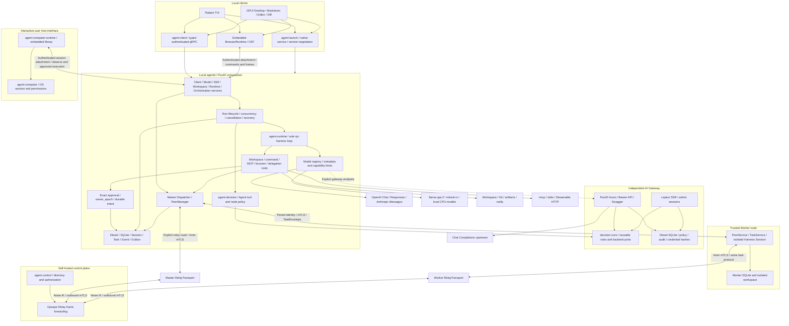
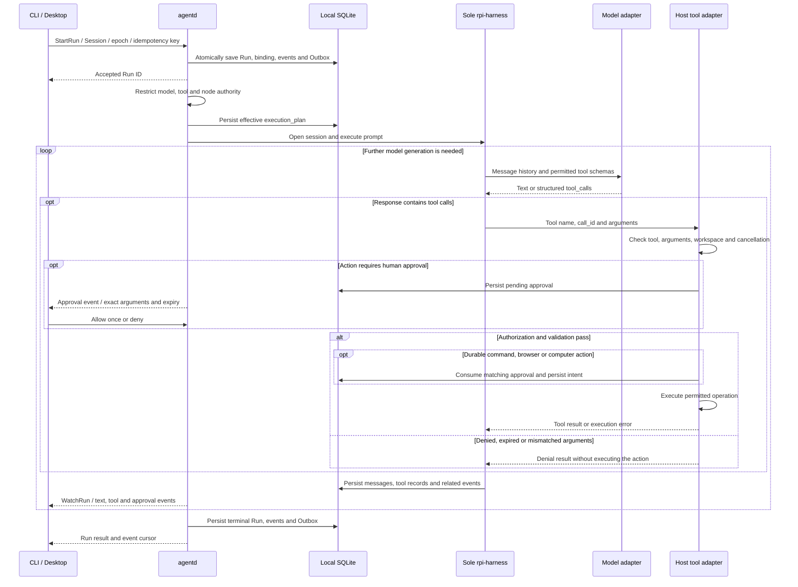
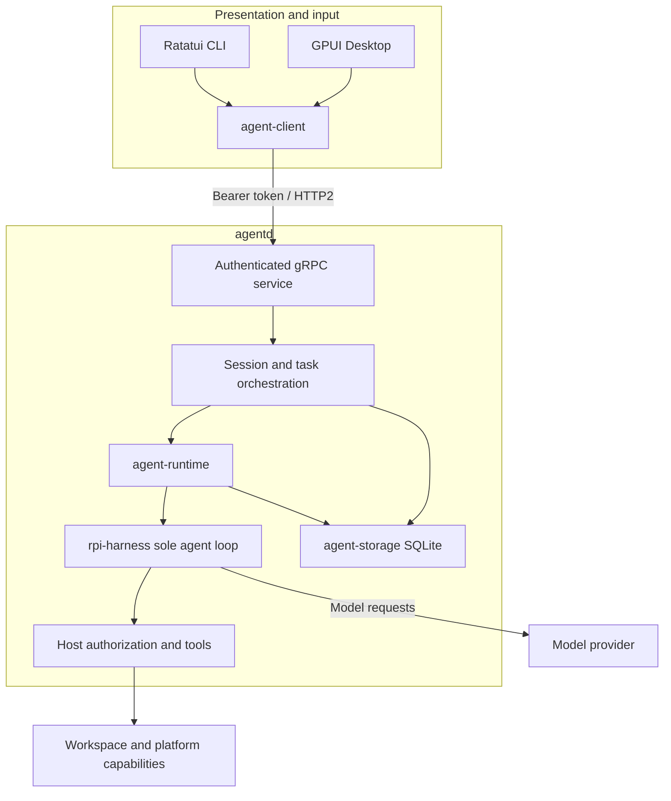
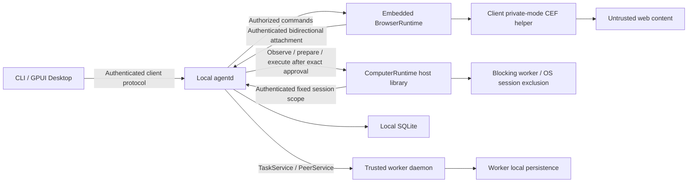

# Components and calls

`agentd` owns sessions, tasks, models, tools and permissions. `agent-client` puts a bearer token in gRPC request metadata; terminal and desktop clients use the same `ClientService` messages. Concrete `rpi-harness` types stay within the runtime adapter and do not enter public protocol or UI models.

## System overview

Typed FluxDI modules inject configuration, identity, storage, models, decision policy and runtime resources. Business modules receive explicit dependencies; clients cannot create model connections, approval decisions or Worker trust records.

The control directory, Noise links and TaskService are separate protocol boundaries. Configuration selects direct or relayed routes before dispatch; a failed operation never triggers automatic route fallback. Relay transports the same mutual-TLS task protocol, preserving Worker identity, capability and owner checks. Control forwards encrypted frames without interpreting tasks or storing Agent Sessions. An encrypted connection alone does not establish task delivery or execution.

## Runs and side effects

A request can involve several model generations and tool calls, while the same daemon-owned Harness manages history and the loop. The model adapter can use a standard API or local inference backend; clients receive domain events only.

Source references: [apps/agentd/src/execution.rs](https://github.com/lyonbrown4d/lyonbrown/blob/705f995a59ff69e186f07a035dcb639e43f9d44d/apps/agentd/src/execution.rs), [crates/agent-runtime/src/runtime.rs](https://github.com/lyonbrown4d/lyonbrown/blob/705f995a59ff69e186f07a035dcb639e43f9d44d/crates/agent-runtime/src/runtime.rs), [crates/agent-runtime/src/tools.rs](https://github.com/lyonbrown4d/lyonbrown/blob/705f995a59ff69e186f07a035dcb639e43f9d44d/crates/agent-runtime/src/tools.rs).

Approval cannot broaden the execution plan. Command, browser and computer actions record intent and outcome under stable action identifiers. A disconnect, cancellation or process exit that leaves an unknown outcome produces `Uncertain`; reconciliation uses the same identity without automatic replay. File writes, MCP and other tools follow their own adapter authorization and error contracts; one tool's receipt guarantees do not apply to every tool.

## Models and distributed tasks

Remote model protocols, local inference engines and decision classifiers share domain boundaries. Model metadata determines tool, image and context support. Host policy, available capabilities and Worker grants further restrict decision output. Local models load from explicitly configured paths without automatic downloads or cloud fallback.

`OrchestrationService` serves authenticated local clients; peer `TaskService` serves paired mTLS nodes. Dispatch transactions validate Master identity, Session, `owner_epoch`, parent Run and workspace, and persist the Worker binding before sending. Clients page, reconcile or cancel using task identities. Worker success leaves the Master task `awaiting_acceptance`; only explicit acceptance changes it to `completed`.

### Local execution details

Model interaction, tool execution and durable execution state belong to the daemon. Clients cannot infer that a tool side effect happened from UI state, or replay a request simply because its event stream disconnected.

## Browser and device boundaries

`agent-browser-runtime` is embedded in CLI/Desktop. CEF helpers start through a private mode of the client executable. The runtime attaches to the daemon through an authenticated bidirectional stream; the daemon authorizes browser commands before dispatch. GPUI window state and browser execution state remain separate.

Disconnecting the browser attachment does not replay actions. Web content cannot access privileged application interfaces. Profiles preserve browser data on disk, without restoring live in-memory pages. Node discovery grants no execution authority; pairing and task authorization remain with the daemon. Public registration and relay use a separate control-plane protocol; discovery does not establish trust.

ComputerRuntime provides an embeddable interactive-user host interface, attached to one fixed daemon session and desktop scope. Native work runs on a blocking worker. Disconnecting cancels commands and retains desktop exclusion until the OS call drains. After checking trusted configuration, session ownership and control permissions, the daemon provides `computer_observe` and `computer_act` through the sole Harness. Observation, immutable action preparation and execution after exact approval use this authenticated connection; approval consumption and intent become durable before execution. CLI/TUI and Desktop use an injected `ComputerHostFactory` to explicitly discover and select a local window or display, then bind the host to the selected daemon session. Switching chats does not transfer an existing attachment. ComputerRuntime is embedded in the client process, without a standalone product process or another Agent Loop. The client `native-computer` feature is disabled by default; wired entry points do not establish native-control runtime acceptance. On macOS, the policy requires a logged-in console session, a valid session UUID and an explicit unlocked field before proceeding to permission checks. Unknown or locked state is rejected; an observed session failure cannot recover automatically after unlocking. See [Native desktop execution boundary](protocol.md#native-desktop-execution-boundary) for permissions, leases and execution limits, and [model computer tools](tools.md#model-computer-tools) for tool behavior.

## Source references

- Services and messages: `proto/agent/v1/agent.proto`.
- Authenticated connection: `crates/agent-client/src/lib.rs`.
- Runtime interfaces: `crates/agent-runtime/src/contracts.rs`.
- Native host attachment: `apps/agent-cli/src/computer_backend.rs`, `apps/agent-desktop/src/computer.rs`, `crates/agent-computer-runtime/src/client.rs`, `crates/agent-computer-runtime/src/attachment.rs`, `apps/agentd/src/computer/service.rs`, `apps/agentd/src/computer/tools/` and `apps/agentd/src/computer/mutation.rs`.
- Durable state: `crates/agent-storage/src/schema.sql`.
- Reusable decisions and Agent integration: `crates/decision-core/`, `crates/decision-semantic/`, `crates/decision-model/` and `apps/agentd/src/model_routing.rs`.
- Independent gateway and synthetic models: `apps/ai-gateway/`, `crates/gateway-core/`, `crates/gateway-storage/`, `crates/gateway-web/` and `apps/model-mock/`.

A successful worker attempt and a master's acceptance of its result have different meanings. The protocol keeps `attempt_id`, `owner_epoch` and explicit `AcceptResult`; receiving a result does not establish acceptance.
