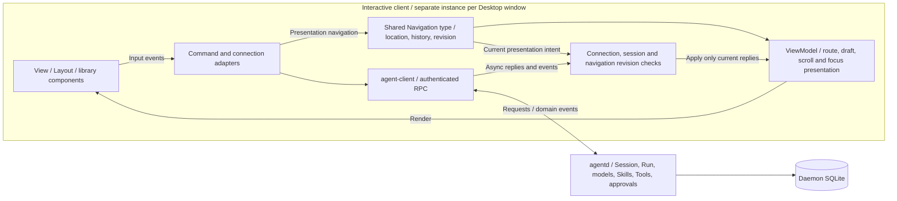

# Terminal and desktop clients

Both clients access the daemon through `agent-client`. Sessions, run results and approvals come from the service; neither client embeds another agent loop.

## Client presentation, navigation and daemon ownership

Both clients reuse a navigation type while owning separate locations, history and presentation state. Navigation creates no additional Agent Loop and transfers no Session or native-host authority.



Discarding a stale presentation reply does not cancel work already accepted by the daemon. Provider credential reads and explicit uploads remain in command adapters; values never enter the ViewModel.

Source references: [crates/agent-client/src/navigation.rs](https://github.com/lyonbrown4d/lyonbrown/blob/705f995a59ff69e186f07a035dcb639e43f9d44d/crates/agent-client/src/navigation.rs), [apps/agent-cli/src/update.rs](https://github.com/lyonbrown4d/lyonbrown/blob/705f995a59ff69e186f07a035dcb639e43f9d44d/apps/agent-cli/src/update.rs), [apps/agent-desktop/src/resources/state.rs](https://github.com/lyonbrown4d/lyonbrown/blob/705f995a59ff69e186f07a035dcb639e43f9d44d/apps/agent-desktop/src/resources/state.rs).

## macOS installed entry points

PKGs place each app under `/Library/Application Support/Lyonbrown/Clients/{cli|desktop}/{version}-{full-tree-hash}/` with a separate content-component receipt. Resource or Helper changes select a different directory and component identifier even when the main executable and product version are unchanged. Separate components own `/usr/local/bin/agent` and `/Applications/Lyonbrown.app`; each contains only a symlink to its selected content. The packager verifies the copied tree, disables Installer relocation for every nested bundle, and does not prune old content components or receipts.

The shared launcher and CEF host use the loaded main executable path reported by the macOS kernel to locate the corresponding bundled agentd, framework and Helpers. After the public entry selects another version, an existing process continues to use its original version's companion files. Helpers are copied executables inside the maintained app layout; sandbox entry validates the same library location used by cef-rs before invoking its loader. Package payload checks and OS installation, upgrade and rollback acceptance are separate. See the [local distribution guide](https://github.com/lyonbrown4d/lyonbrown/blob/main/packaging/README.md).

## Terminal workbench

```sh
cargo run -p agent-cli -- --help
cargo run -p agent-cli -- --endpoint http://127.0.0.1:7447 --data-dir /path/to/lyonbrown-data
```

The workbench shows the conversation and composer by default. Sessions, tasks, computer details and help open in an on-demand context panel rather than persistent empty panels. Pending approvals show the tool, arguments and approve/deny controls above the composer. Wide terminals place context beside the conversation; narrow terminals replace the conversation area with context. `Esc` returns to the previous context, or to the conversation without history. Failed connections display `Disconnected` without simulated model replies. Failed submissions preserve the draft and are not replayed automatically. The matching draft is cleared only after the service confirms acceptance.

| Key | Action |
| --- | --- |
| `F1` / `F2` / `F3` / `F4` / `F5` | Toggle help / sessions / tasks / computer / full approval context |
| `Esc` | Return to the previous context, or the conversation without history |
| `Ctrl+N` | Create a session using the current working directory |
| `Tab` | Select the next session and load its runs |
| `Enter` | Submit input to the selected session |

Local command results never take over a context panel. A command that needs a choice (`/model`, `/models`) floats candidates above the composer: `↑↓` moves, `Enter` confirms, `Esc` cancels. Read-only output (`/status`, `/git`, `/providers`, `/skills` and every operation receipt) is appended to the transcript as a `· 本地` line that is not rendered as Markdown. Submission clears the composer immediately, so a late result never overwrites text typed while waiting. The `/models` hub subcommands (`search`, `inspect`, `plan`, `installed`, `status`) read the daemon's JSON into repository, revision, architecture, licence, size and job fields; an unrecognised shape falls back to the original JSON rather than dropping data.

`/diff` opens a full-screen diff view: unified by default, `Tab` switches to side-by-side, `j`/`k` or the arrow keys scroll, `n`/`p` move between files, `h`/`l` scroll horizontally, `g`/`G` jump to the ends and `Esc` closes. Only changed blocks and their context are expanded. Syntax highlighting uses tree-sitter (Rust, Python, JavaScript, TypeScript, JSON, TOML, Bash, Markdown) and affects presentation only; the text sent to the daemon is unchanged.
| `Shift+Enter` / `Alt+Enter` | Insert a newline in the composer |
| Arrow keys, `Home` / `End`, `Delete` | Move the cursor or edit text at the cursor |
| `Ctrl+R` | Reconnect to the daemon |
| `Ctrl+X` | Request cancellation of the active run |
| `Ctrl+Y` / `Ctrl+E` | Approve / deny the first pending approval |
| `PageUp` / `PageDown` | Scroll the open context panel, or the conversation when no panel is open |
| `Ctrl+C` / `Ctrl+D` | Exit the client |

The composer uses `ratatui-textarea` 0.9.4 for cursor editing, multiline text, wrapping and paste. Application shortcuts take precedence over matching editor bindings: `Ctrl+X` still requests run cancellation and `Ctrl+Y` still handles approval. Pending submissions are not sent again; failure preserves the draft, and service acceptance clears the matching draft and its undo history.

The approval area displays the tool and arguments. Compact layouts retain only the pending count and approval shortcuts; use `F5` to read the full arguments. The daemon validates and saves decisions before the UI updates them. Durable runs refresh every two seconds; newly submitted runs also subscribe to an event stream. Exiting restores the terminal and sends no cancellation request.

The UI uses warm dark or warm light solid terminal backgrounds, text and accents. `--theme auto` uses `COLORFGBG` to choose the palette, falling back to dark without a hint. Select `--theme light` or `--theme dark` explicitly when needed. Model replies render Markdown through fixed `tui-markdown` 0.3.12, adapting the theme through its public `StyleSheet` interface. Default features are disabled, omitting code syntax-highlighting dependencies.

The TUI separates presentation through MVVM: `view_model.rs` projects client `App` state into a read-only `ViewModel` containing connection labels, messages, approvals and current context. `view.rs` renders that data and the composer through Ratatui. Input actions and background updates remain in `input.rs`, `backend.rs` and `update.rs`; presentation never dispatches daemon operations.

The TUI `Router` owns the context page, bounded back stack and page scroll position. `Esc` returns to the previous page. Slash completion is transient composer state and never occupies the route: typing `/` in an empty composer floats candidates above it, `↑↓` moves, `Tab` or `Enter` completes, and typing an argument or `Esc` dismisses it, leaving the transcript and the open page untouched. Session or connection changes clear old history and transient resource pages. `AppLayout` and `BodyLayout` compose Ratatui constraints for wide and narrow screens, approvals and completion overlays; routes hold no daemon execution authority.

## Native computer attachment

CLI/TUI and Desktop embed ComputerRuntime in their own processes. Default builds omit native SDKs; explicitly enable the client `native-computer` feature as described in [development and verification](development.md#native-computer-client-builds). This neither enables daemon model tools nor requests OS permission. Target discovery lists window or display metadata under existing permissions, without screenshots or input. A locked or unknown session, or missing screen permission, prevents discovery.

List targets, then explicitly attach using an existing non-nil daemon Session UUID and one target ID:

```sh
cargo run -p agent-cli --features native-computer -- computer targets
cargo run -p agent-cli --features native-computer -- computer attach --session SESSION_UUID --window WINDOW_ID --process-id PID
# For a display, use --display DISPLAY_ID without --window or --process-id
```

`computer targets` does not connect to a daemon. For a window, copy both its ID and `process_id` from that catalog. `computer attach` discovers targets again and requires an exact PID match before retaining the descriptor, authenticating and checking session ownership. A reused window ID cannot silently select a different process. The command stays in the foreground until `Ctrl+C` detaches; process exit also revokes the host connection. Attachment failure reports unavailability without automatically selecting another target.

In the TUI, connect and select a session, then enter local commands in the composer:

```text
/computer targets
/computer attach window WINDOW_ID
/computer attach display DISPLAY_ID
/computer status
/computer detach
```

Use one of the two `attach` forms. Run `/computer targets` first and choose from that catalog. Attachment uses the exact cached descriptor rather than replacing the target by ID. The Computer area displays the originally bound session, scope and connection state; `Alt+PageUp` / `Alt+PageDown` scroll its details. Switching sessions does not transfer the connection; detach before choosing another target or session. Even invalid `/computer` syntax stays local and is never submitted to the model. Reconnection or disconnect revokes the host and clears the catalog, requiring fresh discovery before attachment; actions are not replayed automatically.

See “Computer pane” below for Desktop controls and binding state, and [native desktop execution boundary](protocol.md#native-desktop-execution-boundary) for discovery, permission and fixed window identity limits. Wired entry points do not establish native-control acceptance. macOS checks session identity and lock fields under the documented project policy, rejecting unknown state with `SessionStateUnknown`. Once the backend observes a lock or invalid session, unlocking still requires a fresh explicit attachment.

## Terminal task management

```sh
cargo run -p agent-cli -- task list --session SESSION_ID --page-size 100
cargo run -p agent-cli -- task get TASK_ID
cargo run -p agent-cli -- task reconcile TASK_ID --node-id WORKER_ID --node-endpoint https://worker.example:7448
```

`task dispatch --help` lists dispatch arguments. Supply stable Task and Attempt UUIDs, an idempotency key, and an active parent Run in the same Session. The daemon validates ownership, workspace, deadline and capability scope. `task cancel` requests cancellation; `task accept` requires `--accepted true` or `--accepted false` to decide whether to adopt the Worker result.

Pairing identity and credentials stay in the daemon; an address grants no trust. After a lost submission response, retain the original Task ID and use `get` and `reconcile`, without automatically generating a new task identity. Pages return `next_task_id`; pass it through `--after` to continue.

The TUI `F3` panel queries durable Tasks for the selected session and displays Task and Worker Attempt status separately. Use arrow keys to select a task, `Enter` with an empty composer to inspect it, and `PageDown` to fetch the next page. Reopening the panel returns to the first page. Composer commands `/task ...` use the standalone CLI subcommands and arguments, such as `/task get TASK_ID` or `/task cancel TASK_ID --node-id WORKER_ID --node-endpoint https://worker.example:7448`. Parsing is local; malformed commands never become model prompts.

The TUI saves session drafts, the unbound draft, selected session, context panel and scroll positions. Switching sessions retains independent input. A submission acknowledgement clears only the originating session draft that still matches the submitted text. `/draft list` lists local drafts; `/draft recover SESSION_ID` places the selected text in the composer, and `/draft recover unbound` retrieves the unbound draft, for inspection before the user decides whether to submit it. Drafts whose original sessions are unavailable remain stored and are never automatically attached to another session.

## GPUI desktop

```sh
cargo run -p agent-desktop
```

The desktop uses GPUI and `gpui-kit` for a session sidebar grouped by workspace, multiple chat tabs, conversation input and Browser, Computer, Files, Editor, Diff and Tasks dock panels. The custom title bar reuses the library's `TitleBar`; macOS uses native close, minimize and zoom controls. The session sidebar starts open and the right workbench starts closed. Title bar buttons toggle each side independently and remain available to restore either panel when both are hidden. Collapsing the left sidebar leaves a compact icon rail. Assistant replies use flat prose, while the composer and workspace information occupy separate layers. Light and dark views share colors and dimensions from `theme.rs`.

Desktop presentation follows MVVM: `DesktopViewModel` holds the active session selection, runs, event cursor, messages, approvals and status, and groups sessions by the service-provided `Session.workspace`. It holds no network client, async runtime or connection credentials. `operations.rs` issues requests through the client port, and `projection.rs` applies replies to presentation state. GPUI views read that state and reuse `gpui-kit` buttons, inputs, Markdown, docking and resizable components.

Background results use bounded `async-channel` 2.5.0 queues; producers await capacity when a queue is full. GPUI applies results on its main thread and discards replies for obsolete tabs or generations. Browser frames retain an independent 160 ms refresh timer, and Computer hosts retain an independent 80 ms health timer. Closing a window cleans up local subscriptions and hosts; daemon jobs retain their independent lifetime.

The ellipsis menu lists Browser, Files, Editor, Diff, Tasks, Computer and Git. Use it when a narrow window hides a tab. Git queries branches, upstream, ahead/behind counts and file states through the daemon and renders patches with the library Diff component; the client does not execute Git. The component library still does not expose proper tab names in its accessibility tree; the menu does not resolve that limitation.

Tasks reads durable daemon Tasks and provides first/next pages, details, reconciliation, cancellation and explicit acceptance/rejection. Dispatch requires a selected session with an active Run, a paired Worker node ID, its HTTPS endpoint and instructions. Workspace access defaults to read-only; the read/write choice still requires approval for writes, and the daemon checks paired capabilities. Desktop generates the Task UUID, Attempt UUID and idempotency key before sending, with a one-hour deadline. Unknown outcomes retain the original identity for inspection and reconciliation without automatic resubmission. A successful Worker Attempt still awaits Master acceptance.

Git previews tracked file differences only. Untracked entries explicitly direct users to Files rather than presenting an empty patch as unchanged content.

### Settings and connection

Settings uses a left navigation column and right content pane for Connection, Models, Providers, Skills, Status and Appearance. The return control sits outside scrolling content. Back to chats, `Esc`, or clicking the title bar Settings button again returns to the chat while preserving drafts and panel visibility. Connection edits the daemon endpoint and access token; Workspace path chooses the daemon-side folder for new chats in the current tab. Appearance offers Light and Dark choices.

Models presents built-in, configured and installed models together; agentd persists the selection for the current session. Hugging Face search, inspection, pinned installation plans, job inspection/cancellation and model load/unload all execute in agentd. An original Job ID can be inspected after reconnecting without replaying work. Providers displays client environment metadata and variable names; only explicit upload transfers a value to the daemon's encrypted credential store, keeping secrets out of UI state. Skills supports daemon-user and session-workspace scopes, with file/hash inspection before installation; changing source or scope invalidates that inspection. Status displays daemon and session state.

The model catalog and Hub management work before creating a chat; only “Use in session” requires a selected session. Creating or switching chats retains Hub plans and known download jobs for the same daemon; changing connections clears that presentation state.

Both clients reuse `agent-client::navigation::Navigation` for typed locations, bounded history, back/forward and navigation revisions, adapting scroll and focus locally. Each desktop window has an independent route context, with `Alt+Left/Right` back/forward navigation. Routes change presentation without transferring chat or session authority. `layout.rs` composes library Sidebar and resizable panels.

Connect is unavailable while a run is active, a request is pending, or file edits are unsaved. Saving unchanged text also blocks reconnection until that save request finishes. The unsaved-edit check covers both the current Editor and cached file drafts for other sessions. While a connection request is pending, the old Editor remains read-only to prevent writes through the connection being replaced.

### Chat tabs and drafts

Use the sidebar’s “新对话” (New chat) control or the tab bar’s “＋” to create a chat tab. Selecting a session in the sidebar opens its tab or activates the existing tab for that session. Each tab has its own identity and retains its native composer, workspace path, input draft, messages, approvals and run state. Inactive tabs retain that state in separate `ChatState` values. Updates carry the tab identity; applying a background result temporarily swaps in its state and then restores the visible chat. Background responses do not enter another chat.

Closing a tab stops only its local event subscription and sends no cancellation request to the daemon. Closing the last tab leaves a fresh blank tab. Closing the desktop does not automatically cancel daemon work either.

Editor and diff views reuse library components; file operations use the daemon workspace protocol. Switching chats caches and restores the open file and unsaved Editor text by session. A pending file save must finish before switching chats, creating a tab or closing the current tab.

After authentication, Desktop restores tab order, the active tab, each tab's composer draft and workspace path, panel visibility, dock layout, widths and appearance. Editing and navigation pause during restoration. Snapshots are coalesced and written in the background; normal window closure waits for the final flush. A tab whose original session is unavailable becomes an unbound draft. Use “为此草稿新建会话” (Create a session for this draft) to bind it before submission. Runs, events and approvals are fetched afresh from the daemon.

Unsaved Editor drafts retain the original session, path, base content and revision. Restoration checks the current file revision; a changed file leaves the draft intact and reports a conflict. Saving still validates the original revision in the daemon, protecting newer file content. Drafts with unavailable sessions remain unbound until explicitly attached. Restoration itself never saves a file.

Browser attachment, navigation, close and takeover requests must finish before creating, switching or closing the current chat, or reconnecting to the daemon. If a Space is created but opening its URL fails, the view retains that Space so the address can be corrected or the Space explicitly closed. A control change clears the old frame and requests a fresh one; late frames, empty results and errors from the previous frame generation cannot replace the new read state.

### Computer pane

Connect to the daemon and select an existing chat, then open Computer:

1. Choose Refresh targets to read the local catalog.
2. Explicitly choose a window or monitor in the library's searchable Select. Refresh leaves the selection empty rather than selecting the first item.
3. Choose Attach to selected chat to attach that exact descriptor to the selected chat.
4. Choose Detach when finished.

The pane separately displays Selected chat, Bound chat and Bound scope. Switching or closing chat tabs does not transfer the original connection; Bound chat continues to show its original session. Refresh and another target selection are unavailable while attached. Wait for target discovery, attachment or detachment to finish before switching, creating or closing chats, or reconnecting.

Starting a Connect attempt revokes the old host and clears the catalog even if authentication to the new connection fails. Refresh, chat binding and connection changes invalidate obsolete asynchronous results; a late attachment result is dropped and its host cancelled. Disconnects never replay actions. Explicitly Detach, refresh and choose again. Failed detachment warns that native calls may still be draining and another attachment can remain temporarily unavailable. Closing Desktop revokes the local host without automatically cancelling daemon jobs.

### Desktop shortcuts

`Cmd/Ctrl` below means either the `Cmd` or `Ctrl` key combination.

| Key | Action |
| --- | --- |
| `Cmd/Ctrl+B` | Toggle the session sidebar |
| `Cmd/Ctrl+Alt+B` | Toggle the right workbench |
| `Cmd/Ctrl+,` | Open Settings |
| `Esc` | Return from Settings to the chat |
| `Cmd/Ctrl+T` | Create a chat tab |
| `Cmd/Ctrl+W` | Close the current tab; return to the chat when in Settings |
| `Cmd/Ctrl+L` | Return to the chat and focus the composer |
| `Enter` / `Cmd/Ctrl+Enter` | Submit committed composer text; active IME composition does not submit |
| `Shift+Enter` | Insert a newline in the composer |
| `Cmd/Ctrl+S` | Save a file in Editor |

Native window startup depends on the target platform's graphical environment and dependencies. Compilation does not replace runtime checks for window creation, input, theme switching and connection to a real daemon, or establish acceptance on Windows, macOS and Linux.

## Inspect and recover interrupted Runs

Desktop shows a recovery entry above the composer for each uncertain Run. The panel displays the reason and pending tools. “核对未终结 Task” (Inspect unresolved Tasks) opens and selects Tasks, filtered to nonterminal Tasks in the original session. Enter the original paired Worker ID and HTTPS endpoint, reconcile, then cancel or explicitly accept/reject according to the actual result. Return to recovery and refresh the report. The daemon checks all Tasks in the session again inside the recovery transaction.

The filter preserves the underlying page cursor: an empty filtered page does not imply that later pages contain no blockers. Continue with Next page when available. CLI/TUI `run inspect` also returns `unresolved_tasks`, `next_task_id` and management guidance. Query later pages with `task list --session SESSION_ID --after NEXT_TASK_ID`.

After verifying file, command and external effects, enter a verification note. Abandon only records a decision; continuing also requires explicit fresh input. The verification note is an audit record; the model receives only the fresh input, which must include the verified facts it needs. “打开继续会话” (Open continuation session) opens the new Run and its approvals while preserving the original chat and draft. Switching or closing the requesting chat is blocked while the request is pending. An unknown result retains the exact request identity and inputs in that chat for the current process. Refresh first: show an existing decision, or explicitly retry the retained request only when recovery is still allowed. No recovery request is sent automatically. A note does not prove an old action succeeded. After restarting the app, inspect the daemon's durable decision again; local snapshots do not restore execution state.

The TUI parses `/run` commands locally, rather than sending them as model input. Use `/run inspect RUN_ID` to inspect the original run, uncertainty reason, pending tools and recorded resolution. Verify actual file, command or external effects before choosing:

```text
/run abandon RUN_ID --idempotency-key KEY --note 'Verified effects; leave this run stopped'
/run continue RUN_ID --idempotency-key KEY --note 'Verified files and external state' --prompt 'Explicit fresh input based on the verified result'
```

CLI subcommands use the same arguments without `/`, for example `agent-cli run inspect RUN_ID`. Recovery requires a stopped `uncertain` run owned by the local Master and a valid owner epoch. Durable Tasks in the original session must first reach a terminal state through reconciliation, cancellation or explicit adoption/rejection, so the epoch fence cannot orphan Worker management. The decision, epoch increment, events, Outbox and optional fresh session/run are committed in one SQLite transaction, fencing late state commits from the old epoch. This does not undo actions already dispatched to the operating system or external services; verify their actual state before recovery.

`abandon` records the decision to leave the run stopped. `continue` creates a new session and Run from the explicit fresh prompt, without copying Harness snapshots, approvals or native handles. The original Run stays `uncertain` and its session remains closed to new execution; a human note is not evidence of successful execution. The new session appears in the TUI session list; use `Tab` to follow progress and approvals. Only one resolution is allowed per original run. After a lost response, inspect first; retries must retain the original key, action, note and prompt. In-place Harness continuation and automatic verification of external effects are not provided.

## Local recovery files

Recovery files live under `client-state/` in the configured data directory. `agent-client::local_state` isolates them by client kind, canonical daemon endpoint and authenticated node identity. An exclusive lock prevents a second client instance from overwriting the same identity's file. Writes atomically replace the file using a temporary file in the same directory, with a 4 MiB size limit. On Unix, directory and file permissions are `0700` and `0600` respectively.

Snapshots contain client presentation and input state. They do not provide credentials, approval decisions, native execution handles, Browser/Computer control or daemon execution state. Restarting still requires authentication and fresh daemon queries; restoring a draft sends no request. Corrupt files, identity mismatches and unsupported versions are reported and preserved instead of being overwritten with empty state.

Entry points: `apps/agent-cli/src/main.rs`, `apps/agent-desktop/src/main.rs`. TUI presentation is defined in `apps/agent-cli/src/view_model.rs`, `view.rs` and `markdown.rs`; Desktop interaction is defined in `apps/agent-desktop/src/view_model.rs`, `operations.rs`, `projection.rs`, `chrome.rs`, `settings.rs`, `tabs.rs`, `tabs/` and `workbench/drafts.rs`.

See [Desktop screenshots and acceptance scope](runtime-evidence.md) for actual windows, light/dark switching, approval, file reading and their verification limits.
