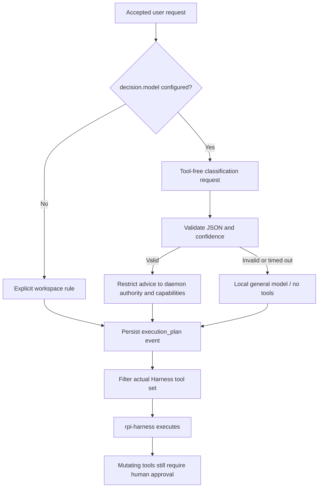

# Models and execution decisions

The Agent embeds the reusable core by default, pins the configured main model and persists `model_route_decision` before the Agent-specific tool plan. See [Reusable decision engine](decision-engine.md) for library/backends and [AI Gateway](gateway.md) for independent serving.

Each run receives an execution plan from `agent-decision` before `agent-runtime` opens `rpi-harness`. A classifier returns advice. It executes no tools and cannot grant permissions.

## How the plan controls execution

Without `decision.model`, the daemon uses an explicit workspace rule: the general model policy, `read_file`, `list_files`, `search_files`, and revision-checked `write_file`, with MCP, browser and trusted-command tools selected by configuration and available runtime capabilities. Configured, actively paired delegation targets can enable distributed execution and `delegate_task`. Workspace path restrictions and per-operation mutation approval still apply. This rule comes from daemon policy; prompt text cannot supply authorization.

When configured, the classifier receives the user request as data. It must return one JSON object containing `task_kind`, `model_policy`, `allowed_tools`, `execution_mode`, `target_hint`, `risk_level` and `confidence`. Unknown fields, invalid enums, wrong types and confidence outside the allowed range are rejected.



The tool set is the intersection of the classifier's selection, authorized tools and available capabilities. Model policies, distributed execution and target nodes are independently constrained by allowlists. Delegation targets must appear in both operator configuration and active pairing records. Local plans do not expose delegation. Classifier output cannot widen tool, model or node authority. See [Delegating to paired nodes](tools.md#delegating-to-paired-nodes) for configuration and approval scope.

The effective plan is persisted as an `execution_plan` event before opening the Harness. It records tools, capabilities, execution mode, risk, confidence, source and `trace_id`. The daemon filters the actual Harness tools against this plan, restricting both model-visible tools and execution. Approval consumption checks the run, tool, full arguments and expiry; a classification never replaces human approval.

Unavailable classifiers, timeout, invalid output, insufficient confidence or missing required capabilities fall back to local execution with the configured main model and no tools or target node. Cancellation during classification persists a cancelled run without calling the main model.

## Remote protocols

| `provider` | Protocol | Credential |
| --- | --- | --- |
| `openai`, `openai-responses` | OpenAI Responses | `OPENAI_API_KEY` |
| `openai-completions` | OpenAI Chat Completions | `OPENAI_API_KEY` |
| `anthropic` | Anthropic Messages | `ANTHROPIC_API_KEY` |

Requests use the actual provider adapter. `openai` aliases Responses; verify which API mode a compatible service supports. `supports_images` is explicit and defaults to false. A model name does not establish image support. Classification requests disable images and tools.

## Configure a classifier

Use `config.toml` in the data directory. Put credentials in its adjacent `.env` or the process environment:

```toml
provider = "openai"
model = "gpt-4.1"
supports_images = false

[decision]
model = "classifier-model-id"
provider = "openai-completions"
api_base = "https://models.example.com/v1"
timeout_ms = 3000
minimum_confidence = 0.75
```

The classifier model ID and domain are examples. Replace them with the service's actual model and endpoint. Omit `[decision]` to use the workspace rule.

| Setting | Environment variable | Default and constraint |
| --- | --- | --- |
| `decision.model` | `LYONBROWN_DECISION_MODEL` | Unset; must be nonempty when set |
| `decision.provider` | `LYONBROWN_DECISION_PROVIDER` | Inherits the main provider |
| `decision.api_base` | `LYONBROWN_DECISION_API_BASE` | Inherits the main endpoint for the same provider; otherwise uses the selected provider's default |
| `decision.timeout_ms` | `LYONBROWN_DECISION_TIMEOUT_MS` | `3000`; accepts `1..=60000` milliseconds |
| `decision.minimum_confidence` | `LYONBROWN_DECISION_MINIMUM_CONFIDENCE` | `0.75`; accepts `0..=1` |

## Local inference boundary

`agent-inference` adapts `llama-cpp-2` and `mistral.rs`. Both generate model output; the same `rpi-harness` retains session and loop ownership. The daemon loads configured local files into its registry before becoming ready. Load failure prevents startup without downloading models or falling back to a cloud provider.

```toml
provider = "local"
model = "local-main"

[[local_models]]
id = "local-main"
backend = "llama"
format = "gguf"
path = "/absolute/path/to/chat-model.gguf"
context_window = 4096
max_output_tokens = 512
parallel_requests = 1
max_model_bytes = 8589934592
```

Replace the example path with an existing local model. Windows requires a native absolute path. Build `agentd` with `local-llama` for `llama`, or `local-mistral` for `mistral`. Llama reads GGUF; Mistral accepts `gguf` or `directory`. The selected engine must support the actual model architecture and quantization; a matching extension alone does not establish compatibility.

Profiles explicitly select CPU execution without implicit GPU allocation. `max_model_bytes` bounds input file size, rather than runtime RAM. Context, output tokens and concurrency have separate limits. Each run persists actual metadata in `model_selected`. Text-only backends do not advertise image or tool support; the daemon removes unsupported tools before persisting the effective plan and opening the Harness.

To select a local classifier independently, set `decision.provider = "local"` and point `decision.model` to a configured profile ID. `LocalClassifier` accepts structured output without tool calls and applies the same JSON, confidence, deadline and cancellation checks. Invalid output takes the conservative fallback. A local main model needs no cloud credentials.

See [Development and verification](development.md) for execution and acceptance commands, and [Connect MCP tools](mcp.md) for MCP configuration.

Source references: [decision validation](https://github.com/lyonbrown4d/lyonbrown/blob/main/crates/agent-decision/src/engine.rs), [daemon composition](https://github.com/lyonbrown4d/lyonbrown/blob/main/apps/agentd/src/decision.rs), [execution and persistence](https://github.com/lyonbrown4d/lyonbrown/blob/main/apps/agentd/src/execution.rs), [configuration](https://github.com/lyonbrown4d/lyonbrown/blob/main/crates/agent-config/src/settings.rs).
