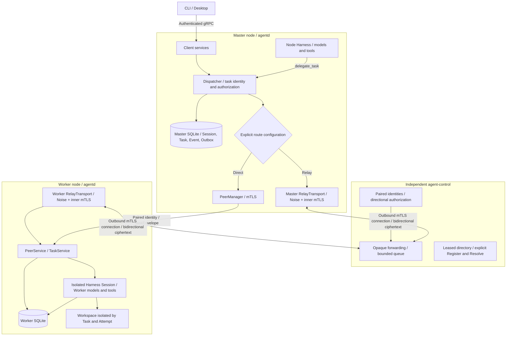
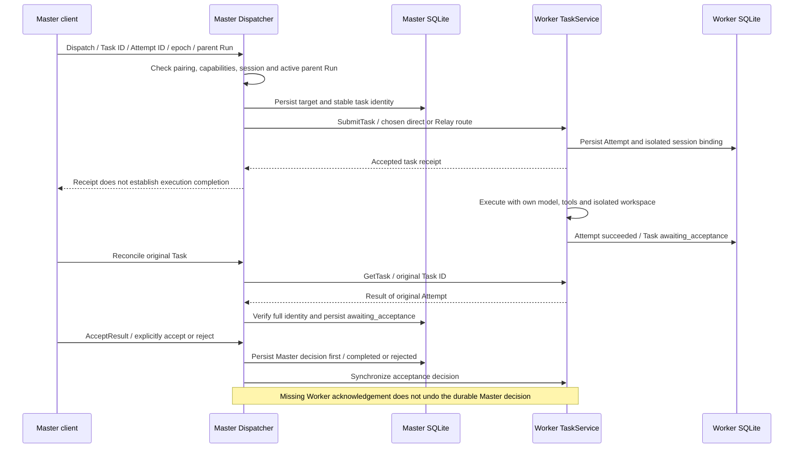

# Connect peers and Control Relay

This page is for operators configuring a Master, Worker and self-hosted `agent-control`. Direct connections and Relay use the same `PeerService`, `TaskService`, pairing and durable task rules. Clients connect to their local Master; daemons establish connections between nodes. See [Components and calls](architecture.md).

## Distributed deployment and trust boundaries

Clients connect to the Master. Daemons dispatch cross-node tasks within paired identity and capability scopes, using separate models, credentials and data directories.



Master and Worker commit separate local SQLite transactions; they share no Session database. Control executes no models or tools and stores no task plaintext. Direct and Relay paths are configured alternatives, not automatic failover channels. Directory APIs are separate; the daemon Relay runtime does not register or renew directory leases automatically.

Source references: [crates/agent-distributed/src/peers.rs](https://github.com/lyonbrown4d/lyonbrown/blob/705f995a59ff69e186f07a035dcb639e43f9d44d/crates/agent-distributed/src/peers.rs), [crates/agent-distributed/src/relay_transport/mod.rs](https://github.com/lyonbrown4d/lyonbrown/blob/705f995a59ff69e186f07a035dcb639e43f9d44d/crates/agent-distributed/src/relay_transport/mod.rs), [apps/agent-control/src/](https://github.com/lyonbrown4d/lyonbrown/blob/705f995a59ff69e186f07a035dcb639e43f9d44d/apps/agent-control/src/).

## Verify identities and permissions

Each daemon has its own data directory and node identity. Its public identity contains a node ID, TLS certificate and Noise public key. Private keys stay in its local `peers/peer-identity.json`. Control has a separate data directory: `identity/peer-identity.json` holds its private identity, while `control.sqlite3` holds trust, directory records and allowed links. Exchange only public JSON exported by the identity commands below; do not copy private identity files.

Before pairing, compare the complete pairing fingerprint over an independent trusted channel. It binds the node ID, TLS certificate fingerprint and Noise public key. A certificate-only fingerprint cannot authorize the independent Noise identity. Pairing is a local human action: network `Pair` requests are denied, and mDNS candidates neither establish trust nor select routes.

Run commands from the repository root, replacing example directories with actual absolute paths. Daemon maintenance commands require exclusive access to their data directory. Stop the corresponding daemon safely before maintenance, then restart its listener to reload mTLS trust roots. Initial identity export does not require a peer listener.

```sh
cargo run -p agentd -- --data-dir /path/to/master peer-identity > master-public.json
cargo run -p agentd -- --data-dir /path/to/worker peer-identity > worker-public.json
```

Public JSON goes to stdout; the complete pairing fingerprint goes to stderr. Replace the fingerprint placeholders only after independent verification:

```sh
cargo run -p agentd -- --data-dir /path/to/worker peer-pair \
  --identity master-public.json --fingerprint '<verified-master-fingerprint>' \
  --capabilities tasks.submit,tasks.read,tasks.cancel,tasks.accept,workspace.read,workspace.write.approval
cargo run -p agentd -- --data-dir /path/to/master peer-pair \
  --identity worker-public.json --fingerprint '<verified-worker-fingerprint>' \
  --capabilities workspace.read,workspace.write.approval
```

The receiving node's trust record governs permissions. On the Worker, `tasks.submit`, `tasks.read`, `tasks.cancel` and `tasks.accept` allow the Master to submit, query/watch, cancel and accept results respectively. Submission also requires the Master's trust scope to include every requested task capability. This example permits reads and writes requiring approval; for read-only work, remove `workspace.write.approval` from both the pairing and task scopes. Pairing the Worker on the Master verifies the Worker's identity without granting it reverse task-submission permission.

## Configure direct connections

Add this section to each daemon's `config.toml` in its data directory:

```toml
[peer]
listen = "0.0.0.0:7448"
advertise_url = "https://worker.example.test:7448"
mdns = false
```

Use each node's own reachable address. The listen port must be nonzero. `advertise_url` must be an HTTPS origin using that port, without credentials, a path, query, fragment or wildcard hostname. Unspecified addresses `0.0.0.0` / `::` cannot be advertised. Without `[peer]`, no peer listener starts. Pair at least one node before starting an mTLS listener.

Keep the local client listener on loopback; do not expose the default client endpoint `127.0.0.1:7447` publicly. The separate peer listener provides mTLS node and task services. TLS verifies the paired certificate and node-derived server name; `Hello` then checks the node ID, certificate fingerprint and protocol range.

See [Run locally](quickstart.md) for daemon configuration precedence. Peer settings support `LYONBROWN_PEER_LISTEN`, `LYONBROWN_PEER_ADVERTISE_URL` and `LYONBROWN_PEER_MDNS`. `mdns` defaults to `false`; enabling it still requires human pairing and an explicit target.

## Configure outbound Relay

Both Master and Worker initiate connections to Control's HTTPS listener. Neither needs direct access to the other's peer TCP port. Both still require `[peer]` and bind its local port at startup. For Relay-only operation, `listen` may use loopback; `advertise_url` must still satisfy peer URL validation.

Export Control's public identity:

```sh
cargo run -p agent-control -- --data-dir /path/to/control identity > control-public.json
```

Import its verified identity on both daemons. The explicit `control.relay` scope does not replace pairing between Master and Worker:

```sh
cargo run -p agentd -- --data-dir /path/to/master peer-pair \
  --identity control-public.json --fingerprint '<verified-control-fingerprint>' \
  --capabilities control.relay
cargo run -p agentd -- --data-dir /path/to/worker peer-pair \
  --identity control-public.json --fingerprint '<verified-control-fingerprint>' \
  --capabilities control.relay
```

Import both public identities on Control and authorize both directions:

```sh
cargo run -p agent-control -- --data-dir /path/to/control pair master-public.json \
  --pairing-fingerprint '<verified-master-fingerprint>'
cargo run -p agent-control -- --data-dir /path/to/control pair worker-public.json \
  --pairing-fingerprint '<verified-worker-fingerprint>'
cargo run -p agent-control -- --data-dir /path/to/control allow '<master-node-id>' '<worker-node-id>'
cargo run -p agent-control -- --data-dir /path/to/control allow '<worker-node-id>' '<master-node-id>'
```

Control's `pair` grants `control.register`, `control.resolve` and `control.relay`. `allow` authorizes one direction only; responses require the reverse direction. Restart Control's listener after pairing to load its trust roots.

Add this section to the Master's `config.toml`; on the Worker, set `routes` to the Master's node ID. IDs come from public identity JSON, not directory names or invented display names.

```toml
[relay]
control_node_id = "control"
endpoint = "https://control.example.test:7449"
routes = ["<worker-node-id>"]
```

`routes` requires 1–32 distinct IDs, excluding Control and the local node. Control and route IDs allow 1–128 ASCII letters, digits, `-`, `_`, `:` and `.`. The Relay endpoint must be an HTTPS origin without credentials, a path, query or fragment. Relay settings come from TOML; there are no dedicated Relay environment variables or CLI flags.

Nodes in `routes` always use Relay; other nodes use direct connections. Once Relay is selected, disconnection or authentication failure returns an error without falling back to a direct route. Task commands still require the Worker's HTTPS `--node-endpoint` for the same inner mTLS connection; do not replace it with Control's address.

Control reads `control.toml` from its data directory by default; `--config` selects another file. For example:

```toml
node_id = "control"
listen = "0.0.0.0:7449"
lease_seconds = 60
queue_capacity = 32
log_directory = "logs"
log_retention = 14
log_filter = "info"
```

Precedence is defaults, TOML, `.env` beside the configuration file, process environment, then `--listen`. Environment aliases are `LYONBROWN_CONTROL_NODE_ID`, `LYONBROWN_CONTROL_LISTEN`, `LYONBROWN_CONTROL_LEASE_SECONDS`, `LYONBROWN_CONTROL_QUEUE_CAPACITY`, `LYONBROWN_CONTROL_LOG_DIRECTORY`, `LYONBROWN_CONTROL_LOG_RETENTION` and `LYONBROWN_CONTROL_LOG_FILTER`. The default listener is `127.0.0.1:7449`. Directory leases allow 1–3600 seconds, queue capacity 1–1024 and retained log files 1–365. Relative log directories resolve against Control's data directory.

Alternatively, manage links with `allowed_links = []` or `[[allowed_links]]` entries containing `source` and `target` in `control.toml`. When this field is present, `serve` atomically replaces the entire persisted allow graph at startup. Omitting it preserves links written by `allow` / `deny`.

```sh
cargo run -p agent-control -- --data-dir /path/to/control serve
cargo run -p agentd -- --data-dir /path/to/master
cargo run -p agentd -- --data-dir /path/to/worker
```

Run these in separate terminals or on their respective nodes. Control authenticates outbound streams with mTLS and checks directional permissions. Noise IK authenticates the end-to-end tunnel using paired public keys; ordinary mTLS and `TaskService` run inside that tunnel. Control sees source/target IDs, link identifiers and ciphertext sizes. It receives no task plaintext and executes no models or tools. Queues are bounded and are not durable task queues; successful enqueueing does not confirm Worker execution.

`ControlService` exposes leased `Register` / `Resolve` operations, but the daemon's Relay runtime only opens an outbound stream. It does not automatically register, renew leases or resolve directory entries. These explicit routes do not depend on directory registration; directory records cannot establish pairing trust.

## Dispatch, approvals and recovery

Manage tasks through the CLI connected to the Master. First create a Master session and start a run; dispatch requires `--parent-run` to identify a run in that session with status `running`. Preserve preselected UUIDs for the Task and Attempt, plus a stable idempotency key.

```sh
cargo run -p agent-cli -- --data-dir /path/to/master task dispatch \
  --node-id '<worker-node-id>' --node-endpoint https://worker.example.test:7448 \
  --session '<session-id>' --parent-run '<active-run-id>' \
  --task-id '<task-uuid>' --attempt-id '<attempt-uuid>' \
  --idempotency-key '<stable-key>' --instructions 'Inspect the assigned workspace' \
  --capability workspace.read --deadline-seconds 3600
```

The deadline allows 1–86400 seconds. The Worker uses its own model, credentials and Harness, creating an isolated workspace and session under `worker-workspaces/<task_id>/<attempt_id>`. It does not copy the Master's session history or workspace files. Task capabilities can only reduce the Worker's available tools. Writes still require local approval on the Worker through a client connected to that Worker; Relay and Master result acceptance cannot bypass tool approval.

A successful Worker attempt leaves the Task `awaiting_acceptance`. Explicit Master acceptance makes it `completed`:

```sh
cargo run -p agent-cli -- --data-dir /path/to/master task get '<task-uuid>'
cargo run -p agent-cli -- --data-dir /path/to/master task reconcile '<task-uuid>' \
  --node-id '<worker-node-id>' --node-endpoint https://worker.example.test:7448
cargo run -p agent-cli -- --data-dir /path/to/master task accept '<task-uuid>' \
  --node-id '<worker-node-id>' --node-endpoint https://worker.example.test:7448 --accepted true
```

`task list --session <session-id>` pages through Master's records. `task cancel` takes the same target arguments as `reconcile`. Reject results with `task accept … --accepted false`.

After disconnects, timeouts or lost cancellation responses, retain the original Task, Attempt, key and target. Use `get` for local state and `reconcile` to check that same remote attempt. The Master persists unknown attempt outcomes as `uncertain`. Relay reconnection restores transport without automatically reconciling business state or replaying requests. Do not dispatch fresh identities to bypass an unknown outcome. On restart, the Worker also marks unfinished attempts uncertain without re-executing them. See [Sessions, tasks and recovery](persistence.md).

## Task dispatch, Attempt completion and result acceptance

Execution success and result acceptance are stored separately. A transport receipt, Worker Attempt result and final Master decision establish different facts.



This trace shows a task that reached the Worker. If submission or cancellation acknowledgement is lost, the Master retains the original Task, Attempt and target, records an unknown outcome as `uncertain`, and reconciles the same attempt without automatic execution replay. Worker writes still require Worker-local approval; Master acceptance does not replace it.

Source references: [crates/agent-distributed/src/dispatcher.rs](https://github.com/lyonbrown4d/lyonbrown/blob/705f995a59ff69e186f07a035dcb639e43f9d44d/crates/agent-distributed/src/dispatcher.rs), [crates/agent-distributed/src/worker.rs](https://github.com/lyonbrown4d/lyonbrown/blob/705f995a59ff69e186f07a035dcb639e43f9d44d/crates/agent-distributed/src/worker.rs), [crates/agent-distributed/src/worker_run.rs](https://github.com/lyonbrown4d/lyonbrown/blob/705f995a59ff69e186f07a035dcb639e43f9d44d/crates/agent-distributed/src/worker_run.rs).

## Revoke access and investigate failures

- Deny one direction with `agent-control --data-dir /path/to/control deny <source> <target>`. Deny both directions for bidirectional isolation. If `allowed_links` is configured, update it too so restart does not restore the old graph.
- Revoke a node on Control with `agent-control --data-dir /path/to/control revoke <node-id>`. Active streams recheck trust; restart the listener to remove its old CA root.
- Revoke a daemon's paired identity by stopping that daemon, running `agentd --data-dir /path/to/node peer-revoke --node-id <node-id>`, then restarting its listener. Identity rotation requires another export, independent verification and pairing on the relevant receivers.
- For mTLS failures, check public identities, complete pairing fingerprints, trust on both ends and listener restarts. Keep identity verification enabled.
- For Relay failures, check both outbound streams, both route sets, Control's bidirectional links and paired identities. `target has no active outbound relay stream` means no active target stream; backpressure errors mean a bounded queue could not accept data in time.
- Inspect structured logs in each data directory for `control.listen`, `control.relay`, `relay.transport` and task IDs. Do not include tokens, private keys or full task plaintext in diagnostic material.

## Sources and verification scope

This page was checked against the current workspace's `apps/agentd/src/peers/`, `apps/agent-cli/src/task_command.rs`, `apps/agent-control/src/`, `crates/agent-config/src/{peer,relay}.rs` and `crates/agent-distributed/src/`. `apps/agent-control/tests/relay_tasks.rs` defines local real mTLS / Noise relay tests covering the Worker Harness, isolated workspaces, result acceptance and reconciliation of the same attempt after disconnection. Standard model protocols use a local mock server without paid model calls.

Test definitions and documentation builds do not establish public deployment, cross-device networking or acceptance on all three platforms. See [Desktop screenshots and acceptance scope](runtime-evidence.md) for the scope of runtime evidence. Commands and configuration here were checked against source; they are not a deployment execution record.
