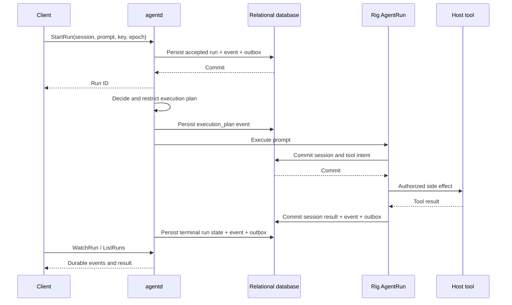
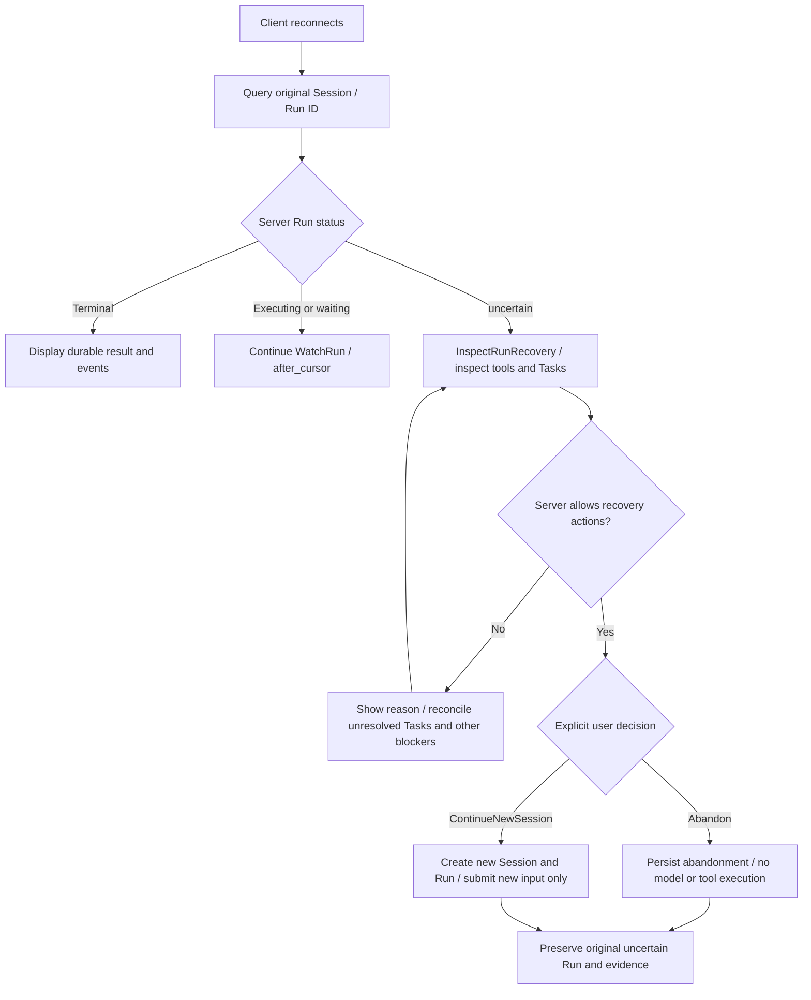
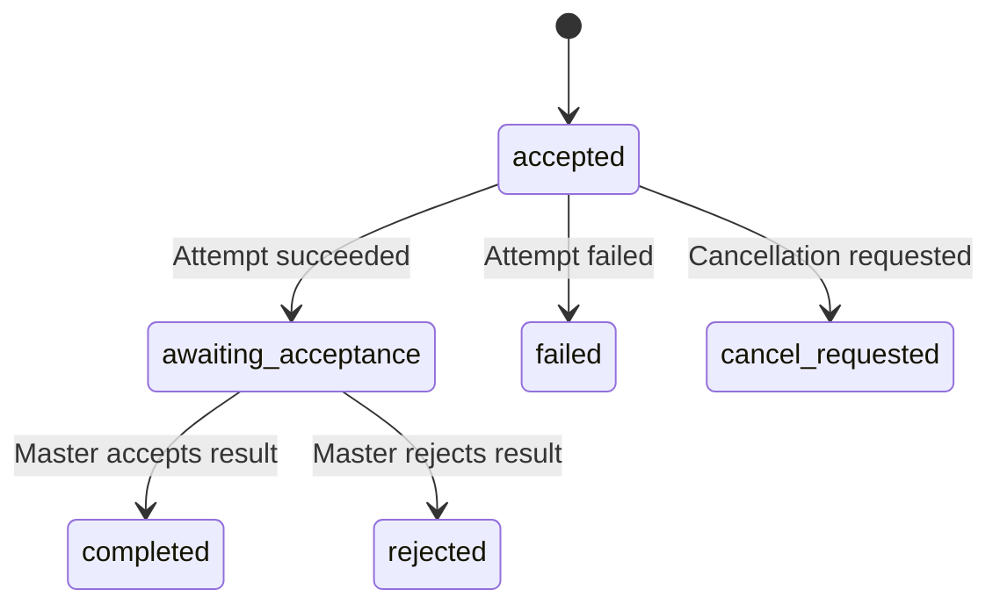

# Sessions, tasks and recovery

Sessions preserve the Runtime semantics needed to continue a conversation. Run records preserve orchestration state for individual user requests. The relational database stores these separately and writes events and Outbox records alongside critical changes. Local SQLite is the default; the daemon can also select PostgreSQL or MySQL.

## Databases and asynchronous transactions

`agent-storage` uses pinned SeaORM 2.0.4 and native asynchronous SQLx connections. `Store::open`, `Store::connect` and read/write APIs are asynchronous; relational I/O uses no blocking-task wrapper, hidden runtime or synchronous facade. SQLite uses WAL, full synchronous writes, a five-second busy timeout and a one-connection pool.

The default file is `agent.sqlite3` inside the daemon data directory. Select `sqlite:`, `postgres:` / `postgresql:` or `mysql:` through `--database-url`, `LYONBROWN_DATABASE_URL` or TOML `database_url`. Keep credential-bearing URLs in a restricted local dotenv file or process environment, outside the repository, command history and UI models. The data directory still owns node identity, authentication files and local ownership information; using a remote database does not remove those requirements.

Critical writes share a `DatabaseTransaction`. A dedicated write-lock record is updated before revision, Session ownership and owner-epoch checks, and state, events and Outbox commit together. Non-MySQL backends additionally use the `one_active_run` partial unique index. MySQL enforces active-run admission through checks under the same transactional write exclusion. Driver integration does not establish runtime acceptance for all three databases or multiple nodes. Each database requires exclusive ownership by one logical daemon; multi-daemon consumption and recovery against a shared database are unsupported.

Versioned Rust SeaORM migrations create and track the current initial schema. There is no legacy Diesel import, compatibility upgrade or automatic database reset. Historical databases are not substitutes for runtime acceptance of the new schema. See `crates/agent-storage/src/lib.rs`, `migration.rs` and `migration/`. [Long-term memory](memory.md) uses the same relational database for content and indexing jobs, with an independently selected vector backend.

## Submission and execution

`accept_run` checks `owner_epoch` and deduplicates by `(session_id, idempotency_key)`. Repeating the same key and prompt returns the existing run; using a different prompt with that key fails. Transactional admission checks and backend-specific constraints prevent multiple unresolved runs within one session.

The runtime delegates tools to host adapters, which own authorization, workspace confinement and cancellation. Runtime provider retries are disabled; retry policy belongs to durable orchestration. Recording intent before a side effect allows recovery to distinguish unexecuted work from unknown outcomes.

## Images in snapshots and events

Versioned Runtime snapshots retain the Session ID, Rig message history, active AgentRun and prepared request, steering messages, unfinished tools, input queue and uncertainty. Rig's native message serialization preserves images for session restoration. Snapshots are execution state rather than client event payloads.

Durable mutation events contain only allowlisted metadata, such as run IDs, call IDs and tool names, and explicit public events. They never copy complete Rig raw responses, messages or images. Store, Outbox and `WatchRun` use the same event payload. Adapters remain responsible for authorization and redaction of tool arguments, custom business data and credentials.

Runtime can restore serialized image messages. Clients use `StartRunWithAttachments` for images while `StartRun` accepts text. Media and Run admission commit in one transaction, and the model must declare image support. See [image input and limits](agent-workflows.md#attach-images). Compilation, tests and image-restoration runtime acceptance were not run in this iteration.

## Disconnection and restart

After reconnecting, query runs in the original session. Events are ordered by run ID and `cursor`; `WatchRun.after_cursor` requests later events. A disconnected stream does not establish task failure and must not trigger prompt replay.

The store's `recover_interrupted` marks executing records without a durable terminal result as `uncertain`. Accepted work that has not started is handled separately from work already executing. Runtime recovery checks unfinished Runtime tool records: a missing committed tool result produces `Uncertain` instead of guessing whether the side effect happened.

The same recovery transaction changes the run's `pending` approvals to `cancelled` and writes `approval_closed`, `run_uncertain` events and Outbox entries. If any write fails, these state and event changes roll back together; repeated recovery creates no additional records. Closing an old approval neither resolves an unknown run outcome nor authorizes tool replay.

An `uncertain` run remains unresolved. Starting another run in the same session cannot bypass it. Preserve the database, events and external operation evidence, then reconcile the actual outcome before choosing the next action. The current protocol has no general-purpose endpoint for manually changing terminal state.

## Choosing the next action after reconnecting

Reconnection restores queries and event subscriptions only. Recovery actions follow the server-provided `allowed_actions`; closed approvals or restored transport do not authorize execution replay.

Source references: [apps/agentd/src/recovery.rs](https://github.com/lyonbrown4d/lyonbrown/blob/705f995a59ff69e186f07a035dcb639e43f9d44d/apps/agentd/src/recovery.rs), [crates/agent-storage/src/runs.rs](https://github.com/lyonbrown4d/lyonbrown/blob/705f995a59ff69e186f07a035dcb639e43f9d44d/crates/agent-storage/src/runs.rs).

## Approvals

An approval records the tool, arguments, owning run and expiry. `decide_approval` accepts only unexpired requests whose run is still awaiting approval. Consumption rechecks the run, tool and arguments and changes the approval to `consumed`, preventing reuse of the same authorization.

## Master and worker

TaskStore checks `attempt_id` and `owner_epoch` when updating worker attempts or accepting results. A successful attempt first enters `awaiting_acceptance`; a task becomes `completed` only after explicit result acceptance.

Worker startup recovery marks only `accepted` or `running` attempts whose persisted dispatch target is the local node as `uncertain`, preserving ownership checks. Master records dispatched to other nodes and generic tasks without a target remain unchanged. This routine neither transfers Master ownership nor replays attempts.

This diagram describes storage state boundaries. It does not establish cross-device scheduling, network-partition or public-relay acceptance. Source references: `crates/agent-storage/src/runs.rs`, `tasks.rs`, `approvals.rs` and `crates/agent-runtime/src/runtime.rs`.
