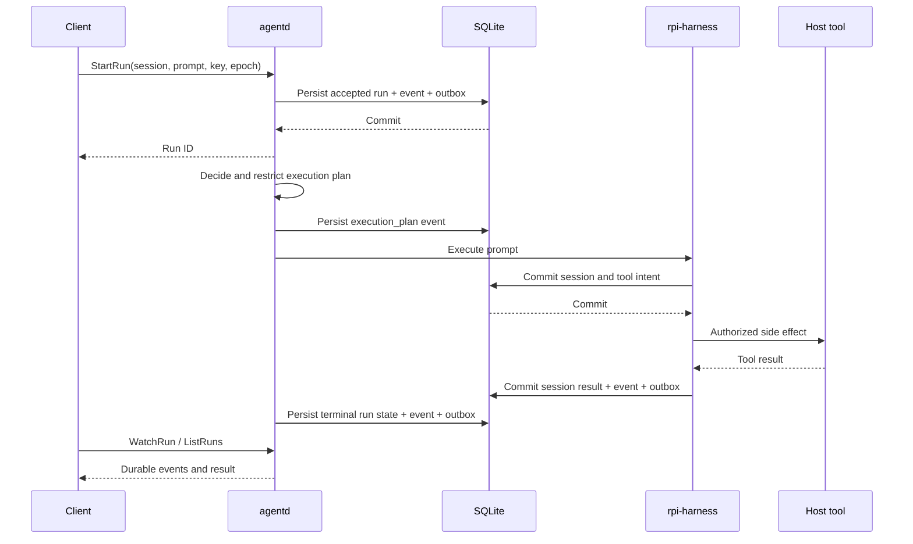
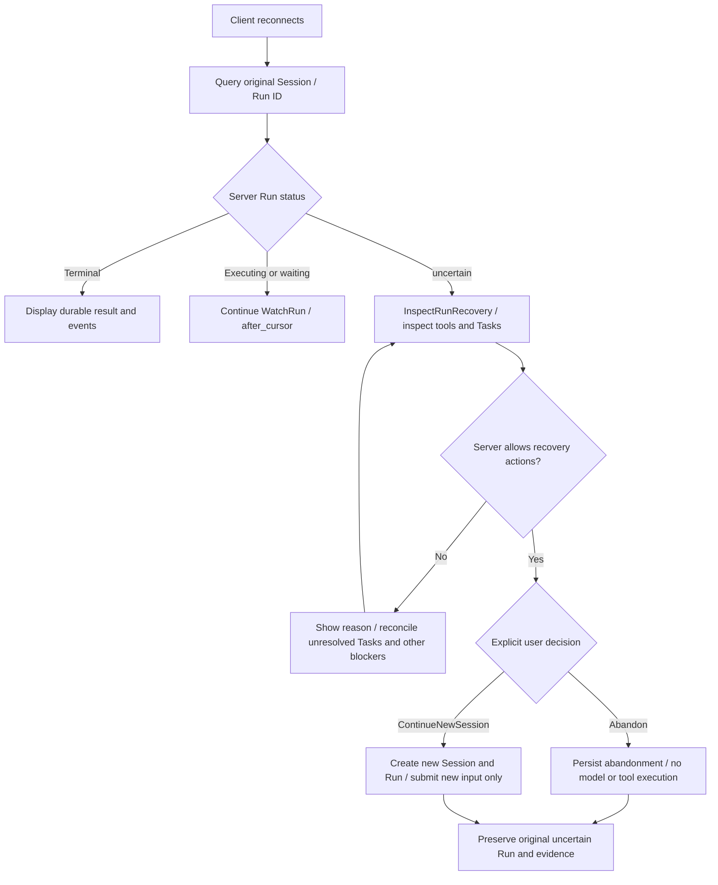
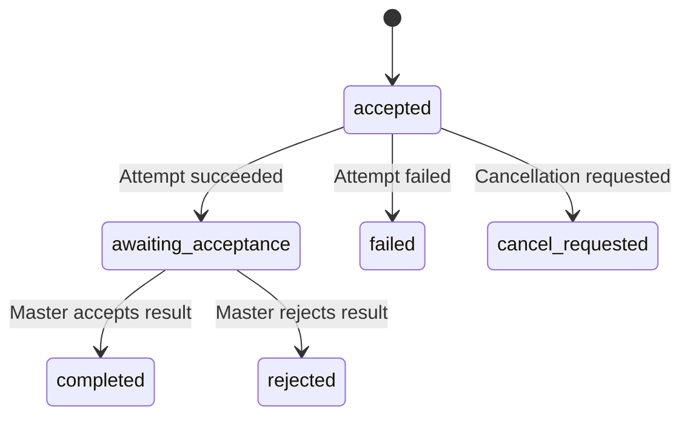

# Sessions, tasks and recovery

Sessions preserve the Harness semantics needed to continue a conversation. Run records preserve orchestration state for individual user requests. SQLite stores these separately and writes events and outbox records alongside critical changes.

## Submission and execution

`accept_run` checks `owner_epoch` and deduplicates by `(session_id, idempotency_key)`. Repeating the same key and prompt returns the existing run; using a different prompt with that key fails. The `one_active_run` unique index prevents multiple unresolved runs within one session.

The runtime delegates tools to host adapters, which own authorization, workspace confinement and cancellation. Harness provider retries are disabled; retry policy belongs to durable orchestration. Recording intent before a side effect allows recovery to distinguish unexecuted work from unknown outcomes.

## Images in snapshots and events

Harness snapshots retain original message content. The separate `entry_appended` and `record_appended` projections retain only `type`, `mimeType`, `dataRedacted` and `encodedBytes` for image blocks, without Base64 content. `encodedBytes` is the byte length of the original Base64 string. This applies to tool results, compaction tails, execution intents, queued messages and stream-start messages. Store, Outbox and `WatchRun` carry the same projected payload. Projection happens when Runtime commits new events; reading existing events does not recompute their payloads.

Projection follows known message schemas rather than recursively removing arbitrary JSON `data` fields. Tool arguments and custom business data remain the responsibility of their adapters. Unrecognized queue payloads or frames expose only a `projectionOmitted` marker. Input-image Debug output includes only MIME and length.

Image-bearing session recovery is unavailable. The recovery entry point retains the snapshot and returns an explicit error without calling a model or replaying a request. rpi-ai 0.5.0 emits duplicate `type` keys in raw JSON serialization; see [upstream issue #59](https://github.com/bigfish1913/pi-rust/issues/59). No snapshot normalization workaround is included. The daemon's `StartRun` still accepts text only; internal Runtime image input does not establish client image-session support.

## Disconnection and restart

After reconnecting, query runs in the original session. Events are ordered by run ID and `cursor`; `WatchRun.after_cursor` requests later events. A disconnected stream does not establish task failure and must not trigger prompt replay.

The store's `recover_interrupted` marks executing records without a durable terminal result as `uncertain`. Accepted work that has not started is handled separately from work already executing. Runtime recovery checks unfinished Harness tool records: a missing committed tool result produces `Uncertain` instead of guessing whether the side effect happened.

The same recovery transaction changes the run's `pending` approvals to `cancelled` and writes `approval_closed`, `run_uncertain` events and Outbox entries. If any write fails, these state and event changes roll back together; repeated recovery creates no additional records. Closing an old approval neither resolves an unknown run outcome nor authorizes tool replay.

An `uncertain` run remains unresolved. Starting another run in the same session cannot bypass it. Preserve the database, events and external operation evidence, then reconcile the actual outcome before choosing the next action. The current protocol has no general-purpose endpoint for manually changing terminal state.

## Choosing the next action after reconnecting

Reconnection restores queries and event subscriptions only. Recovery actions follow the server-provided `allowed_actions`; closed approvals or restored transport do not authorize execution replay.

Source references: [apps/agentd/src/recovery.rs](https://github.com/lyonbrown4d/lyonbrown/blob/705f995a59ff69e186f07a035dcb639e43f9d44d/apps/agentd/src/recovery.rs), [crates/agent-storage/src/runs.rs](https://github.com/lyonbrown4d/lyonbrown/blob/705f995a59ff69e186f07a035dcb639e43f9d44d/crates/agent-storage/src/runs.rs).

## Approvals

An approval records the tool, arguments, owning run and expiry. `decide_approval` accepts only unexpired requests whose run is still awaiting approval. Consumption rechecks the run, tool and arguments and changes the approval to `consumed`, preventing reuse of the same authorization.

## Master and worker

TaskStore checks `attempt_id` and `owner_epoch` when updating worker attempts or accepting results. A successful attempt first enters `awaiting_acceptance`; a task becomes `completed` only after explicit result acceptance.

Worker startup recovery marks only `accepted` or `running` attempts whose persisted dispatch target is the local node as `uncertain`, preserving ownership checks. Master records dispatched to other nodes and generic tasks without a target remain unchanged. This routine neither transfers Master ownership nor replays attempts.

This diagram describes storage state boundaries. It does not establish cross-device scheduling, network-partition or public-relay acceptance. Source references: `crates/agent-storage/src/runs.rs`, `tasks.rs`, `approvals.rs` and `crates/agent-runtime/src/runtime.rs`.
