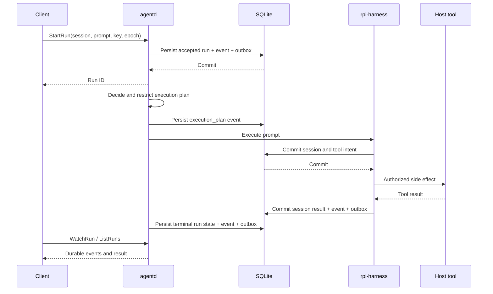
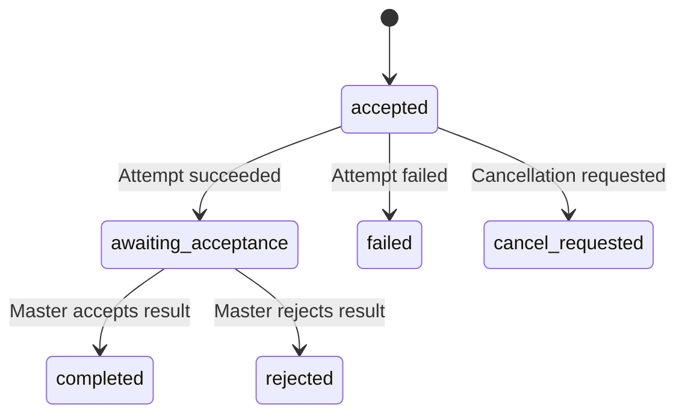

# Sessions, tasks and recovery

Sessions preserve the Harness semantics needed to continue a conversation. Run records preserve orchestration state for individual user requests. SQLite stores these separately and writes events and outbox records alongside critical changes.

## Submission and execution

`accept_run` checks `owner_epoch` and deduplicates by `(session_id, idempotency_key)`. Repeating the same key and prompt returns the existing run; using a different prompt with that key fails. The `one_active_run` unique index prevents multiple unresolved runs within one session.

The runtime delegates tools to host adapters, which own authorization, workspace confinement and cancellation. Harness provider retries are disabled; retry policy belongs to durable orchestration. Recording intent before a side effect allows recovery to distinguish unexecuted work from unknown outcomes.

## Disconnection and restart

After reconnecting, query runs in the original session. Events are ordered by run ID and `cursor`; `WatchRun.after_cursor` requests later events. A disconnected stream does not establish task failure and must not trigger prompt replay.

The store's `recover_interrupted` marks executing records without a durable terminal result as `uncertain`. Accepted work that has not started is handled separately from work already executing. Runtime recovery checks unfinished Harness tool records: a missing committed tool result produces `Uncertain` instead of guessing whether the side effect happened.

An `uncertain` run remains unresolved. Starting another run in the same session cannot bypass it. Preserve the database, events and external operation evidence, then reconcile the actual outcome before choosing the next action. The current protocol has no general-purpose endpoint for manually changing terminal state.

## Approvals

An approval records the tool, arguments, owning run and expiry. `decide_approval` accepts only unexpired requests whose run is still awaiting approval. Consumption rechecks the run, tool and arguments and changes the approval to `consumed`, preventing reuse of the same authorization.

## Master and worker

TaskStore checks `attempt_id` and `owner_epoch` when updating worker attempts or accepting results. A successful attempt first enters `awaiting_acceptance`; a task becomes `completed` only after explicit result acceptance.

This diagram describes storage state boundaries. It does not establish cross-device scheduling, network-partition or public-relay acceptance. Source references: `crates/agent-storage/src/runs.rs`, `tasks.rs`, `approvals.rs` and `crates/agent-runtime/src/runtime.rs`.
