# Runtime screenshots and acceptance scope

Desktop client screenshots show the local native GPUI Desktop window on macOS 27.0.1, arm64, with GPUI Kit 0.7.3. The workspace locks CEF 154.0.34 (`cef` Rust crate 154.5.0+154.0.34). They record runs of the 0.1.0 native acceptance example, using a local HTTP model fixture through an authenticated connection to a real agentd. The fixture returns synthetic content without paid model calls. The eight images of Settings, conversation, tabs, collapsed panels, approval, Editor and Diff were captured on October 18, 2026. The [native capture record](evidence/desktop-native-capture.json) stores the executable, source and image digests, two Runs persisted as `completed`, and the exact file-write approval persisted as `consumed`. See [the client documentation](clients.md) for Settings, chat tabs and panel toggles.

The browser run used a debug-only Chromium test keychain; it does not establish acceptance of production keychain integration. These images do not establish Windows, Linux, public-network, real-model, native Computer input or final installer acceptance.

## Product-window asynchronous replies and chat drafts

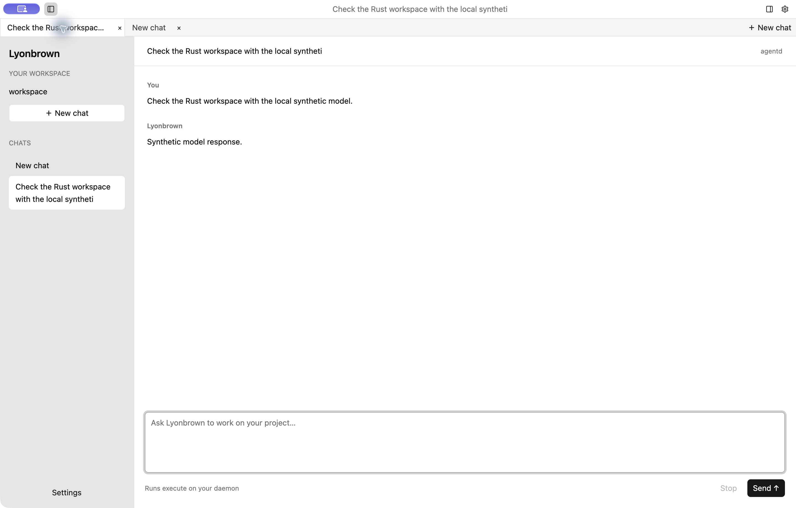

This section records version 0.1.0 product `agent-desktop`, a real agentd and independent loopback `model-mock` on macOS arm64, separately from the native acceptance example above. Desktop authenticated to the daemon with its multithreaded runtime, submitted a synthetic prompt and received `Synthetic model response.`. Switching among chat tabs restored the original conversation while another tab retained `Independent unsent draft` without submitting it. SQLite inspection found 1 Run persisted as `completed`, 20 events and 20 Outbox records. The [runtime record](evidence/desktop-completion-macos.json) contains SHA-256 digests for all three executables, 124 source and build files, and the screenshot.

These operations cover asynchronous reply delivery and tab-draft isolation in the product window. The client used default features without native CEF or Computer SDK support. The synthetic loopback model does not establish real-model quality, performance, browser or computer-control capability, or Windows, Linux, public-network or installer acceptance.

## Settings and native window

The dedicated Settings page shows the connection address, masked access token, workspace and light/dark appearance options. The conversation titlebar does not show the address or token. Native interaction also observed the system macOS window controls and exercised the native zoom action; see the [native capture record](evidence/desktop-native-capture.json).

## Light and dark conversation

The light window shows a synthetic reply streamed through the daemon, the session list and the native composer. The right workbench is closed; this image provides no evidence of a running CEF page.

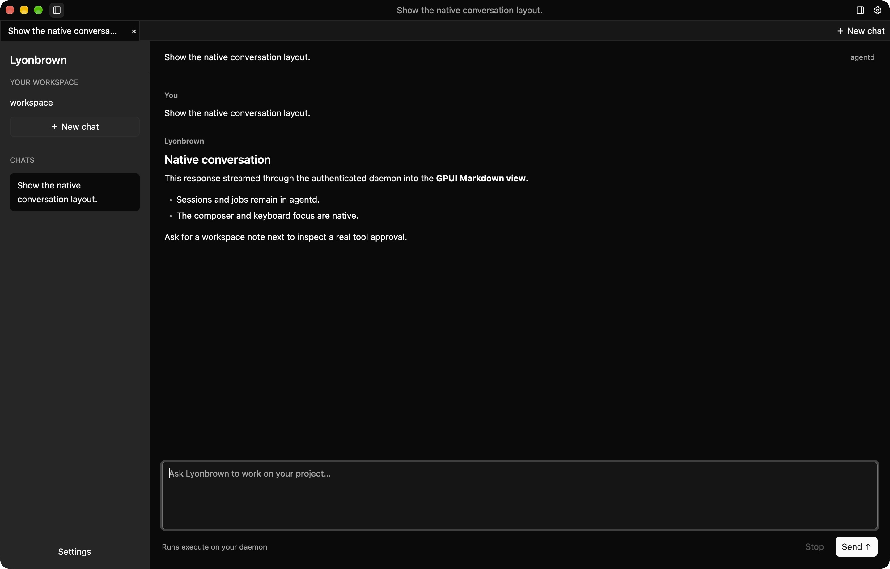

The same session after a manual switch to dark mode. This does not establish automatic synchronization with operating-system theme changes.

## Tabs and panel toggles

Different drafts were entered in two tabs. Returning to the first tab restored `Draft retained in the first tab.` The [native capture record](evidence/desktop-native-capture.json) also records the accessibility observation of `A separate draft in the second tab.` restored in the other tab. Neither draft was submitted to the model.

Native interaction collapsed and expanded each side independently. Both panels are collapsed in this image, while the titlebar retains the buttons that reopen them.

## Approval and file result

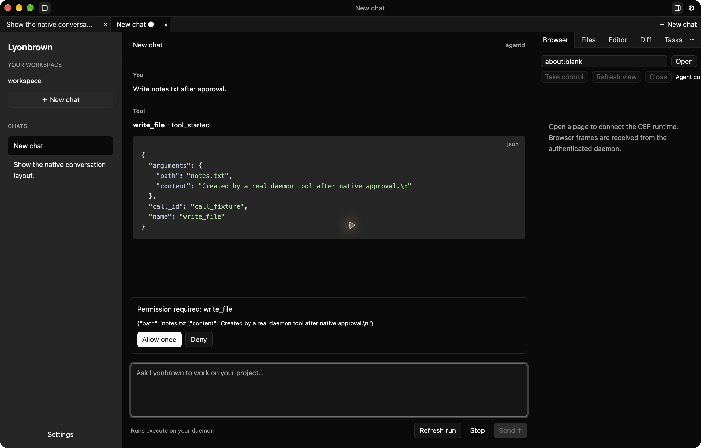

The real daemon requests `write_file` for `notes.txt`. The window shows the exact path and content, with allow-once and deny buttons. This run completed an allow-once decision, with its approval persisted as `consumed` and its Run as `completed`; the screenshot records the state before approval.

After approval, Editor reads `notes.txt` through the daemon workspace interface and displays the actual written content. This image records file reading; separate component tests cover saving and conflict handling.

## Git diff

The acceptance workspace commits the original `README.md`, then modifies its tracked content. After connecting to the daemon, creating a session and refreshing Diff, the panel displays the actual Git patch in dark mode: it removes `Original tracked content.` and adds `A real change for the native Diff workbench.` The conversation on the left comes from the local model fixture in the same native-window run. This image records the unified diff view; no patch content was inserted manually.

The [capture record](evidence/desktop-diff-capture.json) includes executable and image digests, the actual patch and the Run identifier persisted as `completed`. The version 0.1.0 acceptance executable uses production native views and a local fixture; this image is separate from final installer acceptance.

## Embedded browser and human takeover

These two browser images share a separate native acceptance build, outside the build-digest scope of the eight images above. The [browser capture record](evidence/desktop-browser-capture.json) contains executable, source and image digests, the completed Run, and persisted Space open, takeover, release and close results.

The CEF runtime loads a local static acceptance page and sends actual Chromium pixel frames through the daemon to the Browser panel. Agent control presents a read-only view.

Selecting Take control enters Human control. Native input entered `Native takeover verified`, followed by a page button click that displayed `Click reached real Chromium.`. Selecting Dark in Settings and returning to the chat retained both results, as shown above. Control was then returned to the agent and the Space closed. These images use the debug test keychain.

The address field retains navigation input; it is not a trusted display of the committed page origin after redirects. These images cover human browser interaction. Separate autonomous native-CEF acceptance uses an isolated synthetic page; see [Local tools and browser actions](tools.md).

A separate GPUI component test used the real daemon and CEF to verify pixel frames, pointer coordinates, text input, input rejection after releasing takeover, and Space closure. It used GPUI's test window and the debug acceptance executable's test keychain. This checks component calls and actual Chromium behavior separately from the native-window screenshots above.

The [separate check](evidence/browser-production-probe.json) of the packaged release CLI entry on October 19, 2026 initially failed: CEF started and returned frames and AX, but the target page stayed at `about:blank` during the wait. The same executable then passed the complete case three consecutive times with fresh profiles, checking target-page AX and frames, semantic fill and click, pointer focus and committed text, profile isolation and persistence across restart. These rechecks used the production entry with `fixture_keychain=false`; no product code changed between runs. The initial failure remains unexplained. Subsequent passes do not establish its resolution, clean-account Keychain authorization or installer lifecycle acceptance.

## Native Computer targets and session binding

These images were captured on October 19, 2026 using a separate GPUI acceptance executable with `native-computer` enabled. After the user granted screen recording and Accessibility permissions to this test app in macOS Settings, the Computer pane discovered targets and explicitly attached the acceptance window to an authenticated daemon session.

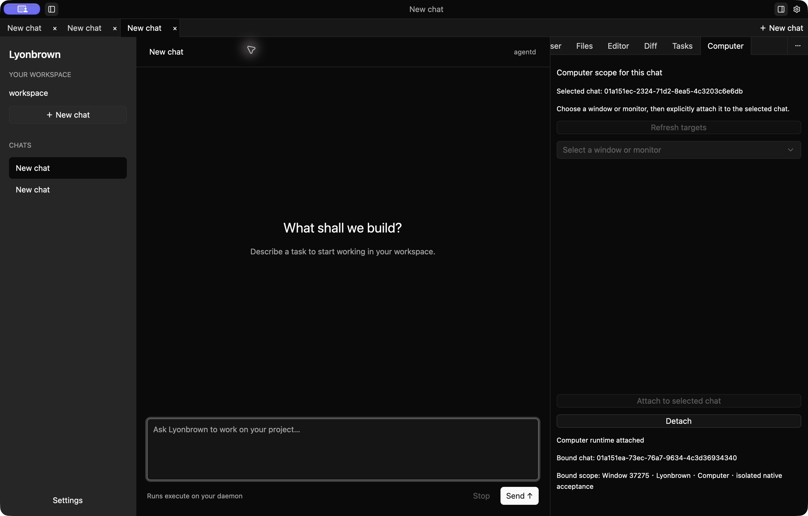

In the second image, Selected chat differs from Bound chat; the original window remains bound to the original session. An actual Detach then restored detached status and cleared the bound session and scope. The [Computer capture record](evidence/desktop-computer-capture.json) includes executable, relevant source and image digests. The isolated database contains two sessions and no Runs, approvals or operations. This verifies target discovery, attachment, chat isolation and detachment only. No Harness screen observation or native input was requested. Actual lock/unlock and user switching remain unverified.

## Actual terminal run records

These images come from an actual `agent-cli` process in an isolated 140-column, 38-row PTY on macOS. It authenticated to the local daemon, created a session, received streamed replies and approved the exact `notes.txt` write using `Ctrl+Y`. The second Run reached `completed`; exiting restored terminal state.

pyte 0.8.2 parsed the recorded ANSI output for terminal-state rendering. **These are not screenshots of an operating-system Terminal window.** Session, reply and approval content were not inserted manually. Synthetic replies reuse the Desktop fixture; references to GPUI, Files and Diff do not imply that those desktop panels exist in the TUI.

Inspect the [approval text](evidence/tui-pty-approval.txt), [completed text](evidence/tui-pty-completed.txt) and [capture metadata](evidence/tui-pty-capture.json). They establish this PTY workflow, without replacing native-terminal font, color or input-method acceptance.

## macOS package-content checks

The 0.1.0 ARM64 release build completed on macOS 27.0.1. Client builds enable `native-cef` and `native-computer`; agentd includes both `local-llama` and `local-mistral` CPU inference adapters. The [package verification record](evidence/native-packages-macos.json) lists build features, executable and packaging-tool digests, and the sizes and SHA-256 hashes of five artifacts.

| Format | Artifacts | Checks performed |
| --- | --- | --- |
| PKG | One each for CLI and Desktop | Component metadata, complete app trees, shared agentd, entry links and BOM inventories |
| tar.gz | One each for CLI and Desktop | Final archive entries match staging types, modes, contents and links |
| DMG | One for Desktop | Read-only mounted app tree matches staging; image detached afterward |

Each client's five Helpers match its main executable digest, and all 232 CEF files match the pinned SDK. Both PKGs are unsigned and the artifacts are not notarized. These records cover generation and package contents; operating-system installation, native service lifecycle, upgrades and rollback require separate runtime acceptance. See the [local distribution guide](https://github.com/lyonbrown4d/lyonbrown/blob/main/packaging/README.md) for build commands.

## AI Gateway administration and model requests

Captured on October 19, 2026 using a 0.1.0 SSR server and WASM hydration debug build on macOS ARM64. The independent `ai-gateway` connects to local `model-mock` through Rig HTTP transport. Leptos components provide the initial SSR page and hydrated interaction. These light-theme images were captured during actual in-app browser operation.

After signing in with the environment-initialized super-administrator username and password through the actual form, the policy revision was saved as `acceptance-v1`. Shared browser validation rejected invalid JSON, and Reset restored the original policy. Synthetic policy text containing HTML markup survived an SSR reload as text without creating extra page nodes. A subsequent automatic-routing request used the new revision. Logging out revoked the SQLite administration session; visiting the models page again returned to sign-in.

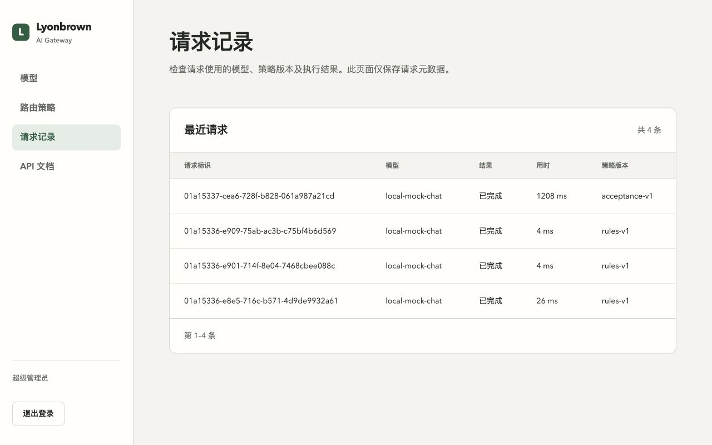

Four synthetic model requests covered explicit-model JSON, automatic-routing JSON, automatic-routing SSE and automatic routing after the policy update. All four SQLite audit records reached Succeeded; the SSE stream included its terminal marker. Additional checks covered API/admin credential separation, unauthenticated rejection and absence of credentials or prompt columns in storage. No paid model was called.

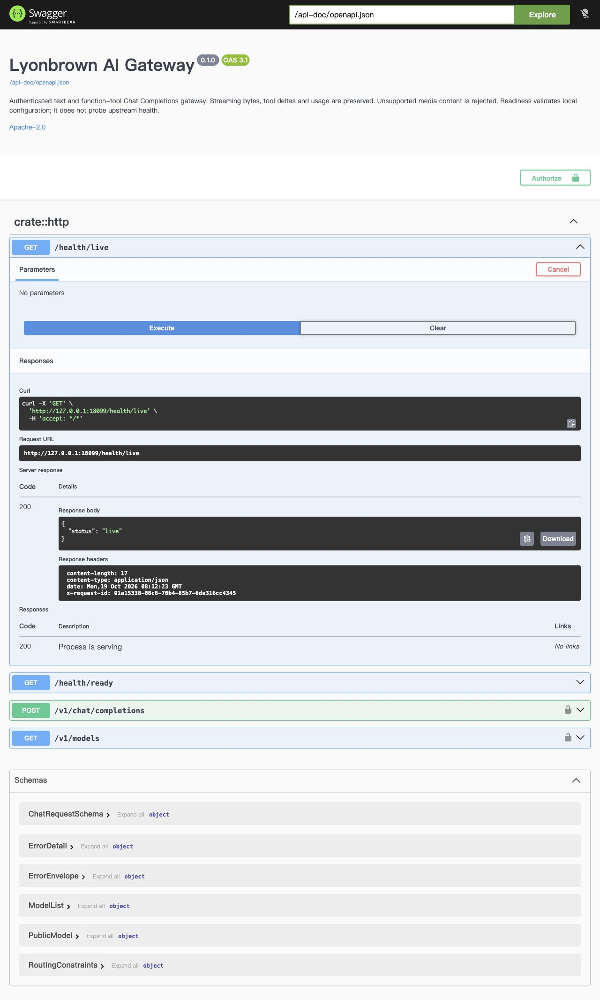

The administration API-documentation link opened Swagger UI with its embedded specification and assets. An actual Try it out health request returned `200` with `status: live`.

The desktop layout was checked at 1280 × 800. The narrow viewport requested 390 × 844; document width after the scrollbar was 380 pixels. The document did not overflow horizontally, and the table scrolled inside its own container. The [runtime record](evidence/gateway-web-macos.json) contains binary, WASM, JavaScript, relevant-source and image hashes plus HTTP and SQLite results. This section does not cover public-network, Windows, Linux or new installer acceptance.

## Gateway existing database and administration interaction

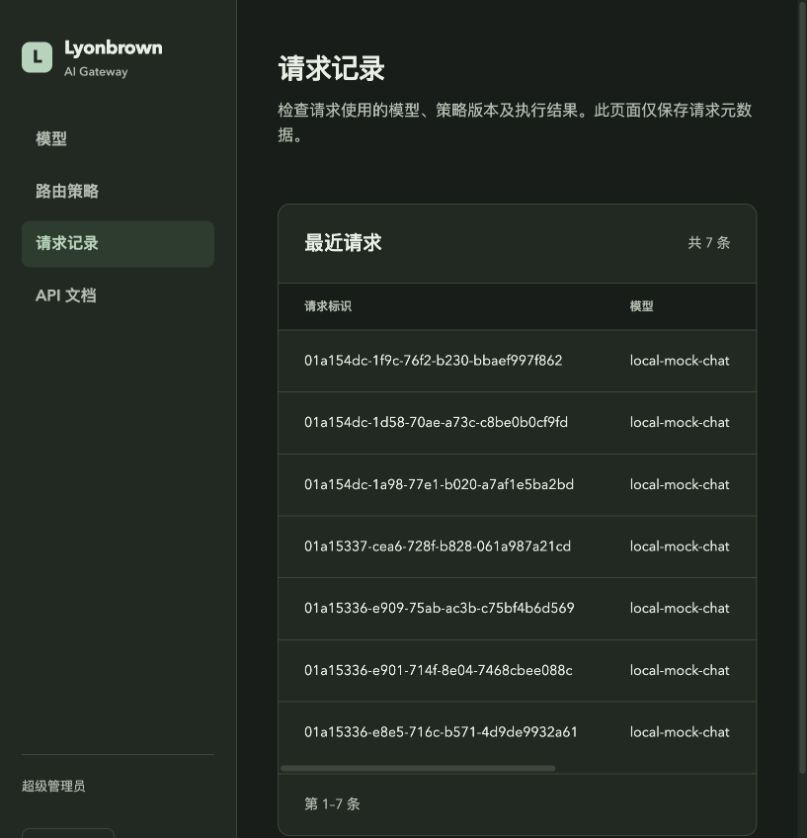

This section uses the version 0.1.0 Gateway SSR/WASM product build and independent loopback `model-mock` on macOS arm64. Startup read a copy of the existing SQLite database, converted legacy versions `[1, 2]` to Diesel versions `["0001", "0002"]` and retired the old ledger, preserving the single super administrator and 4 successful audit records. Three subsequent JSON/SSE requests succeeded, bringing the page and database to 7 successful records.

Actual browser checks covered local WASM rejection of a short password, login with the original account, the request page and logout. After logout, a protected page redirected to login, the database held 0 admin sessions, and the browser console showed no warnings or errors. `POST /v1/models`, `GET /v1/chat/completions`, `POST /health/live` and `DELETE /health/ready` each returned 405 without adding audit records. OpenAPI title and version metadata were preserved.

The [runtime record](evidence/gateway-library-reuse-macos.json) stores these results and SHA-256 digests for two executables, 90 source and build files, browser assets and the screenshot. This section covers only a synthetic loopback model, without paid-model calls or weight loading; it does not establish Windows, Linux, public-network or installer acceptance.

## Capabilities outside this screenshot set

These images do not show model-driven browser semantic actions or native terminal-window presentation. Synthetic-host protocol regressions and actual autonomous CEF acceptance have separate records. See [Local tools and browser actions](tools.md).

## Conversational terminal and inline approval

This section records `agent-cli` 0.1.0 running on macOS arm64 on October 21, 2026. The actual client process authenticated to a local daemon in a 140-column, 36-row PTY and used synthetic HTTP model replies. `vt100` parsed the actual ANSI output, and Pillow rasterized the captured characters, colors and styles. **These are not screenshots of an operating-system Terminal window.** Conversation and approval content were not inserted manually.

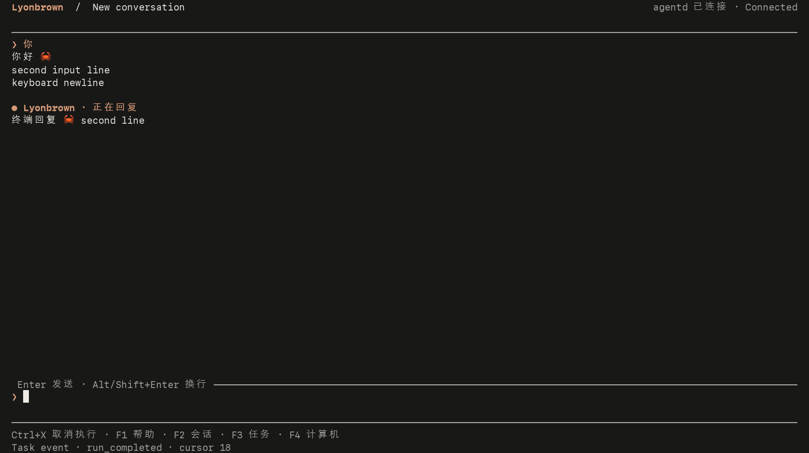

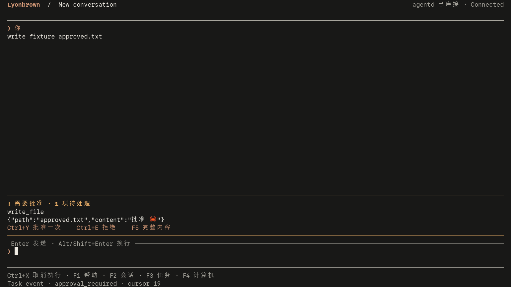

Actual PTY tests passed Chinese and emoji cursor editing, multiline input, viewport resizing, draft retention through disconnection and reconnection, exact file-write approval and denial, execution cancellation, and absence of request replay after reconnect. They also checked persisted approval and run states, absence of the denied file effect, continued daemon execution after client exit, and terminal-state restoration.

Separate `TestBackend` checks cover Markdown colors, narrow-viewport approval controls and the reversed input cursor in light and dark themes; these images show only the dark theme. The [terminal runtime record](evidence/tui-mvvm-macos.json) includes SHA-256 digests for the images, cell captures, corresponding source and dependency files, plus parser, rasterizer and font information. Raw cell captures and process environments are omitted from the public record. This does not establish native terminal-window font or input-method acceptance, or Windows, Linux, public-network, cross-device or installer acceptance.

## Desktop conversation layout and Enter submission

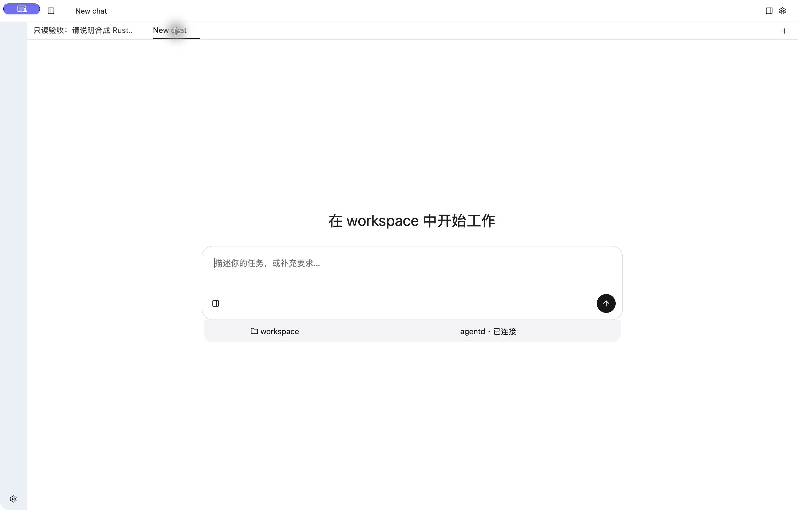

This section uses the actual GPUI Desktop version 0.1.0 on macOS arm64, an isolated agentd and a loopback synthetic model. The logical window is 1440 × 921; captures are 2880 × 1842. A new chat centers the composer; an existing conversation anchors it at the bottom. Collapsing the sidebar leaves an icon rail.

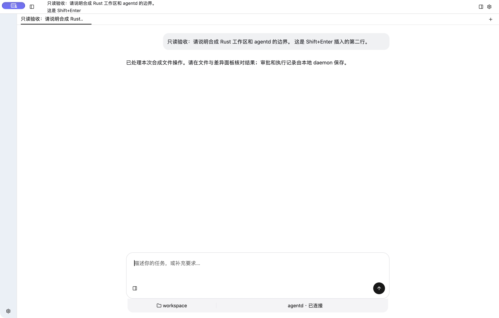

Typing a Chinese draft and pressing `Shift+Enter` inserted a newline without creating a run. Plain `Enter` then created exactly one completed run; the persisted prompt retained that newline and the acknowledged composer cleared. The model text in the capture is a fixed synthetic reply, not evidence of a file change in this read-only request. A GPUI integration test separately checks that active IME composition cannot submit.

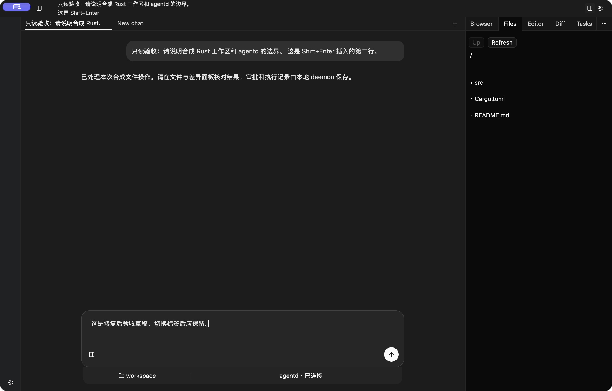

Switching between a new tab and the original conversation preserved the original Chinese draft; see the [tab capture](images/desktop-mvvm-tabs-macos.png). The separate settings view switched light and dark themes while masking the token, and Files listed the synthetic workspace. All three acceptance processes exited and their loopback ports closed without registering an operating-system service.

The [runtime record](evidence/desktop-mvvm-macos.json) contains binary, source and image digests. GPUI rendered-bounds tests also check long Chinese message wrapping and containment at normal and 960 × 640 window sizes. These captures do not claim native narrow-window, final-build approval replay, Editor/Diff, real-model, Windows, Linux or installer acceptance.
