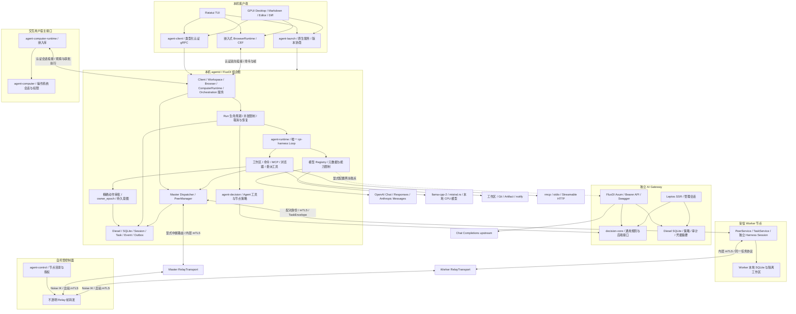
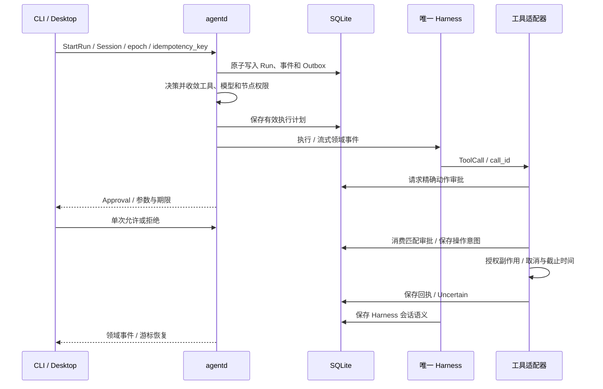
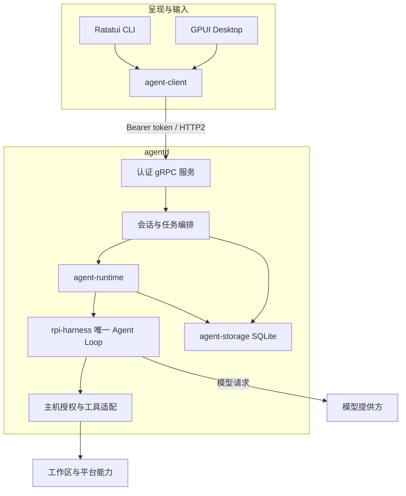
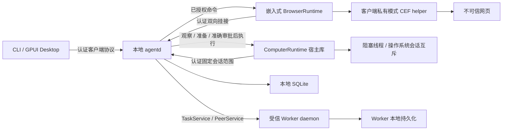

# 组件与调用关系

`agentd` 持有会话、任务、模型、工具和权限。`agent-client` 将 bearer token 放入 gRPC 请求元数据；终端与桌面通过同一套 `ClientService` 消息访问 daemon。`rpi-harness` 的具体类型保留在 runtime 适配层，不进入公共协议或 UI 模型。

## 系统总览

组合根通过 FluxDI 的类型化模块注入配置、身份、存储、模型、决策和运行资源。业务模块显式接收依赖；客户端不能自行构造模型连接、审批结果或 Worker 信任记录。

控制面目录、Noise 链路与 TaskService 是不同的协议边界。配置指定节点使用直连或中继，派发后不会因失败自动切换路由。中继承载同一套 mTLS 任务协议，保留 Worker 的身份、能力和所有者校验；控制面只转发加密帧，不保存 Agent Session 或解释任务内容。加密链路建立成功本身不能证明任务已经送达或执行。

## Run 与副作用

审批不能扩大执行计划。命令、浏览器和计算机动作使用稳定动作标识记录意图和结果；连接丢失、取消或进程退出造成结果未知时，状态进入 `Uncertain`，按原标识核对，不自动重新执行。文件写入、MCP 和其他工具各自遵循适配器的授权及错误契约，不能将一种工具的回执能力推断到所有工具。

## 模型与分布式任务

远程模型协议、本地推理引擎和决策分类器共用领域边界。模型元数据决定是否支持工具、图片和上下文规模；决策结果还要经过主机策略、实际可用能力和 Worker 授权范围限制。本地模型通过显式配置的路径加载，不自动下载或回退到云端。

`OrchestrationService` 面向本地认证客户端；对端 `TaskService` 面向配对后的 mTLS 节点。派发事务校验 Master、Session、`owner_epoch`、父 Run 与工作区，保存 Worker 绑定后才能发送。客户端以任务 ID 分页读取、核对或取消任务。Worker 返回成功后，Master 的任务停留在 `awaiting_acceptance`，只有显式采纳才进入 `completed`。

### 本地执行细节

模型交互、工具调用和执行状态属于 daemon。客户端不能凭 UI 状态认定某次工具副作用已经发生，也不能因为事件流断开就重放请求。

## 浏览器与设备边界

`agent-browser-runtime` 嵌入 CLI/Desktop，客户端可执行文件通过私有运行模式启动 CEF helper。Runtime 通过认证双向流向 daemon 挂接，daemon 授权后才分发浏览器命令。GPUI 窗口状态与浏览器执行状态分开管理。

浏览器挂接断开后不重放操作。网页不能访问应用特权接口；Profile 只保存浏览器磁盘数据，不恢复内存中的活页面。发现节点不授予执行权限，配对和任务授权仍由 daemon 处理。公网注册和转发使用独立的控制面协议，不能将节点发现等同于互信。

ComputerRuntime 以库提供交互用户宿主接口，通过固定的 daemon 会话和桌面范围挂接。原生工作在阻塞线程执行，宿主断开后取消命令，并保持桌面互斥直到操作系统调用结束。daemon 在受信配置、会话归属和控制权限检查后，通过唯一 Harness 提供 `computer_observe` 与 `computer_act`；观察、不可变操作准备和准确审批后的执行均使用认证连接，执行前持久化审批消费与意图。CLI/TUI 和 Desktop 通过注入的 `ComputerHostFactory` 显式发现并选择本地窗口或显示器，再将宿主固定到选定 daemon 会话；切换聊天不会转移已有挂接。ComputerRuntime 嵌入客户端进程，不是独立产品进程，也不创建 Agent Loop。客户端的 `native-computer` feature 默认关闭，入口接线不代表原生控制运行验收完成。macOS 仅在控制台登录会话、有效会话 UUID 与明确未锁定字段均满足策略时允许继续检查权限；状态未知或锁定时拒绝，已观察到的会话失效不会因解锁自动恢复。权限、租约与执行限制见[原生桌面执行边界](protocol.md#原生桌面执行边界)，工具机制见[模型计算机工具](tools.md#模型计算机工具)。

## 源码依据

- 服务和消息：`proto/agent/v1/agent.proto`。
- 认证连接：`crates/agent-client/src/lib.rs`。
- Runtime 接口：`crates/agent-runtime/src/contracts.rs`。
- 原生宿主挂接：`apps/agent-cli/src/computer_backend.rs`、`apps/agent-desktop/src/computer.rs`、`crates/agent-computer-runtime/src/client.rs`、`crates/agent-computer-runtime/src/attachment.rs`、`apps/agentd/src/computer/service.rs`、`apps/agentd/src/computer/tools/` 与 `apps/agentd/src/computer/mutation.rs`。
- 持久状态：`crates/agent-storage/src/schema.sql`。
- 通用决策与 Agent 接入：`crates/decision-core/`、`crates/decision-semantic/`、`crates/decision-model/` 与 `apps/agentd/src/model_routing.rs`。
- 独立网关与合成模型：`apps/ai-gateway/`、`crates/gateway-core/`、`crates/gateway-storage/`、`crates/gateway-web/` 和 `apps/model-mock/`。

跨设备任务中的 Worker Attempt 成功与 Master 采纳结果属于不同语义。协议保留 `attempt_id`、`owner_epoch` 和显式 `AcceptResult`，不能把收到结果当成已经采纳。
