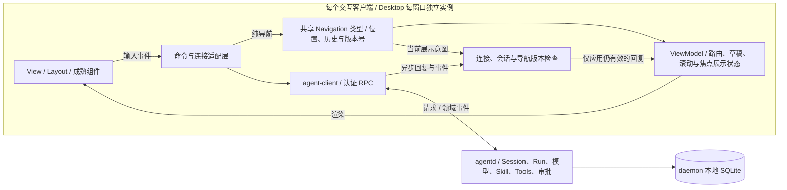

# 终端与桌面客户端

两个客户端均使用 `agent-client` 访问 daemon。界面中的会话、运行结果和审批来自服务端；客户端不内置另一套 Agent Loop。

## 客户端呈现、路由与 daemon 的分工

两端复用导航类型，但分别持有当前路由、返回栈和展示状态。导航不会创建另一套 Agent Loop，也不会转移 Session 或原生宿主的控制权。



过期展示回复被丢弃，不代表 daemon 已接受的工作被取消。Provider 凭据的读取和显式上传留在命令适配层，值不进入 ViewModel。

源码核对: [crates/agent-client/src/navigation.rs](https://github.com/lyonbrown4d/lyonbrown/blob/705f995a59ff69e186f07a035dcb639e43f9d44d/crates/agent-client/src/navigation.rs), [apps/agent-cli/src/update.rs](https://github.com/lyonbrown4d/lyonbrown/blob/705f995a59ff69e186f07a035dcb639e43f9d44d/apps/agent-cli/src/update.rs), [apps/agent-desktop/src/resources/state.rs](https://github.com/lyonbrown4d/lyonbrown/blob/705f995a59ff69e186f07a035dcb639e43f9d44d/apps/agent-desktop/src/resources/state.rs).

## macOS 安装入口

PKG 将应用文件放在 `/Library/Application Support/Lyonbrown/Clients/{cli|desktop}/{version}-{完整目录哈希}/`，每份内容使用独立的组件收据。资源或 Helper 改变时，即使主程序和产品版本相同，也会选择不同的目录与组件标识。`/usr/local/bin/agent` 和 `/Applications/Lyonbrown.app` 分别由独立组件管理，仅作为指向所选内容的符号链接。打包器校验复制后的目录，禁止 Installer 重定位各级 bundle，不清理旧内容组件或收据。

共享 launcher 和 CEF 宿主使用 macOS 内核报告的已加载主程序路径，从对应应用目录查找随附的 agentd、framework 和 Helper。公共入口切换版本后，旧进程仍使用原版本的配套文件。Helper 是包内复制的可执行文件；沙箱入口在调用 cef-rs 前，按该加载器使用的同一路径校验沙箱库。包内容校验与操作系统安装、升级、回滚验收分别进行，详见[本地分发说明](https://github.com/lyonbrown4d/lyonbrown/blob/main/packaging/README.md)。

## 非交互执行 `agent exec`

`agent exec` 经认证连接现有 agentd，使用同一套提交、事件订阅和取消接口，不进入 TUI。默认新建 `CLI exec` 会话；本地连接仍由共享 launcher 检测和复用原生服务。模型、工具、审批和执行状态均由 daemon 持有。

```sh
agent exec "说明这个仓库的结构"
cat build.log | agent exec "分析这份构建日志" --output-format jsonl
agent exec - --workspace /absolute/workspace --timeout 120 < prompt.txt
agent exec "继续检查" --session SESSION_ID --output-format jsonl
```

位置参数为文本；`-` 表示显式读取 stdin。非终端 stdin 会自动读取，并用两个换行追加到位置参数后。省略位置参数时可只提供 stdin；输入须为 UTF-8，合并后最多 1 MiB，且不能全为空白。`--workspace` 只用于新会话，默认当前目录，相对路径按 CLI 当前目录展开；实际目录由 daemon 校验。`--session` 与 `--workspace` 互斥，已有会话沿用其工作区，并使用服务端返回的当前 `owner_epoch` 提交。

默认 `--output-format text` 只向 stdout 写最终模型结果；连接、会话、运行标识和诊断写入 stderr。`--output-format jsonl` 向 stdout 连续写入单行 JSON，无终端控制序列；每条记录包含 `schema_version: 1`：

| `type` | 含义与主要字段 |
| --- | --- |
| `submission` | 提交前记录 `session_id`、`owner_epoch`、`idempotency_key` |
| `accepted` | daemon 已确认接受，包含 `session_id` 和 `run_id` |
| `event` | daemon 持久事件，包含 `run_id`、递增的 `cursor`、`kind`、`payload`、`created_at_ms` |
| `result` | 最终查询结果或等待审批状态，包含 `status`、`result`、`error`、`exit_code`、`reason` |
| `error` | 输入或执行失败，包含 `phase`、`message`、已知标识和 `submission_outcome_unknown` |
| `stopped` | 超时或中断后未能确认取消结果，包含 `reason`、`exit_code`、已知标识及 `cancellation_confirmed: false` |

正常完成时，CLI 查询最终 Run，并按游标补读已持久化的尾部事件。超时、中断或等待审批可能提前结束事件订阅；`result` 的 `status` 才是所查询的 daemon 状态。参数解析、配置加载失败可能尚未进入 JSONL 输出阶段；输出端阻塞或进程被强制结束也可能留下不完整尾行。缺少成功 `result` 不能视为执行成功。

| 退出码 | 含义 |
| --- | --- |
| `0` | daemon Run 为 `completed`，且结果已输出 |
| `1` | 连接、会话准备、提交、事件流或输出失败，或 Run 为 `failed` |
| `2` | CLI 参数解析或 Prompt/stdin 文本输入无效 |
| `3` | Run 等待人工审批；CLI 不批准也不取消该运行 |
| `4` | Run 为 `uncertain`，须人工核对 |
| `124` | CLI 执行超时 |
| `130` | CLI 收到中断，或 daemon Run 为 `cancelled` |

`--timeout` 默认 600 秒，可设 1–86400 秒，从读取输入开始计时，覆盖连接、会话创建、提交和订阅。Ctrl+C 和 Unix 的 SIGTERM 会请求取消已确认接受的本次 Run。超时也发送同样的取消请求，最多等待 5 秒确认最终状态，再最多等待 1 秒输出结束记录；最终退出码保留超时或中断原因。stdin 未关闭或 stdout 下游暂停读取不阻止该等待上限。daemon 自身的运行超时仍独立生效。

取消不撤销已经发生的工具副作用，最终状态可能是 `uncertain`。若提交响应尚未返回，CLI 无法确认 Run ID，也不能声称已取消；`submission_outcome_unknown` 会标记该情况。普通断线或输出错误不会自动重放提交，也不会隐式取消 daemon 作业。人工审批可在 TUI 或 Desktop 中继续处理。`exec` 不自动挂接本机 Browser 或 Computer 宿主；这些能力仍需交互客户端显式连接。

可用 `--idempotency-key KEY` 显式指定提交身份；默认生成 UUID。保存 `submission` 与 `accepted` 中的标识。结果未知时先在原会话中核对；如需显式重复同一提交，必须同时复用原 `--session`、幂等键和完全相同的合并输入。仅复用幂等键而新建会话不能去重。已有运行的继续执行和异常恢复仍使用 `agent run`，不会由 `exec` 自动处理。

## 终端工作台

```sh
cargo run -p agent-cli -- --help
cargo run -p agent-cli -- --endpoint http://127.0.0.1:7447 --data-dir /path/to/lyonbrown-data
```

工作台默认显示对话和输入区。会话、任务、计算机与帮助通过上下文面板按需打开，不常驻空面板；待处理审批出现时，在输入区上方显示工具、参数和批准／拒绝操作。宽终端将上下文面板放在对话右侧，窄终端用面板替换对话区域；`Esc` 返回上一层，无历史时回到对话。初次连接失败时显示 `Disconnected`，不会展示虚构的模型回复。提交请求失败时保留草稿，不自动重放请求；只有服务端确认接受后才清空对应草稿。

| 按键 | 操作 |
| --- | --- |
| `F1`～`F7` | 帮助、会话、Task、计算机、审批、执行记录、排队输入 |
| `Enter` | 空闲时提交新 Run；运行时将输入排入当前回复之后 |
| `Ctrl+S` | 向当前 Run 提交纠偏输入，保持原工具和授权范围 |
| `Alt+Enter` / `Shift+Enter` | 换行 |
| `↑` / `↓` | 输入区首行／末行回填已确认输入历史；面板内选择条目 |
| `Ctrl+P` | 搜索输入历史，`Enter` 只回填，需再次确认才提交 |
| `Ctrl+Y` / `Ctrl+E` | 批准一次／拒绝所选审批；过期或已移除的选择不能操作 |
| `F5` 内 `Space` | 展开／折叠所选审批参数 |
| `F6` 内 `Enter` | 展开／折叠所选工具记录；`↑↓` 选择，`PgUp/PgDn` 滚动 |
| `F7` 内 `Delete` | 请求撤销所选待处理输入；已采纳的输入不能撤回 |
| `/search TEXT`、`Alt+N/P`、`End` | 搜索本地对话、前后命中、返回最新消息 |
| `Ctrl+N` / `Tab` | 创建／切换会话 |
| `Ctrl+R` / `Ctrl+X` | 重连／请求取消当前 Run |
| `Ctrl+C` / `Ctrl+D` | 在对话、选择器或 Diff 中退出客户端，daemon 作业继续 |
| `Esc` | 收起浮层或返回上层面板 |

本地命令的结果不占用上下文面板。需要选择时（`/model`、`/models`、`/providers`、`/skills`）在输入区上方浮出可选项，`↑↓` 选择、`Enter` 确认、`Esc` 取消；只读结果（`/status`、`/git` 与各类操作回执）直接追加到对话记录，以 `· 本地` 标记并且不按 Markdown 渲染。命令提交时立即清空输入区，后到的结果不会覆盖等待期间新输入的文字。`/models` 的 hub 子命令（`search`、`inspect`、`plan`、`installed`、`status`）把 daemon 返回的 JSON 读成仓库、版本、架构、许可、文件大小与作业状态等字段；无法识别的结构退回原始 JSON，不会丢信息。

`/diff` 打开全屏 diff 视图：默认 unified，`Tab` 切换 side-by-side，`j`／`k` 或方向键滚动，`n`／`p` 切换文件，`h`／`l` 横向滚动，`g`／`G` 跳到首尾，`Esc` 关闭。视图只展开改动块与其上下文，语法高亮使用 tree-sitter（Rust、Python、JavaScript、TypeScript、JSON、TOML、Bash、Markdown）；着色只影响呈现，不改变发送给 daemon 的文本。
执行记录消费共享的 `agent_core::events::AgentEvent` 枚举。agentd 产出阶段、模型、工具结果、用量和队列事实；TUI 只映射文案和渲染，不从文本增量或 Harness 审计 JSON 推断“正在连接模型”。模型请求阶段来自 Provider 请求入口，表示正在发起请求，不证明网络连接已经建立。工具与队列事实、用量同 Harness 快照、事件及 Outbox 原子保存。`F6` 使用同一投影处理实时事件和历史回放，按 Run 与游标去重；用量是已报告值，不推算剩余上下文。尚未报告时不显示虚构数据。

运行中的 `Enter` 使用 Harness follow-up 队列，`Ctrl+S` 使用 steering 队列，不创建第二个 Agent Loop，也不扩大原执行计划的工具权限。每次输入保留稳定 request ID；只有 agentd 确认持久化后才清空匹配草稿和记录历史。重复确认使用同一身份，内容不一致会被拒绝；断线不自动重放。 未确认输入沿用原 Run、request ID 和模式，即使原 Run 已结束，也不会转成新的 StartRun。`F7` 区分待处理、已采纳和已撤销。队列在执行边界后仍待处理时，保留到下一次显式运行；接收不代表本轮已经采纳。撤销失败不会显示成功；已进入执行的输入只能通过 Run 取消处理，不能撤销已经产生的副作用。重启后无活动 Runtime 的遗留队列可核对，但不能假装已恢复可撤销的宿主。

输入历史按 daemon 身份和 Session 隔离，仅保存已确认输入；最多 32 个会话、每会话 100 条、合计 1 MiB。草稿与未确认输入不进入历史。模型、会话、Provider、技能和历史选择器支持键入过滤与 Backspace，筛选后仍使用原始条目身份。`/context`、`/permissions`、`/tools`、`/mcp` 读取现有 daemon 接口；完整上下文、权限策略全文、工具目录和 MCP 连接健康尚未由协议开放，界面明确说明限制。

输入区复用 `ratatui-textarea` 0.9.4，支持光标编辑、多行文本、换行显示和粘贴。应用快捷键优先于编辑器的同名映射，例如 `Ctrl+X` 仍请求取消运行，`Ctrl+Y` 仍处理审批。提交等待期间不重复发送；失败保留草稿，服务端接受后清空对应草稿及其撤销历史。

审批区展示所选工具和参数；紧凑布局只保留待处理数量和审批快捷键，完整参数通过 `F5` 查看。审批决定由 daemon 校验并保存，界面按服务端结果更新。对话的 Run 记录每两秒刷新一次，新提交的运行同时订阅事件流。持久 Task 按面板查询与本地管理命令刷新。客户端退出时恢复终端状态，不向 daemon 发送取消请求。

界面使用暖深色或暖浅色的纯色终端背景、正文和强调色。`--theme auto` 根据 `COLORFGBG` 选择配色；无法检测时使用深色，可显式指定 `--theme light` 或 `--theme dark`。模型回复的 Markdown 复用固定版本 `tui-markdown` 0.3.12，经公开 `StyleSheet` 接口适配主题；关闭该库的默认 features，不启用代码语法高亮依赖。

TUI 按 MVVM 分离呈现：`view_model.rs` 从客户端 `App` 状态生成只读 `ViewModel`，整理连接标签、消息、审批和当前上下文；`view.rs` 只通过 Ratatui 渲染该数据与输入组件。输入动作和后台更新分别留在 `input.rs`、`backend.rs` 与 `update.rs`，呈现层不派发 daemon 操作。

TUI 的 `Router` 统一上下文页面、返回栈和页面滚动位置。`Esc` 返回上一层。斜杠命令补全是输入框的临时状态，不占用路由：在空输入框输入 `/` 会在输入框上方浮出候选，`↑↓` 选择、`Tab` 或 `Enter` 补全、输入参数或 `Esc` 收起，对话和当前页面保持原样。会话或连接变更会清除旧返回栈及临时资源页面。`AppLayout`、`BodyLayout` 复用 Ratatui 的约束布局，集中计算宽屏、窄屏、审批区和补全浮层的区域；路由不持有 daemon 的执行权限。

## TUI Provider 配置对话框

输入 `/providers`，选择「新增 Provider」或已有自定义配置，按 Enter 打开模态对话框。通过 Tab／Shift+Tab 切换字段和按钮；协议字段使用左右方向键或空格切换。表单支持名称、标准协议、Base URL、模型 ID 和掩码密钥。支持的协议为 OpenAI Responses、OpenAI Chat Completions 和 Anthropic Messages；名称、模型 ID 和地址分别限制为 100、256、2048 字节。Base URL 必须为 HTTPS，只有回环地址允许 HTTP，不能包含用户名、密码、查询参数或 fragment。OpenAI 常用地址以 `/v1` 结尾；自定义路径应与推理适配器使用的地址一致。

「探测」由 agentd 向该协议的模型列表端点发送只读 GET，不发起推理，不保存表单，也不能证明所填模型支持生成或工具调用。探测最长 5 秒，响应最多 1 MiB、100 个模型；禁用代理、自动重试与重定向。失败时保留表单并显示安全错误。按 Esc 关闭对话框会停止客户端的探测请求；已经受理的保存或移除操作仍可能完成，不能把关闭视为回滚。

「保存」将配置交给 agentd，首次保存必须填写密钥，编辑时留空保留原凭据。密钥只进入临时输入适配器和认证请求，不进入 App、ViewModel、聊天草稿、输入历史或客户端持久状态；保存确认、关闭、断线和身份变化会清空输入。保存不会选择模型，关闭后使用 `/model` 显式选择该 Provider。不要把保存成功当成探测成功。

配置最多 100 条，通过修订号防止旧表单覆盖新修改。移除需要再次确认，不删除已经固定到 Session 或 Run 的绑定；删除过的配置身份不能重新使用。每次修改密钥创建新的加密凭据引用，旧绑定仍可使用原值。旧凭据目前保留在 daemon 凭据存储中，没有自动垃圾回收。配置变更、事件和 Outbox 在同一个关系数据库事务中保存；连接验证不写配置、事件或 Outbox。

列表中的内置 Provider 打开凭据对话框，可填写新密钥、显式导入允许的环境变量或移除已保存凭据；打开和选择 Provider 不会自动上传。需要自定义地址与模型时使用「新增 Provider」。这套自定义配置界面目前仅接入 TUI；Desktop 的 Providers 页面仍只提供环境变量凭据管理。

## 原生计算机连接

CLI/TUI 与 Desktop 在自身进程内嵌入 ComputerRuntime。默认构建不启用原生 SDK；需要显式构建客户端的 `native-computer` feature，见[开发与验证](development.md#原生计算机客户端构建)。这不启用 daemon 的模型工具，也不请求操作系统权限。目标发现只列出已有权限下的窗口或显示器元数据，不截图、不发送输入；会话锁定、状态未知或缺少屏幕权限时会拒绝发现。

CLI 先列出目标，再用 daemon 中已有的非零 Session UUID 和一个目标 ID 显式挂接：

```sh
cargo run -p agent-cli --features native-computer -- computer targets
cargo run -p agent-cli --features native-computer -- computer attach --session SESSION_UUID --window WINDOW_ID --process-id PID
# 显示器范围使用 --display DISPLAY_ID，不传 --window 或 --process-id
```

`computer targets` 不连接 daemon。选择窗口时，需要同时复制目录中的窗口 ID 和 `process_id`。`computer attach` 重新发现目标，先核对 PID 完全一致，再保留描述符、建立认证连接并检查会话归属；窗口 ID 被其他进程复用时不会静默采用新目标。命令保持前台运行，按 `Ctrl+C` 断开；进程退出也撤销宿主连接。挂接失败会显示不可用原因，不自动选择其他目标。

TUI 在已连接并选定会话后，通过输入区执行本地命令：

```text
/computer targets
/computer attach window WINDOW_ID
/computer attach display DISPLAY_ID
/computer status
/computer detach
```

两个 `attach` 示例择一使用。必须先运行 `/computer targets`，再从当前目录选择；挂接使用缓存中的准确目标描述符，不按 ID 临时替换目标。Computer 区显示原绑定会话、范围和连接状态，`Alt+PageUp` / `Alt+PageDown` 滚动详情。切换会话不转移已有连接；换目标或会话前先 detach。`/computer` 前缀即使语法错误也不会提交给模型。重连或断线会撤销宿主并清空目标目录，重新挂接前必须再次发现；动作不会自动重放。

Desktop 的操作与绑定状态见下方「Computer 面板」。目标目录与权限、固定窗口身份的限制见[原生桌面执行边界](protocol.md#原生桌面执行边界)。入口接线不等于原生控制验收；macOS 按会话身份与锁字段策略检查，状态未知时以 `SessionStateUnknown` 拒绝。后端一旦观察到锁屏或会话失效，解锁后仍须显式重新挂接。

## 终端任务管理

```sh
cargo run -p agent-cli -- task list --session SESSION_ID --page-size 100
cargo run -p agent-cli -- task get TASK_ID
cargo run -p agent-cli -- task reconcile TASK_ID --node-id WORKER_ID --node-endpoint https://worker.example:7448
```

`task dispatch --help` 列出派发参数。必须显式提供稳定的 Task UUID、Attempt UUID、幂等键及同一 Session 中正在运行的父 Run；daemon 校验所有权、工作区、截止时间与能力范围。`task cancel` 请求取消；`task accept` 必须使用 `--accepted true` 或 `--accepted false` 显式决定是否采纳 Worker 结果。

配对身份和凭据留在 daemon，节点地址不授予信任。提交响应丢失时，保留原 Task ID，通过 `get` 和 `reconcile` 核对，不生成新的任务身份自动重试。分页返回 `next_task_id`，后续查询通过 `--after` 继续。

TUI 的 `F3` 面板查询当前会话的持久 Task，分别显示 Task 与 Worker Attempt 状态。方向键选择任务，输入区为空时按 `Enter` 查看详情，`PageDown` 查询下一页；重新打开面板回到第一页。输入区中的 `/task ...` 使用与独立 CLI 相同的子命令和参数，例如 `/task get TASK_ID`、`/task cancel TASK_ID --node-id WORKER_ID --node-endpoint https://worker.example:7448`。这些命令在本地解析，语法错误也不会成为模型 Prompt。

`F3` 选择 Task 后，输入区为空时可用 `i/r/c/a/x` 查看、核对、取消、采纳或拒绝。远程操作由 daemon 从首次 dispatch 意图取出原始 Worker ID 和 HTTPS origin，并重新验证当前配对、撤销状态与 owner epoch；不会从发现结果猜目标。旧任务没有原始 origin 时明确要求使用原有显式目标命令。Worker Attempt 成功仍不等于 Master 已采纳。


TUI 保存各会话草稿、未绑定草稿、所选会话、上下文面板和滚动位置。会话切换保留各自的输入；提交确认只清除原会话中仍与已提交文本一致的草稿。`/draft list` 列出本地草稿，`/draft recover SESSION_ID` 将选定草稿放入输入区，`/draft recover unbound` 读取未绑定草稿，供用户检查后决定是否提交。原会话当前不可用的草稿仍保留，不会自动附到其他会话。

## GPUI 桌面

```sh
cargo run -p agent-desktop
```

桌面使用 GPUI 和 `gpui-kit` 组件，包含按工作区分组的会话侧栏、多聊天标签页、对话输入，以及 Browser、Computer、Files、Editor、Diff 和 Tasks 停靠面板。自定义标题栏复用组件库的 `TitleBar`；macOS 使用系统原生的关闭、最小化和缩放按钮。左侧会话栏默认展开，右侧工作台默认收起。标题栏上的左右面板按钮分别控制两侧；即使两侧均已收起，也可以从标题栏重新展开；左侧收起后保留紧凑图标栏。助手回复以扁平正文显示，输入区与工作区信息分层放置，明暗外观共用 `theme.rs` 的颜色和尺寸定义。

桌面按 MVVM 组织呈现状态：`DesktopViewModel` 只代表一个聊天标签，保存该标签的所选会话、运行、事件游标、消息、审批、异常运行核对草稿和状态信息，切换标签时与 `ChatState` 整体交换，不逐字段搬运。窗口级的 daemon 会话列表和按 `Session.workspace` 的分组由 `Desktop` 持有，不随标签交换。两者都不保存网络客户端、异步运行时或连接凭据。`operations.rs` 通过客户端端口发起请求，`projection.rs` 用 `events.rs` 解码后的运行事件把回复投影到状态；GPUI 视图读取状态并复用 `gpui-kit` 的按钮、输入、Markdown、停靠和调整尺寸组件。

后台结果通过 `async-channel` 2.5.0 的有界队列投递，队列满时生产者异步等待；GPUI 在主线程应用结果，并丢弃过期会话或代次的回复。本地界面状态只在变更后写入：观察者或变更点置脏，帧入口先用廉价快照键比对，未变化的帧既不重建也不序列化 `DesktopState`；持久化 actor 防抖落盘，各退出路径复用同一个 Stop 构造。切换聊天与重连的拒绝原因收敛在 `block.rs`，视图、快照和清理逻辑读同一个枚举，不用横幅文案判断状态。Browser 帧刷新保留独立的 160 毫秒定时器，Computer 宿主存活检查保留独立的 80 毫秒定时器。窗口关闭时清理本地订阅与宿主，daemon 作业保留自身生命周期。

工作台标签栏的省略号菜单列出 Browser、Files、Editor、Diff、Tasks、Computer 和 Git，可直接选择；标签被窄窗口挤出时也可从这里切换。Git 通过 daemon 查询分支、上游、领先／落后数量及文件状态，文件差异复用组件库的 Diff，不在客户端执行 Git。当前组件库的辅助功能树仍不能正确提供这些标签的名称，菜单入口不代表标签的辅助功能问题已解决。

Tasks 面板读取 daemon 的持久 Task，提供首页、下一页、详情、核对、取消和显式采纳／拒绝。派发前须选定有活动 Run 的会话，并填写已配对 Worker 的节点 ID、HTTPS 地址和任务说明；默认只授予只读工作区范围，选择读写范围时写入仍须经过审批，daemon 还会检查配对权限。桌面在发送前生成 Task UUID、Attempt UUID 和幂等键，截止时间为一小时。未知结果保留原身份供查询、核对，不自动重发；Worker Attempt 成功仍显示为等待 Master 采纳。

Git 面板只预览已跟踪文件的差异；未跟踪文件会明确提示通过 Files 打开，不以空补丁表示其内容没有变化。

### 设置与连接

标题栏的 Settings 按钮打开左右分栏设置页，左侧为 Connection、Models、Providers、Skills、Status 和 Appearance，右侧显示当前分类。顶部返回入口独立于滚动内容；选择 Back to chats、再次点击标题栏设置按钮或按 `Esc` 返回聊天时，保留两侧面板状态和草稿。Daemon 地址和访问令牌只在 Connection 编辑；Workspace path 用于当前标签页的新聊天。远程 daemon 的工作区路径指向远端文件系统。Appearance 提供 Light 和 Dark 外观。

Models 统一显示内置、已配置和已安装模型，选择结果由 agentd 保存到当前会话。Hugging Face 的搜索、检查、固定版本安装计划、下载作业查询／取消和模型加载／卸载均由 agentd 执行；断线后可输入原 Job ID 查询，不自动重放。Providers 只展示本机环境变量的检测状态和变量名，用户显式上传后才将值发送至 daemon 的加密凭据存储，界面状态不保存密钥。Skills 支持 daemon 用户和会话工作区范围，先检查文件与哈希，再确认安装；修改来源或范围会使旧检查失效。Status 展示当前 daemon 和会话状态。

模型目录和 Hub 管理不要求先创建聊天；只有「用于当前会话」需要已选会话。创建或切换聊天保留同一 daemon 的 Hub 计划和已知下载任务，更换连接时清空这些展示状态。

两端复用 `agent-client::navigation::Navigation` 的类型化位置、有限历史栈、前进／后退和导航版本号，各自适配页面滚动及焦点。每个桌面窗口持有独立路由上下文，聊天与设置分类通过 `Alt+Left/Right` 返回／前进。路由只切换呈现，不迁移聊天标签页或会话权限；`layout.rs` 组合组件库的 Sidebar 和可调整尺寸面板。

存在活动运行、尚未结束的请求或未保存的文件修改时，Connect 不可用。保存未改动的文件时，也要等待保存请求结束后再重连。未保存修改检查同时覆盖当前 Editor 和其他会话缓存的文件草稿。连接请求尚未完成时，旧 Editor 保持只读，避免向待切换的连接写入。

### 聊天标签页与草稿

使用侧栏「新对话」或标签栏「＋」创建聊天标签页；从侧栏选择会话时，打开对应标签页，或切换到已打开的同一会话。每个标签页有独立标识，并保留自己的原生输入组件、工作区路径、输入草稿、消息、审批和运行状态。非活动标签页由独立的 `ChatState` 保留这些状态；后台更新按标签页标识投递，在应用结果时暂时切换对应状态，结束后恢复当前可见聊天。后台响应不会写入其他聊天。

关闭标签页只停止该标签页的本地事件订阅，不向 daemon 发送取消请求。关闭最后一个标签页后，界面保留一个新的空白标签页。关闭桌面也不默认取消 daemon 作业。

Editor 与差异视图复用组件库，文件操作通过 daemon 的工作区协议执行。切换聊天时，Editor 按会话缓存并恢复打开文件及未保存文本；文件保存请求尚未完成时，必须等待保存结束才能切换、新建或关闭当前聊天。

认证后，桌面恢复标签页顺序、活动标签页、各标签页的聊天草稿和工作区路径，以及两侧面板、停靠布局、宽度和明暗外观。恢复期间暂停编辑和导航；后台合并快照并写入本地，正常关闭窗口前等待最后一次刷盘。原会话当前不可用的标签页标为未绑定草稿，须点击「为此草稿新建会话」完成绑定后才能提交。运行、事件和审批重新向 daemon 查询，不从快照恢复执行状态。

未保存的 Editor 草稿包含原会话、文件路径、原始内容和版本。恢复后重新读取当前文件版本；文件已改变时保留草稿并报告冲突，保存仍由 daemon 校验原始版本，不覆盖较新的文件。找不到原会话的文件草稿保留为未绑定草稿，须显式绑定；恢复本身不会保存文件。

Browser 的连接、导航、关闭或接管请求尚未完成时，也必须等待结果才能切换、新建或关闭当前聊天，以及重新连接 daemon。Space 创建成功但地址打开失败时，界面保留该 Space，可修正地址后继续打开，或显式关闭。切换接管状态后，面板清除旧帧并重新获取；迟到的旧帧、空帧或错误不会覆盖新的读取状态。

### Computer 面板

先连接 daemon 并选择已有聊天，再打开 Computer 面板：

1. 选择 Refresh targets，读取本机目标目录。
2. 在组件库提供的可搜索 Select 中明确选择窗口或显示器。刷新后的选择为空，不自动选中第一项。
3. 选择 Attach to selected chat，将准确的目标描述符挂接到当前选定聊天。
4. 使用完毕后选择 Detach。

面板分别显示 Selected chat、Bound chat 和 Bound scope。切换或关闭聊天标签页不会将原连接转给其他聊天；Bound chat 始终显示原会话，挂接期间不能刷新或另选目标。目标发现、挂接或断开尚未完成时，先等待结果，再切换、新建或关闭聊天及重新连接。

Connect 开始尝试时就撤销旧宿主并清空目录，即使新连接认证失败也不保留旧授权。刷新、聊天绑定及连接变化使过期异步结果失效；迟到的挂接结果被丢弃并取消宿主。断线不会重放动作；显式 Detach 后再刷新并重新选择。断开失败会提示原生调用可能仍在结束，新的挂接可能暂不可用。关闭桌面撤销本地宿主，不默认取消 daemon 作业。

### 桌面快捷键

以下 `Cmd/Ctrl` 表示使用 `Cmd` 或 `Ctrl` 组合键。

| 按键 | 操作 |
| --- | --- |
| `Cmd/Ctrl+B` | 展开或收起左侧会话栏 |
| `Cmd/Ctrl+Alt+B` | 展开或收起右侧工作台 |
| `Cmd/Ctrl+,` | 打开 Settings |
| `Esc` | 从 Settings 返回聊天 |
| `Cmd/Ctrl+T` | 新建聊天标签页 |
| `Cmd/Ctrl+W` | 关闭当前标签页；在 Settings 中返回聊天 |
| `Cmd/Ctrl+L` | 返回聊天并聚焦输入区 |
| `Enter` / `Cmd/Ctrl+Enter` | 在输入区提交已确认的输入；输入法组合态不发送 |
| `Shift+Enter` | 在输入区换行 |
| `Cmd/Ctrl+S` | 在 Editor 中保存文件 |

原生窗口是否可启动取决于目标平台的图形环境和依赖。编译通过不能替代窗口创建、输入、主题切换以及真实 daemon 连接的运行验收，也不能据此认定 Windows、macOS 和 Linux 均已验收。

## Run 异常核对与继续

Desktop 在异常 Run 对话的输入区上方提供「核对异常运行」入口。打开后查看异常原因和待核对工具；「核对未终结 Task」会展开并选中 Tasks 面板，只查询原会话中尚未终结的 Task。填写原配对 Worker 的节点 ID 与 HTTPS 地址，先 Reconcile，再按实际结果 Cancel 或明确 Accept result／Reject result。完成后返回恢复面板，选择「刷新核对」；daemon 仍会在恢复事务中检查整个会话的 Task 状态。

Task 筛选保留原列表的分页游标。当前页没有未终结 Task 不表示后续页也没有；有 Next page 时须继续查询。CLI/TUI 的 `run inspect` 同样返回 `unresolved_tasks`、`next_task_id` 和后续核对命令提示，后续页使用 `task list --session SESSION_ID --after NEXT_TASK_ID` 查询。

核对实际文件、命令和外部服务结果后，在 Desktop 填写「核对记录」。选择「记录放弃原运行」只记录决定；选择「按新输入继续」还须填写明确的新输入。核对记录只用于留档，模型仅收到新输入，需要在新输入中说明核对结果。成功后通过「打开继续会话」查看新 Run 和审批，原聊天及其草稿保留。请求期间不能切换或关闭当前聊天。结果未知时保留本进程中该聊天的准确请求身份与输入，先刷新核对；已有决定时展示它，尚无决定且允许恢复时才能显式使用原身份重试。客户端不会自动发送恢复请求，也不会把核对记录当作旧动作成功的证明。应用重启后须重新核对 daemon 的持久决定，界面不从本地快照恢复执行状态。

TUI 的 `/run` 命令在本地解析，不作为模型输入发送。先用 `/run inspect RUN_ID` 查看原运行、异常原因、未确定的工具调用和已记录的恢复决定；检查文件、命令或外部服务的实际结果后，再选择：

```text
/run abandon RUN_ID --idempotency-key KEY --note '已核对实际副作用，结束此运行'
/run continue RUN_ID --idempotency-key KEY --note '已核对文件与外部状态' --prompt '根据核对结果继续处理的明确新输入'
```

CLI 子命令使用同样参数，去掉 `/` 前缀即可，例如 `agent-cli run inspect RUN_ID`。恢复写操作要求原运行已停止且状态为 `uncertain`、本机 Master 所有权和有效的 `owner_epoch`。原会话中的持久 Task 必须先核对、取消或明确采纳／拒绝并进入终态，避免递增代次后失去对 Worker 的管理权。恢复决定、所有权代次递增、事件、Outbox 和可选的新会话／Run 在同一关系数据库事务中写入；旧代次的迟到状态提交会被拒绝。这不撤回已经发往操作系统或外部服务的动作，核对时仍须确认其实际状态。

`abandon` 只记录放弃原运行；`continue` 使用显式新输入创建新会话和新 Run，不复制原 Harness 快照、审批或执行句柄。原 Run 始终保留 `uncertain`，原会话不重新开放写入，不将人工核对记录当作执行成功。新会话出现在 TUI 会话列表，用 `Tab` 切换查看进度和处理审批。同一个原 Run 只能记录一次恢复决定；响应丢失时先 `inspect`，重试必须保留原 key、动作、核对记录和输入，不换身份重发。当前不提供原 Harness 操作的原地续跑，也不会自动核对外部副作用。

## 本地恢复文件

客户端的恢复文件位于配置数据目录的 `client-state/` 下。`agent-client::local_state` 按客户端类型、规范化的 daemon 地址和认证后的节点身份隔离文件；同一身份的恢复文件由独占锁保护，第二个客户端实例不能同时覆盖它。写入使用同目录临时文件并原子替换，文件大小上限为 4 MiB；Unix 上目录和文件权限分别为 `0700`、`0600`。

恢复文件只保存客户端展示与输入状态。令牌、审批决定、原生执行句柄、Browser/Computer 控制权和 daemon 的执行状态均不从恢复文件取得。重启后仍须认证并向 daemon 查询；恢复草稿不会提交请求。损坏、身份不符或版本不支持的文件会保留并报告错误，不会用空白状态覆盖。

源码入口：`apps/agent-cli/src/main.rs`、`apps/agent-desktop/src/main.rs`。终端呈现见 `apps/agent-cli/src/view_model.rs`、`view.rs` 和 `markdown.rs`；桌面交互见 `apps/agent-desktop/src/view_model.rs`、`events.rs`、`block.rs`、`operations.rs`、`projection.rs`、`chrome.rs`、`settings.rs`、`tabs.rs`、`tabs/` 和 `workbench/drafts.rs`。

实际窗口、明暗切换、审批与文件读取截图及其验收边界见[桌面运行截图与验收范围](runtime-evidence.md)。


## 记忆管理

TUI 通过 `/memory` 调用认证的 daemon 记忆服务，结果显示在已有的本地记录页。它不会直接连接数据库或 Qdrant。未选择 Session 时可管理当前用户范围；选择本机拥有的 Session 后才增加相应项目和会话范围。范围身份由 daemon 确定，缺少 Session 的项目／会话操作会被拒绝。当前没有 Desktop 记忆面板，也没有自动提取或模型记忆工具。配置、索引作业与 Run 绑定见[长期记忆](memory.md)。

| TUI 命令 | 行为 |
| --- | --- |
| `/memory`、`/memory list [STATE\|all] [AFTER_ID]` | 列表，默认全部状态，每页 50 条；返回后续游标 |
| `/memory get ID`、`/memory status` | 查看正文修订或检索配置状态 |
| `/memory search TEXT` | 搜索当前授权范围，最多 10 条 |
| `/memory add SCOPE KIND TEXT` | 用户显式创建 `active` 记录 |
| `/memory propose SCOPE KIND TEXT` | 用户显式创建 `proposed` 记录；不是模型自动提取 |
| `/memory approve ID REVISION` | 先读取并核对指定修订，只激活仍为 `proposed` 的记录 |
| `/memory edit ID REVISION TEXT` | 核对修订后修改正文，保留原种类、范围、状态与有效期 |
| `/memory forget ID REVISION` | 按指定修订忘记记录并提交向量删除意图 |
| `/memory jobs ID`、`/memory retry ID JOB_ID` | 查看该记录的作业，或显式重试失败／未知作业 |

`SCOPE` 为 `user`、`project` 或 `session`；`KIND` 为 `preference`、`fact` 或 `procedure`。`STATE` 可选 `proposed`、`active`、`superseded`、`rejected`、`deleted` 或 `all`。正文支持 shell 引号或剩余词拼接，限制为 1–16,384 个 UTF-8 字节。

新增、激活和修改命令在解析时生成稳定请求 ID；新增还生成记忆 ID。写操作取消、超时或断线时显示未确认身份，不自动重试；先用详情与作业列表核对结果。忘记与作业重试协议没有独立 `request_id`，分别使用修订和作业身份限制操作。当前仅提供 TUI `/memory` 与共享 AgentClient / RPC，非交互 CLI 未增加 memory 子命令。上述入口尚未完成本轮编译或实际 TUI 验收。
