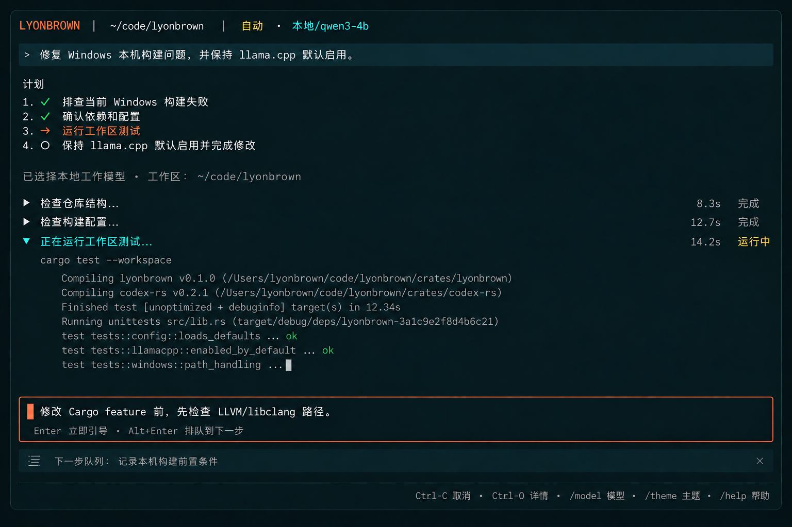
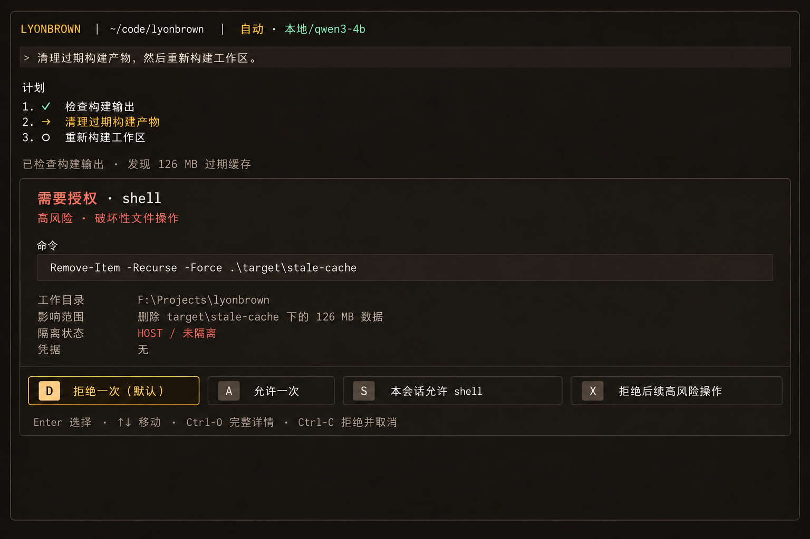
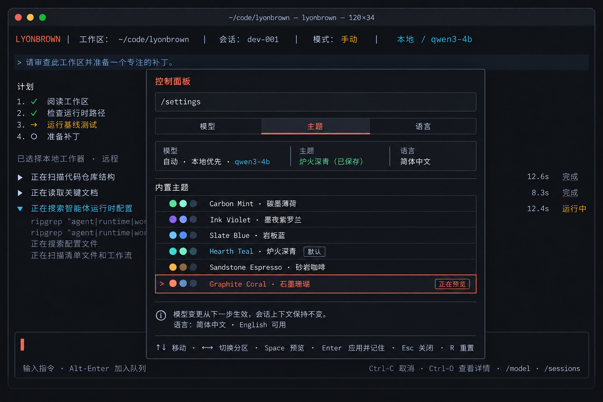
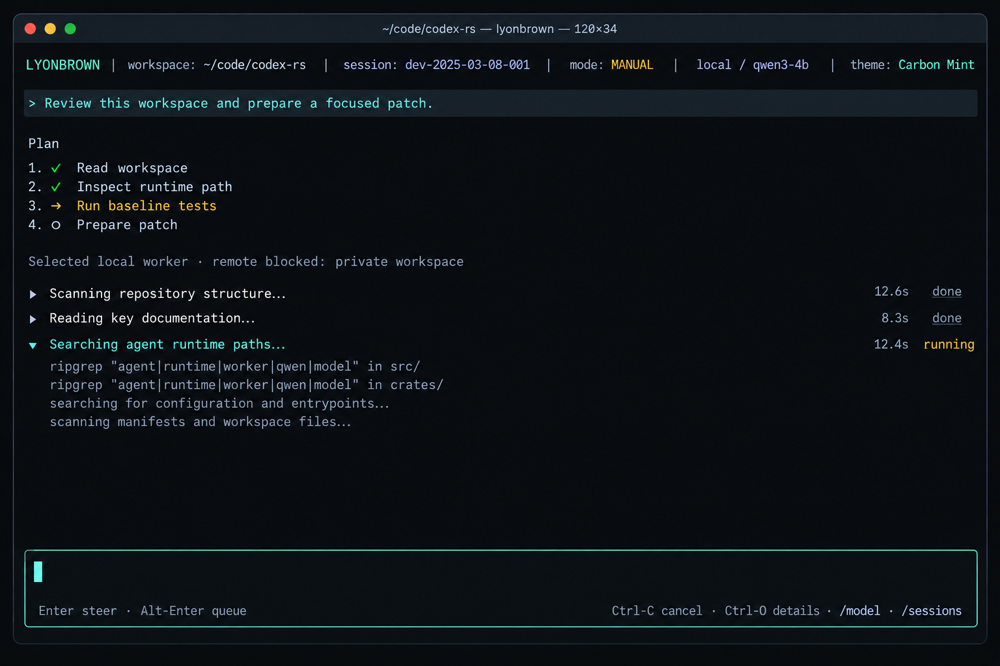
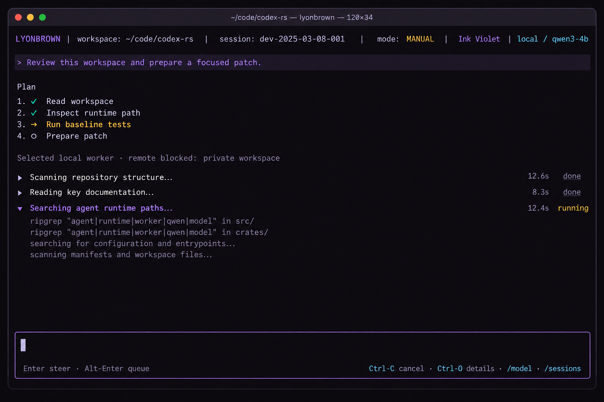
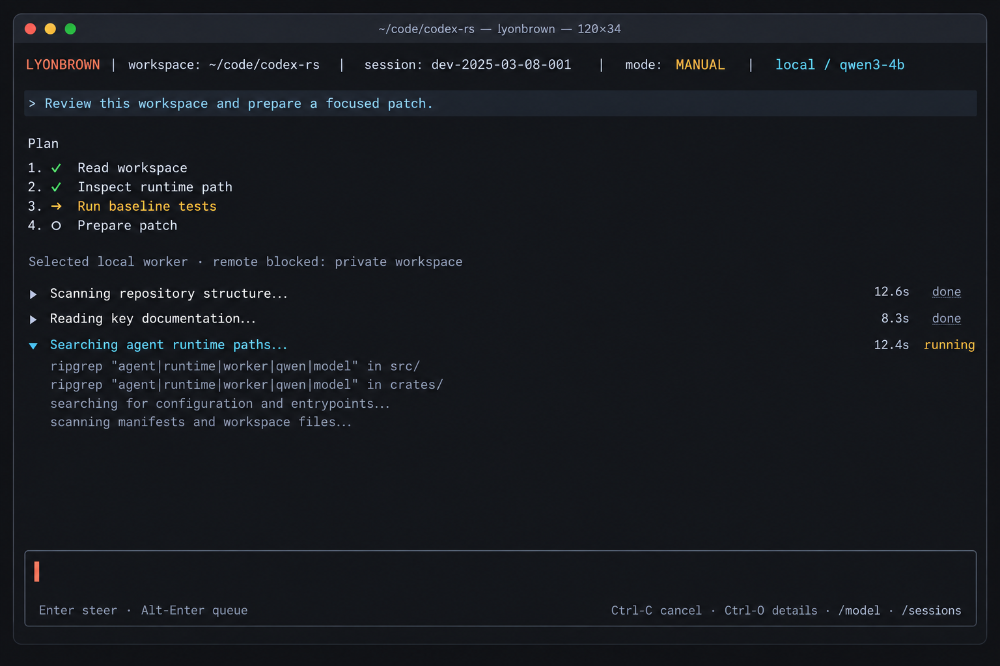

# TUI 视觉与交互设计基线

> 状态：Accepted
> 决策日期：2026-10-01
> 适用范围：M12 TUI 产品化，以及 GUI 共享交互契约
> 关联计划：[第二阶段产品与交互实施计划](../plans/phase-two-product-plan.md)

## 1. 设计结论

Lyonbrown TUI 采用接近成熟终端 Agent 的低界面感设计，但不复制任何产品的品牌元素：

- 单一、可滚动的对话与活动流是默认工作区；
- Composer 固定在底部，任务运行时仍可接收用户输入；
- Session、Model、Theme、Language、Help 和 Inspector 使用临时 overlay；
- 审批嵌入当前任务流，不用脱离上下文的全屏确认页；
- 默认主题为 `hearth-teal`，同时内置六套可持久化主题；
- 首发界面语言为英文和简体中文，命令、模型 ID、路径和快捷键不翻译。

常驻多栏布局不再作为 TUI 默认方案。它会压缩终端正文、破坏原生 scrollback，并增加 SSH、tmux 和窄终端中的操作成本。详情仍可通过 overlay 或临时全屏视图访问。

## 2. 信息架构

默认界面只有四个纵向区域：

```text
Context line        workspace · mode · model
Transcript          user intent · answer · grouped activity
Composer            input · focus · queue
Status line         cancel · details · commands
```

### 2.1 Context line

只显示当前决策真正需要的信息：

- workspace；
- `Auto` 或已固定的 Worker；
- 本地/远程属性；
- 当前模型。

Session ID、token、完整路由原因和诊断数据不常驻显示，由 Inspector 按需展开。

### 2.2 Transcript

Transcript 同时承载对话和按 step 聚合的活动，但不把每个底层事件渲染成聊天消息。活动默认折叠为一行，当前活动可以展开显示命令和必要输出。

### 2.3 Composer

Composer 始终是主要焦点。边框和光标表达焦点，主题色只作强调，不依赖颜色区分输入状态。

### 2.4 Overlay

Overlay 是临时上下文，不改变 Session，也不清空 Composer：

- `/model`：模型与路由策略；
- `/theme`：主题预览与持久化；
- `/language`：英文/简体中文；
- `/sessions`：新建、选择和恢复；
- `/status`：Runtime 与当前路由摘要；
- `/help`：命令和快捷键；
- `Ctrl-O`：当前活动或审批详情。

在模型设置之外，Esc 只关闭最上层 overlay 或清除选择，不退出 TUI。模型设置是
下文明确列出的例外：`Required`、`Failed` 或 `Cancelled` 时 `Esc` 退出；仅当
`allowed_actions` 允许 `Cancel` 时，`Esc` 才取消活跃阶段。

### 2.5 首次模型设置

运行 `agent` 后先进入 TUI，任何模型传输都不会抢在界面之前开始。若 daemon
持有的模型不可用，已落地的设置界面会按实际情况展示来源、当前 phase、允许动作、
失败详情、模型 ID、预估大小，以及适用时的 operation ID。界面覆盖 `Required`、
`WaitingForLock`、`Checking`、`Downloading`、`Verifying`、`Installing`、
`Activating`、`Ready`、`Cancelled` 和 `Failed`，不虚构 client-only phase。

托管 preset 处于 `Required` 时，用户有两个同等明确的去向：

```text
本地模型  qwen3-1.7b-q4_k_m
推荐默认模型 · 1.03 GiB · 仅在确认后下载

████████████████░░░░░░░░░░░░░░░░  512 MiB / 1.03 GiB  50%

Enter/D  下载     Q/Esc  不下载并退出
```

确认后由 daemon 执行任务，TUI 始终保持响应。所有操作只来自 Snapshot 的
`allowed_actions`：`Enter`/`D` 开始 Download；在 `Failed` 或 `Cancelled` 后，
`Enter`/`D`/`R` 开始 Retry；可取消的活跃 phase 使用当前 `operation_id`，按
`C`/`Esc` 取消。`Installing` 与 `Activating` 可见但不可取消。任一设置 phase
都可按 `Q` 退出；`Required`、`Cancelled` 和 `Failed` 还可按 `Esc` 退出，且不会
因此发起网络请求。显式配置路径缺失时绝不提供 Download 或 Retry。

已知总量时展示已下载字节、总字节数、百分比和适应宽度的进度条；未知总量时展示
不定进度标记和已下载字节。窄终端会逐级压缩同一信息，不隐藏设置状态。模型设置
RPC 处于待处理状态期间禁用重复操作；没有模型设置 RPC 待处理时，可退出状态下的
`Q` 或 `Esc` 会立即退出。若 `Download`、`Retry` 或 `Cancel` 已经处于待处理状态，
允许的 `Q`/`Esc` 退出请求会等待这一既有命令的 receipt，不发送第二条命令；命令失败则
留在当前界面而不是静默关闭。Snapshot 失败和命令失败都会留屏，
直到设置状态前进。

设置界面支持英文与简体中文，并在六套内置主题中使用同一组语义 token。模型 ID、
operation ID、路径和快捷键不翻译。stale Snapshot 仍保留展示供诊断，但在收到已
接受 server epoch 的 fresh state 前只禁用 `Download`、`Retry`、`Cancel` 等
daemon 操作；本地 `Q` 退出和全局 `F2` 语言切换仍可用。退出 client 不会取消
daemon 已经接受的下载；取消只能通过显式操作项发起。校验仍是独立可见 phase，
Runtime 绝不加载未经校验的文件。

### 2.6 GUI 共用模型设置界面

GUI 消费同一套模型设置投影和命令。设置卡片位于 conversation 与 Composer 之间，
Runtime 状态栏展示真实 phase 以及已知或未知进度。顶部栏可在英文与简体中文间
切换全部 client 文案，但不翻译标识符。过期模型设置状态继续可读，`Download`、
`Retry` 和 `Cancel` 则在 fresh Snapshot 被接受前禁用。GUI 同样只允许一个模型
设置命令处于待处理状态，并保留失败详情。

## 3. 核心交互

### 3.1 执行中引导与排队



运行中的 Composer 有两种明确意图：

| 操作 | 语义 | 对 Runtime 的影响 |
|---|---|---|
| `Enter` | 立即引导当前 turn | 形成 `SteerCurrentTurn`，在下一个安全边界注入 |
| `Alt-Enter` | 排队到下一步 | 形成 `QueueFollowUp`，不打断当前工具 |
| `Ctrl-C` | 取消当前 turn | 第一次请求取消，第二次强制停止 |
| `Ctrl-O` | 查看详情 | 打开当前活动 Inspector，不改变执行 |

排队内容显示在 Composer 下方，可移除或编辑。界面必须明确写出“立即引导”和“排队到下一步”，不能只靠快捷键提示推断。

终端无法区分 `Alt-Enter` 时，必须提供 `/queue <text>` 等价入口。多行输入使用可配置的 `Ctrl-J`；不能占用引导和排队语义。

### 3.2 内联工具审批



审批由类型化 `ToolPreview` 驱动，固定呈现：

- 工具与风险等级；
- 完整命令或动作；
- 工作目录与目标；
- 影响范围；
- `host/unsandboxed` 或具体 sandbox backend；
- 需要的 Secret 名称，不显示 Secret 值。

动作顺序和语义固定：

1. Deny once（默认焦点）；
2. Allow once；
3. Allow this tool for session；
4. Deny remaining risky actions。

关闭窗口、客户端断开、超时或无法渲染预览均视为拒绝。等待审批时按 `Ctrl-C` 等价于 Deny once 后取消 turn。

### 3.3 模型、主题与语言控制面板



控制面板是临时 overlay，包含 Model、Theme 和 Language 三个键盘可达分区：

- 模型变更只从下一个 step 生效；
- Session 上下文和工作记忆不因模型变更而重置；
- 主题支持即时预览，`Enter` 应用并记住，Esc 恢复已保存主题；
- 语言切换立即重绘客户端文案，不改变 transcript 原始内容；
- 当前值、已保存值和正在预览的值必须可区分。

上述完整控制面板、预览与偏好持久化仍属于 M12。当前已落地的语言切片会
根据系统 locale 选择启动语言，并提供全局 `F2` 切换和本地 `/language` 命令；
现在尚不宣称完整、可持久化的 Language overlay 已完成。

主题和语言属于客户端偏好；Session 模型 pin 属于共享应用层状态；Provider 凭据和模型安装状态属于 Runtime/配置状态。三者不得使用同一个无类型 settings map。

## 4. 输入状态机

| 当前状态 | `Enter` | `Alt-Enter` | `Esc` | `Ctrl-C` |
|---|---|---|---|---|
| Ready | 提交新 turn | 排队为提交后的 follow-up | 清除选择/关闭 overlay | 清空输入；再次按下退出确认 |
| Streaming / RunningTool | 立即引导 | 排队下一步 | 关闭 overlay | 取消 turn |
| AwaitingApproval | 执行焦点动作 | 无操作 | Deny once | Deny once 并取消 |
| Overlay | 应用/进入 | 由 overlay 定义 | 关闭 overlay | 关闭 overlay；再次按下取消 turn |
| Cancelling | 无操作 | 无操作 | 无操作 | 强制停止 |

所有键盘动作都必须先转成类型化的 UI intent，再映射到 `AgentCommand`。Widget 不直接操作 Kernel。

## 5. 内置主题

默认主题是 `hearth-teal`。所有主题共享语义 token，组件不得硬编码某个主题的具体色值。

| ID | 显示名称 | Background | Primary accent | Secondary accent |
|---|---|---:|---:|---:|
| `carbon-mint` | 碳墨薄荷 | `#090C10` | `#5EEAD4` | `#A5B4FC` |
| `ink-violet` | 墨夜紫罗兰 | `#0C0B10` | `#A78BFA` | `#7DD3FC` |
| `slate-blue` | 岩板蓝 | `#0A0F16` | `#60A5FA` | `#67E8F9` |
| `hearth-teal` | 炉火深青（默认） | `#0B1113` | `#E07A5F` | `#74C7B8` |
| `sandstone-espresso` | 砂岩咖啡 | `#100E0C` | `#D4A373` | `#8FB996` |
| `graphite-coral` | 石墨珊瑚 | `#101114` | `#F28C70` | `#82A7C9` |

### 5.1 主题预览

| 碳墨薄荷 | 墨夜紫罗兰 |
|---|---|
|  |  |

| 岩板蓝 | 炉火深青 |
|---|---|
|  |  |

| 砂岩咖啡 | 石墨珊瑚 |
|---|---|
|  |  |

### 5.2 语义 token

每套主题至少提供：

```text
background
surface.raised
surface.active
text.primary
text.secondary
text.faint
accent.primary
accent.secondary
status.success
status.warning
status.danger
border.default
focus.ring
```

状态必须同时具有文字或符号。成功、警告、危险不能只通过绿色、黄色、红色表达。

### 5.3 完整 token 值

以下顺序统一为 `background / raised / active`、`primary / secondary / faint text`、`primary / secondary accent`、`success / warning / danger`、`border`：

- `carbon-mint`：`#090C10 #121820 #18212B`；`#E8EDF2 #9AA5B1 #647080`；`#5EEAD4 #A5B4FC`；`#4ADE80 #FBBF24 #FB7185`；`#273240`。
- `ink-violet`：`#0C0B10 #16141D #1D1928`；`#F0EDF5 #A39CAC #6F687A`；`#A78BFA #7DD3FC`；`#5EEAD4 #F6C453 #FB7185`；`#332D40`。
- `slate-blue`：`#0A0F16 #111A24 #182433`；`#E6EDF5 #98A6B8 #64748B`；`#60A5FA #67E8F9`；`#34D399 #F5B942 #F87171`；`#2B3A4D`。
- `hearth-teal`：`#0B1113 #122024 #182A2F`；`#EAE7DF #A8A39A #716D66`；`#E07A5F #74C7B8`；`#6FCF97 #E9B949 #E76F76`；`#2A3A3D`。
- `sandstone-espresso`：`#100E0C #1A1713 #241F19`；`#EEE9E0 #A9A093 #70685E`；`#D4A373 #8FB996`；`#7BC8A4 #E8B44F #E27D75`；`#3A3229`。
- `graphite-coral`：`#101114 #191A1F #22242B`；`#ECEEF2 #9DA3AE #666C78`；`#F28C70 #82A7C9`；`#74C69D #F0B95B #EF6F78`；`#30333D`。

`focus.ring` 默认等于 `accent.primary`；若后续对比度测试不通过，只允许在主题定义中覆盖，不在组件中局部修色。

## 6. 多语言规则

- 首发 locale 是 `en-US` 和 `zh-CN`。启动时，`zh-CN`、`zh_CN`、`zh-Hans` 等系统
  tag 选择 `zh-CN`；未知或不可用的 tag 回退到 `en-US`。
- 无 modifier 的 `F2` 可在模型设置、审批或普通 conversation 界面全局即时切换
  client 文案。
- `/language` 切换当前 locale；`/language en-US` 和 `/language zh-CN` 显式选择
  locale。这些都是 client 本地命令，不访问 daemon，也不改变 transcript 或
  Session state。参数无效时，以当前语言显示 `/language [en-US|zh-CN]` 用法。
- 选择结果持久化和完整控制面板入口仍属于 M12 工作。
- Slash command、配置 key、模型 ID、Provider ID、命令、路径和快捷键保持稳定英文形式。
- 标题、状态、帮助、风险说明、动作和空状态全部本地化。
- Transcript 中已产生的用户/模型内容保持原文；只重新本地化客户端 chrome。
- 中文按 Unicode grapheme 编辑，宽度按终端 cell 计算；不假设一个 Unicode scalar 等于一个 cell。
- 文案长度不得决定布局正确性；30×8、52×12 和 90+ 列宽均需要中英文 snapshot。

## 7. 响应式与可访问性

- `90+` 列：完整 transcript、Composer 和状态提示；overlay 使用受限宽度。
- `52–89` 列：缩短 context line，overlay 占满可用宽度。
- `30–51` 列：只保留任务、关键状态和单行动作；详情按需全屏。
- `<30` 列或 `<8` 行：显示可恢复的终端过小提示，不能 panic。
- 焦点不仅用颜色表示；选中行同时使用前导符和文本标签。
- 支持终端原生选择/复制，避免强制 alternate screen 破坏 scrollback。
- 动态输出保持稳定锚点，不让 Composer 随流式 token 跳动。

## 8. 实现边界

建议的模块归属：

| 能力 | 所属模块 |
|---|---|
| `Theme`, token 与 Ratatui style 映射 | TUI client |
| `Locale`, 文案目录与键位提示 | TUI client，共享 locale ID |
| `UiPreferences` 持久化 | 配置/客户端偏好存储 |
| `SteerCurrentTurn`, `QueueFollowUp` | `agent-app` 类型化命令 |
| `ApprovalView`, `ToolPreview` | `agent-app` / `agent-tool` |
| Session model pin 与 RoutingDecision | `agent-app` / `agent-model` |

`UiPreferences` 至少包含：

```text
theme_id
locale
reduced_motion
```

未知主题或 locale 必须回退到 `hearth-teal` 和系统/英文，而不是阻止应用启动。

## 9. 验收清单

- 三组基线交互均有英文和简体中文渲染测试；
- 六套主题覆盖 Ready、Running、Approval、Error 和 Overlay 状态；
- 切换主题/语言不重启 Runtime、不改变 Session；
- 切换模型不丢失上下文，只影响下一个 step；
- 引导、排队、取消和强制停止具有互斥且可测试的命令；
- 审批默认拒绝，命令、目录、影响和 sandbox 状态完整可见；
- 终端 resize、Unicode/CJK、scrollback、复制和长输出无 panic；
- 所有颜色组合通过对比度检查，状态不依赖颜色单独传达。
