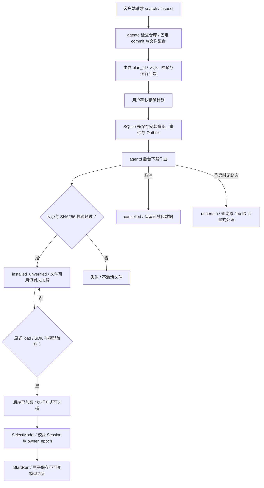
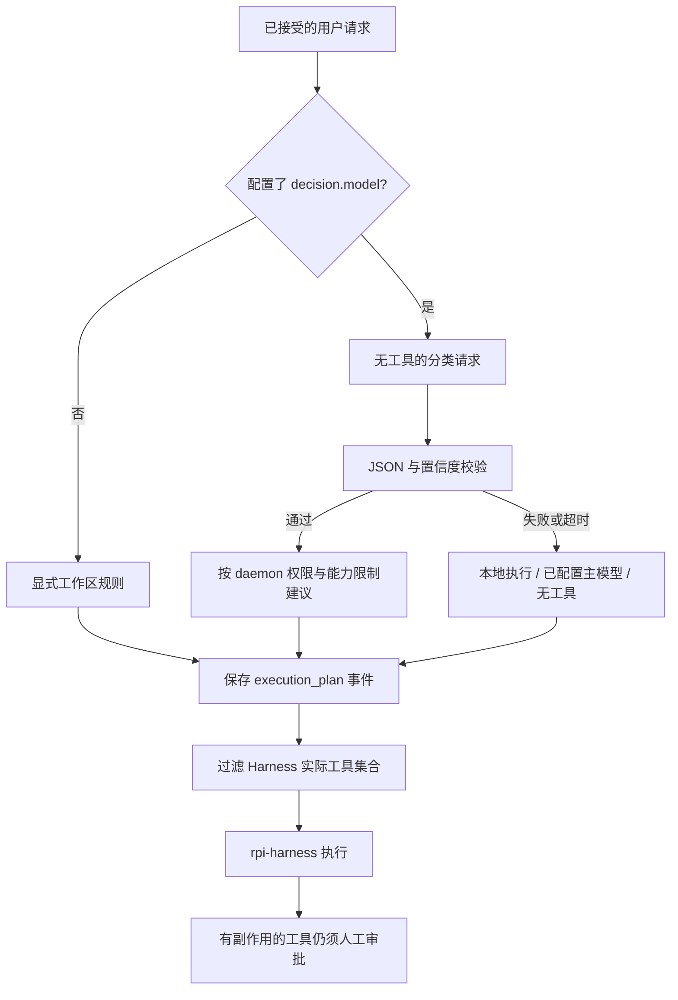

# 模型与执行决策

## 终端模型目录与安装

`/models` 通过认证协议读取 agentd 的统一目录，包含内置 API 模型、配置模型和 Hugging Face 已安装权重。目录中的 `configurable`、`installed_unverified` 和 `ready` 分别表示需要凭据、文件已安装但未加载、执行方式已具备；API 凭据存在不代表已完成联网推理验证。模型与执行方式分别有稳定 ID，使用 `/models select MODEL EXECUTION` 选择。agentd 校验会话归属和 `owner_epoch`，有活动或结果未知的 Run 时拒绝切换。选择写入 SQLite，Run 接受时在同一事务复制执行绑定，后续选择不改写原 Run。

```text
/models search "SmolLM2"
/models inspect OWNER/REPO REVISION
/models plan OWNER/REPO REVISION FILE llama_cpp
/models install OWNER/REPO REVISION FILE llama_cpp PLAN_ID
/models status PLAN_ID
/models cancel PLAN_ID
/models installed
/models load PLAN_ID
/models select PLAN_ID local:PLAN_ID
/models unload PLAN_ID
/models remove PLAN_ID
```

运行后端参数为 `llama_cpp` 或 `mistral_rs`。计划固定 commit 和文件集合；安装前必须确认计划 ID。GGUF 下载选定文件，safetensors 计划包含配置、tokenizer 和权重分片，不执行仓库代码。agentd 使用官方 Rust `hf-hub` 下载、校验大小及 SHA256，再激活安装目录。取消保留下载文件；固定版本且有预期哈希的部分文件可通过 Range 续传，其他部分文件重新下载。续传后仍校验完整 SHA256，服务器忽略 Range 或文件损坏时拒绝激活。移除将文件移入隔离目录，可由管理员恢复。

安装作业先在 SQLite 记录意图、事件和 Outbox，再下载；`status` 查询持久进度。daemon 重启后未终结作业进入 `uncertain`，须检查后显式恢复安装。下载完成为 `installed_unverified`；`load` 调用实际推理后端，加载成功才可选用。agentd 必须启用对应的 `local-llama` 或 `local-mistral` feature。`HF_ENDPOINT` / `--hub-endpoint` 配置 Hub 地址，`HF_TOKEN` 由 agentd 读取，TUI 不下载或加载权重。

当前加载使用 CPU 配置；尚无自动硬件推荐、空闲卸载、更新回滚或重启后自动重新加载。GGUF/safetensors 文件格式符合不代表架构兼容，加载错误会原样体现为不可用状态。终端 Hub 操作目前显示 JSON，进度通过 `status` 查询。

本机模型的工具能力默认关闭。配置 Profile 的 `supports_tools = true` 或以 `--local-model-tools` 启动 agentd 后执行 Hub `load`，可显式要求 mistral.rs 使用模型的工具模板与解析器；仍须针对具体模型验收。llama 适配器目前不提供工具调用，配置时声明该能力会被拒绝。能力声明不授予工具或绕过审批，实际工具范围继续由 agentd 的执行计划决定。

mistral.rs 可通过 Profile 的 `chat_template` 或 daemon 的 `--local-model-chat-template` 指定绝对路径的 UTF-8 `.jinja` 文件，大小为 1 字节至 1 MiB，拒绝符号链接；llama 适配器拒绝此覆盖。它使用 SDK 的显式模板接口，适用于权重内嵌模板存在问题的情况。工具消息通过公开 `RequestLike` 传递标准 `tool_calls`，相关上游问题见 [mistral.rs #2528](https://github.com/EricLBuehler/mistral.rs/issues/2528)。

Linux CPU 的 [真实工具验收记录](evidence/model-tools-linux.json) 确认了实际文件读取及跨轮返回结果，但 0.5B 模型列目录时反复添加非法字段，严格四轮验收失败。第二轮重新读取了文件，不能据此声称纯历史记忆通过。较大模型推理验收已延期；这些记录不证明所有模型均能正确调用所有工具。

真实 CPU 推理验收使用 `cargo test --profile native-acceptance -p agentd --features local-mistral --test model_native_tools -- --ignored --nocapture`。该配置优化 Rust 推理内核并关闭 LTO，不使用未优化 debug 构建衡量本地模型响应能力。测试显式下载固定版本权重，校验真实工作区工具事件和多轮结果；Mock 通过不能替代该验收。

Agent 默认内嵌通用核心，先固定本次配置的主模型并保存 `model_route_decision`，再生成 Agent 专属的工具计划。通用库与可选后端见[可复用决策引擎](decision-engine.md)；独立网关见 [AI Gateway](gateway.md)。

每次运行先由 `agent-decision` 生成执行计划，再由 `agent-runtime` 打开 `rpi-harness`。分类器只返回建议，不执行工具，也不能授予权限。

## 模型安装与运行绑定流程

目录查询、安装和加载均由 agentd 处理，不要求先创建聊天。只有选择模型时才绑定具体会话。文件校验成功、后端加载成功和模型质量验收是三件不同的事。



源码核对: [apps/agentd/src/model_hub.rs](https://github.com/lyonbrown4d/lyonbrown/blob/705f995a59ff69e186f07a035dcb639e43f9d44d/apps/agentd/src/model_hub.rs), [apps/agentd/src/model_jobs.rs](https://github.com/lyonbrown4d/lyonbrown/blob/705f995a59ff69e186f07a035dcb639e43f9d44d/apps/agentd/src/model_jobs.rs), [apps/agentd/src/model_catalog.rs](https://github.com/lyonbrown4d/lyonbrown/blob/705f995a59ff69e186f07a035dcb639e43f9d44d/apps/agentd/src/model_catalog.rs).

## 执行计划如何生效

未配置 `decision.model` 时，daemon 使用显式工作区规则：通用模型、允许 `read_file`、`list_files`、`search_files` 和带版本校验的 `write_file`，并按配置及运行时能力提供 MCP、浏览器和受信任命令工具。配置且已配对的委派目标可启用分布式执行与 `delegate_task`。文件路径仍受工作区限制，变更操作仍须逐次审批。规则来自 daemon 配置，不从 prompt 中提取授权。

配置分类器后，daemon 将用户输入作为待分类数据发送。返回值必须是单个 JSON 对象，包含 `task_kind`、`model_policy`、`allowed_tools`、`execution_mode`、`target_hint`、`risk_level` 和 `confidence`。额外字段、无效枚举、错误类型或超出范围的置信度均被拒绝。



工具集合取分类结果、已授权工具和可用能力的交集。模型策略、分布式执行和目标节点也分别受允许列表约束。委派目标必须同时出现在配置和有效配对记录中；本地执行计划不提供委派工具。分类器不能通过输出其他工具、策略或节点扩大权限。委派配置与审批范围见[本地工具与浏览器操作](tools.md#委派给配对节点)。

有效计划先写入持久事件 `execution_plan`，其中包含工具、能力、执行模式、风险、置信度、来源及 `trace_id`，然后才打开 Harness。daemon 按该计划过滤实际工具集合，因此限制同时作用于模型可见工具和实际执行。审批按运行、工具、完整参数和有效期核对；分类器判断不能替代人工批准。

分类器不可用、超时、输出无效、置信度不足或缺少所需能力时，回退为本地执行模式，使用已配置的主模型且不提供工具或目标节点。分类阶段取消会将运行保存为取消状态，不调用主模型。

## 远程协议

| `provider` | 协议 | 凭证 |
| --- | --- | --- |
| `openai`、`openai-responses` | OpenAI Responses | `OPENAI_API_KEY` |
| `openai-completions` | OpenAI Chat Completions | `OPENAI_API_KEY` |
| `anthropic` | Anthropic Messages | `ANTHROPIC_API_KEY` |

协议通过实际提供方适配器访问端点。`openai` 是 Responses 的别名；选择兼容服务时应核对它支持的 API 模式。`supports_images` 是显式配置，默认关闭，不能根据模型名推断视觉支持。分类请求固定禁用图片和工具。

## 配置分类器

在数据目录的 `config.toml` 中配置；凭证放在相邻 `.env` 或进程环境中：

```toml
provider = "openai"
model = "gpt-4.1"
supports_images = false

[decision]
model = "classifier-model-id"
provider = "openai-completions"
api_base = "https://models.example.com/v1"
timeout_ms = 3000
minimum_confidence = 0.75
```

`classifier-model-id` 和域名为示例，须替换为实际服务的模型 ID 与端点。省略整个 `[decision]` 即使用工作区规则。

| 配置 | 环境变量 | 默认值与约束 |
| --- | --- | --- |
| `decision.model` | `LYONBROWN_DECISION_MODEL` | 无；设置后不得为空 |
| `decision.provider` | `LYONBROWN_DECISION_PROVIDER` | 继承主模型 provider |
| `decision.api_base` | `LYONBROWN_DECISION_API_BASE` | 同 provider 时继承主模型地址，否则使用该 provider 默认地址 |
| `decision.timeout_ms` | `LYONBROWN_DECISION_TIMEOUT_MS` | `3000`；允许 `1..=60000` 毫秒 |
| `decision.minimum_confidence` | `LYONBROWN_DECISION_MINIMUM_CONFIDENCE` | `0.75`；允许 `0..=1` |

## 本地推理边界

`agent-inference` 通过 `llama-cpp-2` 和 `mistral.rs` 提供本地推理适配。它们只生成模型输出；会话与 Agent Loop 仍由同一个 `rpi-harness` 管理。daemon 启动时加载配置的本地文件并注册模型，加载失败则不会就绪，也不会转用云端或自动下载模型。

```toml
provider = "local"
model = "local-main"

[[local_models]]
id = "local-main"
backend = "llama"
format = "gguf"
path = "/absolute/path/to/chat-model.gguf"
context_window = 4096
max_output_tokens = 512
parallel_requests = 1
max_model_bytes = 8589934592
```

路径和模型文件为示例，必须换成本机文件；Windows 应使用本机绝对路径。`llama` 需要构建 `agentd` 时启用 `local-llama`，`mistral` 需要 `local-mistral`。llama 读取 GGUF；Mistral 可选择 `gguf` 或 `directory`。文件、模型架构与量化格式仍须被所选推理库支持，扩展名相同不代表兼容。

本地配置使用 CPU，不隐式分配 GPU。`max_model_bytes` 限制输入文件大小，不表示运行时内存上限；上下文、输出 token 与并发量分别受配置约束。运行开始时，实际模型元数据写入 `model_selected` 事件。文本模型不声明图片或工具能力，daemon 会在保存执行计划和创建 Harness 前移除不受支持的工具。

分类器也可设置 `decision.provider = "local"`，并将 `decision.model` 指向已配置的本地模型 ID，与主模型独立选择。`LocalClassifier` 只接受无工具的结构化输出，仍受同一 JSON、置信度、超时和取消规则约束；格式不合格时保守回退。本地主模型不需要云端凭证。

运行方法与验收边界见[开发与验证](development.md)，MCP 配置见[连接 MCP 工具](mcp.md)。

源码依据：[决策校验](https://github.com/lyonbrown4d/lyonbrown/blob/main/crates/agent-decision/src/engine.rs)、[daemon 接线](https://github.com/lyonbrown4d/lyonbrown/blob/main/apps/agentd/src/decision.rs)、[执行与持久化](https://github.com/lyonbrown4d/lyonbrown/blob/main/apps/agentd/src/execution.rs)、[配置](https://github.com/lyonbrown4d/lyonbrown/blob/main/crates/agent-config/src/settings.rs)。
