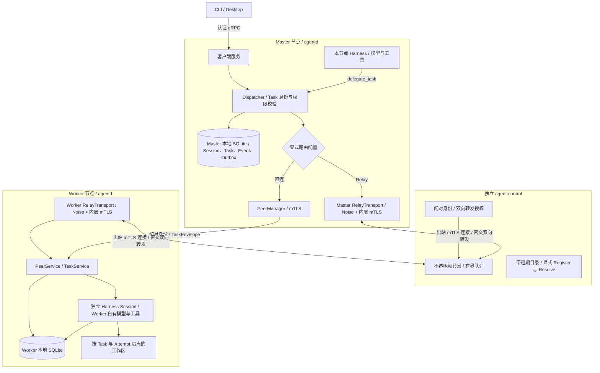
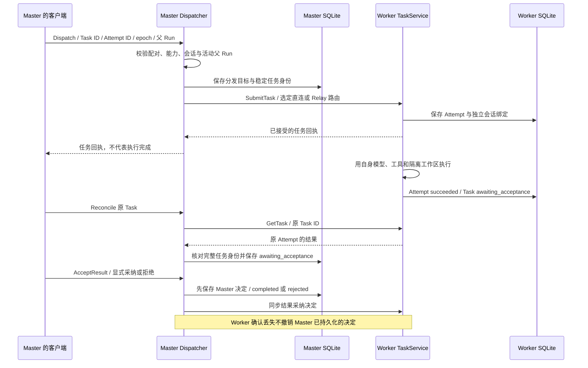

# 连接节点与 Control Relay

本页面向配置 Master、Worker 和自托管 `agent-control` 的运维人员。直连与 Relay 共用 `PeerService`、`TaskService`、节点配对和任务持久化规则。客户端只连接本机 Master；跨节点连接由 daemon 建立。组件关系见[组件与调用关系](architecture.md)。

## 分布式部署与信任边界

客户端连接 Master；跨节点任务由 daemon 在已配对的身份和能力范围内发送。双方使用各自模型、凭据和持久化目录。



Master 与 Worker 各自提交本地 SQLite 事务，没有跨节点共享的 Session 数据库。Control 不执行模型或工具，也不保存任务明文。图中直连和 Relay 是配置选择的替代路径，不是故障时自动切换的两条通道；目录 API 独立存在，daemon 的 Relay runtime 不自动注册或续租。

源码核对: [crates/agent-distributed/src/peers.rs](https://github.com/lyonbrown4d/lyonbrown/blob/705f995a59ff69e186f07a035dcb639e43f9d44d/crates/agent-distributed/src/peers.rs), [crates/agent-distributed/src/relay_transport/mod.rs](https://github.com/lyonbrown4d/lyonbrown/blob/705f995a59ff69e186f07a035dcb639e43f9d44d/crates/agent-distributed/src/relay_transport/mod.rs), [apps/agent-control/src/](https://github.com/lyonbrown4d/lyonbrown/blob/705f995a59ff69e186f07a035dcb639e43f9d44d/apps/agent-control/src/).

## 先确认身份与权限

每个 daemon 使用独立数据目录和节点身份。公开身份包含节点 ID、TLS 证书和 Noise 公钥；私钥保留在本机 `peers/peer-identity.json`。Control 使用自己的数据目录，在 `identity/peer-identity.json` 保存私有身份，在 `control.sqlite3` 保存信任、目录记录和允许转发的节点关系。只交换 `peer-identity` / `identity` 命令导出的公开 JSON，不复制私有身份文件。

配对前，通过独立可信渠道核对命令输出的完整配对指纹。指纹绑定节点 ID、TLS 证书指纹和 Noise 公钥；仅核对证书指纹不足以授权 Noise 身份。配对是本地人工操作；网络 `Pair` 接口拒绝修改信任，mDNS 候选也不会建立信任或选择路由。

在仓库根目录运行以下命令。将示例目录替换为实际绝对路径。daemon 维护命令需要独占数据目录，应先妥善停止对应 daemon，再操作并重启监听器以重新加载 mTLS 信任根。首次导出身份不要求开启 peer 监听器。

```sh
cargo run -p agentd -- --data-dir /path/to/master peer-identity > master-public.json
cargo run -p agentd -- --data-dir /path/to/worker peer-identity > worker-public.json
```

JSON 写到标准输出；完整配对指纹写到标准错误。以下命令中的 `<verified-…-fingerprint>` 必须替换为独立核对后的值：

```sh
cargo run -p agentd -- --data-dir /path/to/worker peer-pair \
  --identity master-public.json --fingerprint '<verified-master-fingerprint>' \
  --capabilities tasks.submit,tasks.read,tasks.cancel,tasks.accept,workspace.read,workspace.write.approval
cargo run -p agentd -- --data-dir /path/to/master peer-pair \
  --identity worker-public.json --fingerprint '<verified-worker-fingerprint>' \
  --capabilities workspace.read,workspace.write.approval
```

权限按接收方保存的信任记录判断：Worker 对 Master 授予 `tasks.submit`、`tasks.read`、`tasks.cancel`、`tasks.accept`，分别允许提交、查询/事件、取消和结果采纳。提交还要求 Master 的信任范围包含任务请求的每个能力。示例允许读和需审批的写；只需读取时，应同时从配对范围和任务范围移除 `workspace.write.approval`。Master 对 Worker 的配对用于验证 Worker 身份，不因此授予 Worker 反向提交任务的权限。

## 配置直连

在各 daemon 数据目录的 `config.toml` 加入：

```toml
[peer]
listen = "0.0.0.0:7448"
advertise_url = "https://worker.example.test:7448"
mdns = false
```

每个节点使用自己的可达地址。`listen` 端口必须非零；`advertise_url` 必须是 HTTPS origin，端口与监听端口相同，不能含凭证、路径、查询参数、fragment 或通配主机名。不能将未指定地址 `0.0.0.0` / `::` 用作公告地址。未配置 `[peer]` 时不会启动 peer 监听器；启动 mTLS 监听器前至少配对一个节点。

保留本地客户端的回环监听地址；不要把默认 `127.0.0.1:7447` 客户端入口开放到公网。peer 监听器单独提供 mTLS 的节点和任务服务。TLS 使用配对证书与节点派生的服务名验证身份，连接后 `Hello` 再核对节点 ID、证书指纹和协议范围。

daemon 的配置优先级见[本地运行](quickstart.md)。peer 设置支持 `LYONBROWN_PEER_LISTEN`、`LYONBROWN_PEER_ADVERTISE_URL`、`LYONBROWN_PEER_MDNS` 环境变量；`mdns` 默认 `false`。启用发现仍需人工配对并显式提供目标。

## 配置出站 Relay

Master 和 Worker 都主动连接 Control 的 HTTPS 监听器，无需让另一节点直接访问本机 peer TCP 端口。每个 daemon 仍需配置 `[peer]`，启动时仍绑定该本地端口；仅使用 Relay 时可将 `listen` 绑定回环地址，`advertise_url` 仍须满足 peer URL 校验。

先导出 Control 公开身份：

```sh
cargo run -p agent-control -- --data-dir /path/to/control identity > control-public.json
```

在 Master 和 Worker 上分别导入已核验的 Control 身份。`control.relay` 是此配对的明确范围，不能代替 Master 与 Worker 之间的配对：

```sh
cargo run -p agentd -- --data-dir /path/to/master peer-pair \
  --identity control-public.json --fingerprint '<verified-control-fingerprint>' \
  --capabilities control.relay
cargo run -p agentd -- --data-dir /path/to/worker peer-pair \
  --identity control-public.json --fingerprint '<verified-control-fingerprint>' \
  --capabilities control.relay
```

Control 也要导入双方公开身份，并显式允许两个方向：

```sh
cargo run -p agent-control -- --data-dir /path/to/control pair master-public.json \
  --pairing-fingerprint '<verified-master-fingerprint>'
cargo run -p agent-control -- --data-dir /path/to/control pair worker-public.json \
  --pairing-fingerprint '<verified-worker-fingerprint>'
cargo run -p agent-control -- --data-dir /path/to/control allow '<master-node-id>' '<worker-node-id>'
cargo run -p agent-control -- --data-dir /path/to/control allow '<worker-node-id>' '<master-node-id>'
```

`pair` 在 Control 中授予 `control.register`、`control.resolve`、`control.relay`。`allow` 只授权一个方向，返回流量需要反向授权。配对后重启 Control 监听器以加载信任根。

在 Master 的 `config.toml` 加入以下内容，Worker 上则将 `routes` 改为 Master 的节点 ID。节点 ID 来自公开身份 JSON，不是目录名或自行选择的显示名称。

```toml
[relay]
control_node_id = "control"
endpoint = "https://control.example.test:7449"
routes = ["<worker-node-id>"]
```

`routes` 接受 1 至 32 个不同节点 ID，不能包含 Control 或本机 ID。Control ID 和路由 ID 只允许 ASCII 字母、数字、`-`、`_`、`:`、`.`，长度为 1 至 128。Relay endpoint 必须是无凭证、路径、查询参数或 fragment 的 HTTPS origin。Relay 设置由 TOML 提供，没有专用的 Relay 环境变量或 CLI 参数。

`routes` 中的节点始终使用 Relay；不在其中的节点走直连。选定 Relay 后，断线或认证失败会返回错误，不会自动改走直连。Task 命令仍需提供 Worker 的 HTTPS `--node-endpoint`，用于同一内层 mTLS 连接；此地址不会因 Relay 模式而变成 Control 地址。

Control 默认读取其数据目录中的 `control.toml`，或使用 `--config` 指定文件。例如：

```toml
node_id = "control"
listen = "0.0.0.0:7449"
lease_seconds = 60
queue_capacity = 32
log_directory = "logs"
log_retention = 14
log_filter = "info"
```

Control 按默认值、TOML、配置文件旁的 `.env`、进程环境、`--listen` 顺序覆盖。环境变量为 `LYONBROWN_CONTROL_NODE_ID`、`LYONBROWN_CONTROL_LISTEN`、`LYONBROWN_CONTROL_LEASE_SECONDS`、`LYONBROWN_CONTROL_QUEUE_CAPACITY`、`LYONBROWN_CONTROL_LOG_DIRECTORY`、`LYONBROWN_CONTROL_LOG_RETENTION`、`LYONBROWN_CONTROL_LOG_FILTER`。默认监听 `127.0.0.1:7449`；目录租期允许 1 至 3600 秒，队列容量允许 1 至 1024，日志保留文件数允许 1 至 365。相对日志目录以 Control 数据目录为基准。

也可在 `control.toml` 中使用 `allowed_links = []` 或 `[[allowed_links]]` 的 `source`、`target` 字段管理关系。只要该字段存在，`serve` 启动时就会原子替换数据库中的整张允许关系表；省略该字段则保留 `allow` / `deny` 写入的关系。

```sh
cargo run -p agent-control -- --data-dir /path/to/control serve
cargo run -p agentd -- --data-dir /path/to/master
cargo run -p agentd -- --data-dir /path/to/worker
```

三条命令运行于各自节点或终端。Control 使用 mTLS 验证出站流身份，再按方向检查转发权限；Noise IK 使用配对公钥验证端到端隧道，隧道内仍运行普通 mTLS 与 `TaskService`。Control 可见源/目标节点、连接标识和密文长度，不接收任务明文，也不执行模型或工具。队列有界且不作为持久任务队列；接收或入队成功不等于 Worker 已执行。

`ControlService` 提供带租期的 `Register` / `Resolve`，但 daemon 的 Relay runtime 只建立出站流，不自动注册、续租或解析目录。此配置使用显式路由，不依赖目录注册；目录记录也不能建立配对信任。

## 派发、审批与断线恢复

通过连接 Master 的 CLI 管理任务。先在 Master 创建会话并启动运行；派发要求 `--parent-run` 是该会话中状态为 `running` 的运行。Task 与 Attempt 均使用预先保存的 UUID，`idempotency_key` 使用稳定标识。

```sh
cargo run -p agent-cli -- --data-dir /path/to/master task dispatch \
  --node-id '<worker-node-id>' --node-endpoint https://worker.example.test:7448 \
  --session '<session-id>' --parent-run '<active-run-id>' \
  --task-id '<task-uuid>' --attempt-id '<attempt-uuid>' \
  --idempotency-key '<stable-key>' --instructions 'Inspect the assigned workspace' \
  --capability workspace.read --deadline-seconds 3600
```

截止时间允许 1 至 86400 秒。Worker 使用自身模型、凭据与 Harness，在 `worker-workspaces/<task_id>/<attempt_id>` 下创建独立工作区和会话；不会复制 Master 的会话历史或工作区文件。任务能力只能缩小 Worker 可用工具范围；写操作仍需 Worker 本地审批，通过连接 Worker 的客户端处理，Relay 和 Master 的结果采纳均不能绕过工具审批。

Worker 成功后 Task 为 `awaiting_acceptance`，Master 显式采纳后才是 `completed`：

```sh
cargo run -p agent-cli -- --data-dir /path/to/master task get '<task-uuid>'
cargo run -p agent-cli -- --data-dir /path/to/master task reconcile '<task-uuid>' \
  --node-id '<worker-node-id>' --node-endpoint https://worker.example.test:7448
cargo run -p agent-cli -- --data-dir /path/to/master task accept '<task-uuid>' \
  --node-id '<worker-node-id>' --node-endpoint https://worker.example.test:7448 --accepted true
```

`task list --session <session-id>` 查询 Master 的分页记录；`task cancel` 使用与 `reconcile` 相同的目标参数。拒绝结果使用 `task accept … --accepted false`。

断线、超时或取消响应丢失后，先保留原 Task、Attempt、幂等键和目标，再用 `get` 查看本地状态，用 `reconcile` 核对同一次远端尝试。Master 将结果未知的尝试保存为 `uncertain`；Relay 重新连通只恢复传输，不自动核对业务状态或重放请求。不要换用新标识重新派发来规避未知结果。Worker 重启也会将未持久结束的尝试标记为未知，不重新执行。状态与审批细节见[会话、任务与恢复](persistence.md)。

## Task 派发、Attempt 完成与结果采纳

执行成功与采纳结果分开保存。传输回执、Worker Attempt 结果以及 Master 的最终决定不能互相替代。



这是一条任务已到达 Worker 的成功路径。提交或取消响应丢失时，Master 保留原 Task、Attempt 和目标，将未知结果记录为 `uncertain`，通过 `reconcile` 查询同一次尝试；不会自动重发执行。Worker 的写操作仍需 Worker 本地审批，Master 采纳结果不能代替该审批。

源码核对: [crates/agent-distributed/src/dispatcher.rs](https://github.com/lyonbrown4d/lyonbrown/blob/705f995a59ff69e186f07a035dcb639e43f9d44d/crates/agent-distributed/src/dispatcher.rs), [crates/agent-distributed/src/worker.rs](https://github.com/lyonbrown4d/lyonbrown/blob/705f995a59ff69e186f07a035dcb639e43f9d44d/crates/agent-distributed/src/worker.rs), [crates/agent-distributed/src/worker_run.rs](https://github.com/lyonbrown4d/lyonbrown/blob/705f995a59ff69e186f07a035dcb639e43f9d44d/crates/agent-distributed/src/worker_run.rs).

## 撤销与排障

- 禁止一个转发方向：`agent-control --data-dir /path/to/control deny <source> <target>`。需要双向隔离时分别禁止两个方向；若配置了 `allowed_links`，同时修改配置以免重启时恢复旧关系。
- 撤销 Control 中的节点身份：`agent-control --data-dir /path/to/control revoke <node-id>`。活动流会重新检查信任；重启监听器以移除旧 CA 根。
- 撤销 daemon 中的身份：停止对应 daemon，执行 `agentd --data-dir /path/to/node peer-revoke --node-id <node-id>`，再启动监听器。更换身份需要重新导出、独立核验并在相关接收方重新配对。
- mTLS 失败时，核对公开身份、完整配对指纹、双方信任和监听器是否重启；不要通过关闭验证恢复连接。
- Relay 不通时，核对两端出站连接、双方 `routes`、Control 的双向允许关系和已配对身份。`target has no active outbound relay stream` 表示目标没有活动流；背压错误表示有界队列未能及时接受数据。
- 查看各数据目录下的结构化日志，关注 `control.listen`、`control.relay`、`relay.transport` 和任务 ID。日志用于定位连接与状态变化；不要把 token、私钥或完整任务明文加入排障材料。

## 来源与验证范围

本文按当前工作区中的 `apps/agentd/src/peers/`、`apps/agent-cli/src/task_command.rs`、`apps/agent-control/src/`、`crates/agent-config/src/{peer,relay}.rs` 和 `crates/agent-distributed/src/` 核对。`apps/agent-control/tests/relay_tasks.rs` 定义了本地真实 mTLS / Noise 转发、Worker Harness、隔离工作区、结果采纳及断线后同一尝试核对的测试，并通过本地 mock server 覆盖标准模型协议，不调用付费模型。

测试定义和文档构建不能证明公网部署、跨设备网络或三平台运行验收。实际运行证据与截图的范围见[桌面运行截图与验收范围](runtime-evidence.md)；本页命令与配置经过源码核对，不作为部署执行记录。
