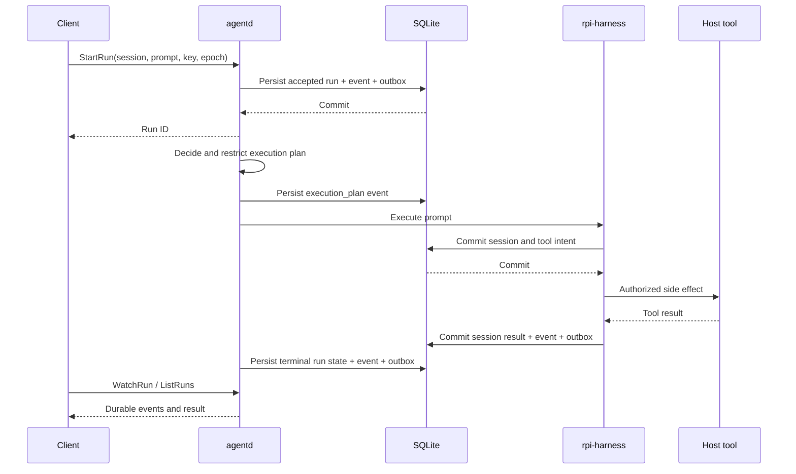
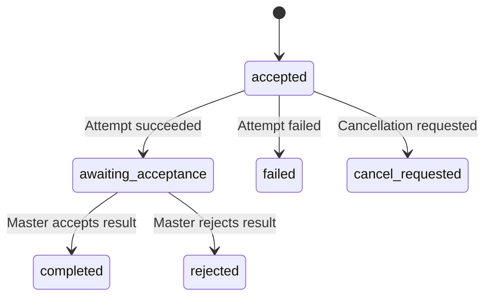

# 会话、任务与恢复

会话保存可继续对话的 Harness 语义，运行记录保存一次用户请求的编排状态。SQLite 将这两类数据分开存储，并在关键写入中一并记录事件和 Outbox。

## 提交与执行

`accept_run` 校验 `owner_epoch`，用 `(session_id, idempotency_key)` 去重。同一键再次提交相同 prompt 会返回既有运行；换用不同 prompt 会报错。数据库的 `one_active_run` 唯一索引阻止一个会话同时拥有多个未结束运行。

Runtime 将工具交给主机适配器执行，主机负责授权、工作区约束和取消。Harness 自身的 provider 自动重试被禁用；重试策略属于持久任务编排。先保存执行意图，再产生副作用，是恢复时区分「未执行」与「结果未知」的依据。

## 快照与事件中的图像

Harness 快照保留原始消息内容。`entry_appended` 和 `record_appended` 则使用独立投影：图像块只保留 `type`、`mimeType`、`dataRedacted` 和 `encodedBytes`，不携带 Base64 内容。`encodedBytes` 表示原 Base64 字符串的字节数。该规则也适用于工具结果、压缩保留的消息、执行意图、排队消息和流式起始消息；Store、Outbox 与 `WatchRun` 使用同一投影载荷。投影发生在 Runtime 提交新事件时，读取既有事件不会重新计算载荷。

投影按已知消息类型处理图像，不递归删除任意 JSON 中的 `data` 字段。工具参数和自定义业务数据仍由对应适配器约束；无法识别的排队载荷或消息帧只返回 `projectionOmitted` 标记。输入图像的调试输出只含 MIME 和长度。

含图像会话的恢复暂不开放。恢复入口保留原快照并明确返回不可用，不调用模型或重放请求。原因是 rpi-ai 0.5.0 的原始 JSON 序列化会产生重复的 `type` 字段，见[上游问题 #59](https://github.com/bigfish1913/pi-rust/issues/59)。代码没有加入快照规范化适配。daemon 的 `StartRun` 接口仍只接收文本；Runtime 内部的图像输入不代表客户端支持图像会话。

## 断线与重启

客户端断线后，使用原会话重新查询运行状态。事件按运行 ID 和 `cursor` 排序，`WatchRun` 的 `after_cursor` 用于请求后续事件。事件流断开不能证明任务失败，也不能触发 prompt 重放。

存储层的 `recover_interrupted` 将执行中而没有持久终态的记录标记为 `uncertain`。尚未开始的 `accepted` 记录与已经进入执行的记录分开处理。Runtime 恢复 Harness 会话时检查未完成的工具记录：工具结果未提交时返回 `Uncertain`，不会猜测副作用是否发生。

恢复事务同时将对应运行的 `pending` 审批改为 `cancelled`，并写入 `approval_closed`、`run_uncertain` 事件及 Outbox。任一写入失败时，这些状态和事件一并回滚；重复恢复不再次生成记录。关闭旧审批不会解决运行的未知结果，也不会授权重放工具。

`uncertain` 仍属于未解决的运行，不能通过创建同会话的新运行绕过。应保留数据库、事件和对应外部操作证据，核对实际结果后再决定后续操作。当前协议没有通用的人工修改终态接口。

## 审批

审批保存工具名、参数、所属运行和过期时间。`decide_approval` 只接受尚未过期且仍处于等待审批的请求。消费审批时再次核对运行、工具和参数，并将审批状态改为 `consumed`，防止同一授权被重复使用。

## Master 与 Worker

TaskStore 在更新 Worker Attempt 或采纳结果时校验 `attempt_id` 与 `owner_epoch`。成功的 Attempt 先进入 `awaiting_acceptance`；只有显式接受结果后 Task 才进入 `completed`。

Worker 启动恢复只处理持久分发目标为本机、Attempt 状态为 `accepted` 或 `running` 的记录，将其标记为 `uncertain`，同时保留所有权校验。发往其他节点的 Master 记录和未记录目标的通用 Task 保持原样；它们不会因 Worker 恢复而被改写。该操作不迁移 Master 所有权，也不重放 Attempt。

图示反映存储层的状态边界，不代表已经验证了跨设备调度、网络分区或公网转发。相关实现依据为 `crates/agent-storage/src/runs.rs`、`tasks.rs`、`approvals.rs` 与 `crates/agent-runtime/src/runtime.rs`。
