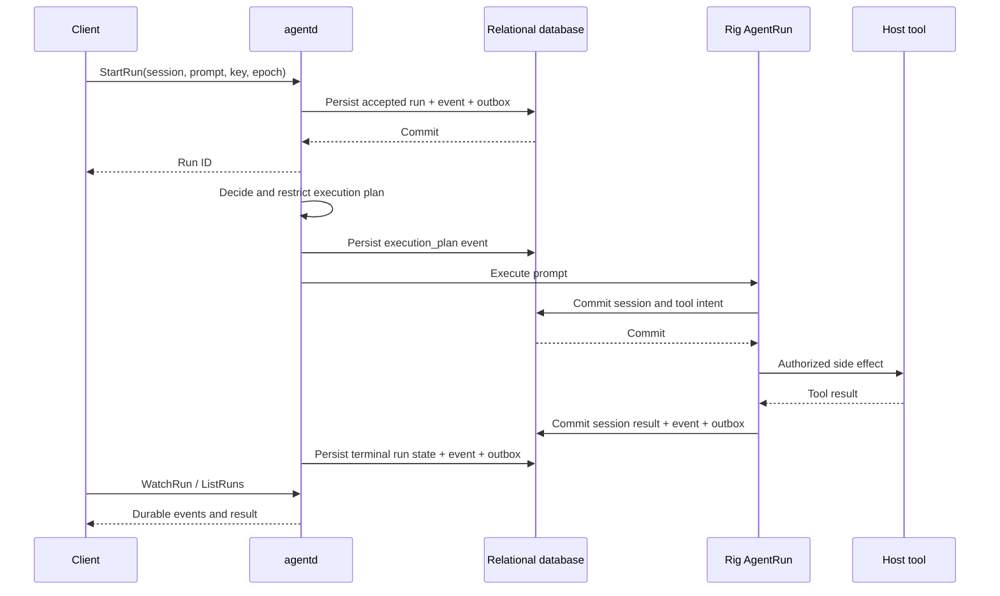
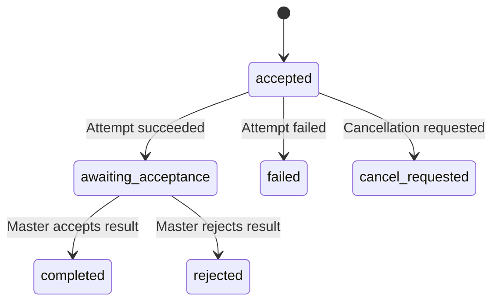

# 会话、任务与恢复

会话保存可继续对话的 Runtime 语义，运行记录保存一次用户请求的编排状态。关系数据库将这两类数据分开存储，并在关键写入中一并记录事件和 Outbox。默认后端为本机 SQLite；daemon 也可配置 PostgreSQL 或 MySQL。

## 数据库与异步事务

`agent-storage` 使用固定版本 SeaORM 2.0.4 与 SQLx 原生异步连接。`Store::open`、`Store::connect` 和读写接口均需等待异步结果；关系数据库操作不通过 `spawn_blocking`、隐藏运行时或同步外观执行。SQLite 启用 WAL、完整同步和 5 秒 busy timeout，连接池限制为一个连接。

默认文件为 daemon 数据目录下的 `agent.sqlite3`。`--database-url`、`LYONBROWN_DATABASE_URL` 或 TOML 的 `database_url` 可选择 `sqlite:`、`postgres:` / `postgresql:`、`mysql:`。含凭据的连接地址应置于本机受限的 `.env` 或进程环境，不写入仓库、命令历史或 UI 模型。数据目录仍保存节点身份、认证文件和本机所有权信息；远程数据库不取消这些要求。

关键写入使用共享 `DatabaseTransaction`。事务内更新专用写锁记录，再检查修订、Session 所有权和 `owner_epoch`，一并提交状态、事件和 Outbox。非 MySQL 后端还使用 `one_active_run` 条件唯一索引；MySQL 的活动运行限制由同一事务内的校验和写入互斥承担。接入三种驱动不代表三种数据库或多节点场景已经完成运行验收。一份数据库只支持由一个逻辑 daemon 独占；多个 daemon 共用同库的作业消费和恢复尚未支持。

数据库结构由 SeaORM Migration 的版本化 Rust 迁移创建与记录，面向最新初始结构，不提供旧 Diesel 数据库的导入、兼容升级或自动清空。不要用历史数据库替代新结构的运行验收。具体实现见 `crates/agent-storage/src/lib.rs`、`migration.rs` 与 `migration/`。[长期记忆](memory.md)使用同一关系数据库保存正文和索引作业，向量后端单独配置。

## 提交与执行

`accept_run` 校验 `owner_epoch`，用 `(session_id, idempotency_key)` 去重。同一键再次提交相同 prompt 会返回既有运行；换用不同 prompt 会报错。事务校验与对应后端的数据库约束阻止一个会话同时拥有多个未结束运行。

Runtime 将工具交给主机适配器执行，主机负责授权、工作区约束和取消。Runtime 自身的 provider 自动重试被禁用；重试策略属于持久任务编排。先保存执行意图，再产生副作用，是恢复时区分「未执行」与「结果未知」的依据。

## 快照与事件中的图像

Runtime 快照使用版本化结构，保存 Session ID、Rig 消息历史、活动 AgentRun 与已准备请求、steering 消息、未完成工具、输入队列及未知结果。消息使用 Rig 原生序列化，完整保留图像以便恢复会话。快照属于执行状态，不作为客户端事件载荷。

持久化变更事件仅写入白名单元数据（如运行 ID、调用 ID、工具名）与显式公共事件，不复制完整 Rig raw 响应、消息或图像内容。Store、Outbox 与 `WatchRun` 使用同一事件载荷。工具参数、自定义业务数据与凭据仍由各适配器约束；该规则不代替对应数据的授权和脱敏。

Runtime 支持消息图像的序列化恢复，客户端通过独立的 `StartRunWithAttachments` 提交图片，`StartRun` 保留文本输入。图片媒体与 Run 接受在同一事务保存；模型须显式支持视觉。详见[图片输入及限制](agent-workflows.md#输入图片)。默认 feature 的工作区编译通过，测试及图像恢复运行验收未重新执行。

## 断线与重启

客户端断线后，使用原会话重新查询运行状态。事件按运行 ID 和 `cursor` 排序，`WatchRun` 的 `after_cursor` 用于请求后续事件。事件流断开不能证明任务失败，也不能触发 prompt 重放。

存储层的 `recover_interrupted` 将执行中而没有持久终态的记录标记为 `uncertain`。尚未开始的 `accepted` 记录与已经进入执行的记录分开处理。Runtime 恢复会话时检查未完成的工具记录：工具结果未提交时返回 `Uncertain`，不会猜测副作用是否发生。

恢复事务同时将对应运行的 `pending` 审批改为 `cancelled`，并写入 `approval_closed`、`run_uncertain` 事件及 Outbox。任一写入失败时，这些状态和事件一并回滚；重复恢复不再次生成记录。关闭旧审批不会解决运行的未知结果，也不会授权重放工具。

`uncertain` 仍属于未解决的运行，不能通过创建同会话的新运行绕过。应保留数据库、事件和对应外部操作证据，核对实际结果后再决定后续操作。当前协议没有通用的人工修改终态接口。

## 重连后如何决定下一步

重连只恢复查询和事件订阅。恢复动作以服务端返回的 `allowed_actions` 为准；旧审批关闭或传输恢复都不构成重新执行的授权。

```mermaid
flowchart TD
    A["客户端重连"] --> B["按原 Session / Run ID 查询"]
    B --> C{"服务端运行状态"}
    C -->|已结束| D["显示持久结果与事件"]
    C -->|仍在执行或等待| E["WatchRun / after_cursor 继续订阅"]
    C -->|uncertain| F["InspectRunRecovery / 核对工具与 Task"]
    F --> G{"服务端允许恢复动作？"}
    G -->|否| H["显示原因 / 先核对未解决 Task 等阻塞项"]
    H --> F
    G -->|是| I{"用户显式决定"}
    I -->|Abandon| J["保存放弃记录 / 不执行模型或工具"]
    I -->|ContinueNewSession| K["创建新 Session 与新 Run / 仅提交新的输入"]
    J --> L["保留原 Run 的 uncertain 状态与证据"]
    K --> L
```

源码核对: [apps/agentd/src/recovery.rs](https://github.com/lyonbrown4d/lyonbrown/blob/705f995a59ff69e186f07a035dcb639e43f9d44d/apps/agentd/src/recovery.rs), [crates/agent-storage/src/runs.rs](https://github.com/lyonbrown4d/lyonbrown/blob/705f995a59ff69e186f07a035dcb639e43f9d44d/crates/agent-storage/src/runs.rs).

## 审批

审批保存工具名、参数、所属运行和过期时间。`decide_approval` 只接受尚未过期且仍处于等待审批的请求。消费审批时再次核对运行、工具和参数，并将审批状态改为 `consumed`，防止同一授权被重复使用。

## Master 与 Worker

TaskStore 在更新 Worker Attempt 或采纳结果时校验 `attempt_id` 与 `owner_epoch`。成功的 Attempt 先进入 `awaiting_acceptance`；只有显式接受结果后 Task 才进入 `completed`。

Worker 启动恢复只处理持久分发目标为本机、Attempt 状态为 `accepted` 或 `running` 的记录，将其标记为 `uncertain`，同时保留所有权校验。发往其他节点的 Master 记录和未记录目标的通用 Task 保持原样；它们不会因 Worker 恢复而被改写。该操作不迁移 Master 所有权，也不重放 Attempt。

图示反映存储层的状态边界，不代表已经验证了跨设备调度、网络分区或公网转发。相关实现依据为 `crates/agent-storage/src/runs.rs`、`tasks.rs`、`approvals.rs` 与 `crates/agent-runtime/src/runtime.rs`。
