# 运行截图与验收范围

桌面客户端截图来自本地 GPUI Desktop 原生窗口，运行环境为 macOS 27.0.1、arm64、GPUI Kit 0.7.3；工作区锁定的 CEF 版本为 154.0.34（Rust crate `cef` 154.5.0+154.0.34）。截图记录 0.1.0 原生验收程序的运行，使用本地 HTTP 模型 fixture，经认证连接真实 agentd。fixture 返回合成内容，不调用付费模型。设置、对话、标签页、面板折叠、审批、Editor 和 Diff 八张图采集于 2026 年 10 月 18 日。[原生截图记录](evidence/desktop-native-capture.json)保存了对应程序、源文件与图片摘要、两次已持久化为 `completed` 的 Run，以及状态为 `consumed` 的精确文件写入审批。设置页、聊天标签页和面板开关的使用方式见[客户端文档](clients.md)。

浏览器运行使用仅用于调试的 Chromium 测试钥匙串，不能据此认定生产钥匙串集成已验收。下列图片不代表 Windows、Linux、公网连接、真实模型、原生 Computer 输入或最终安装包验收。

## 设置与原生窗口

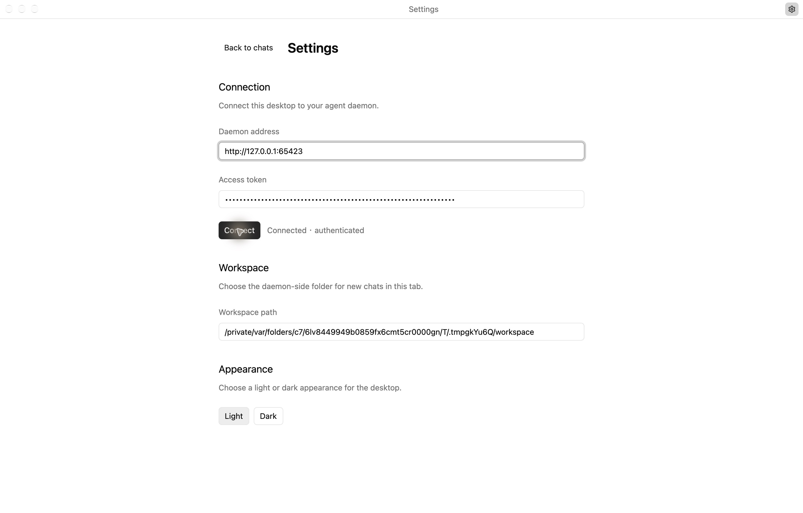

Settings 独立页面显示连接地址、已掩码的访问令牌、工作区和明暗外观选项。对话主窗口标题栏未显示地址或令牌。此次原生操作还观察到 macOS 系统窗口控制按钮，并实际执行了原生缩放动作；记录见[原生截图记录](evidence/desktop-native-capture.json)。

## 明暗对话

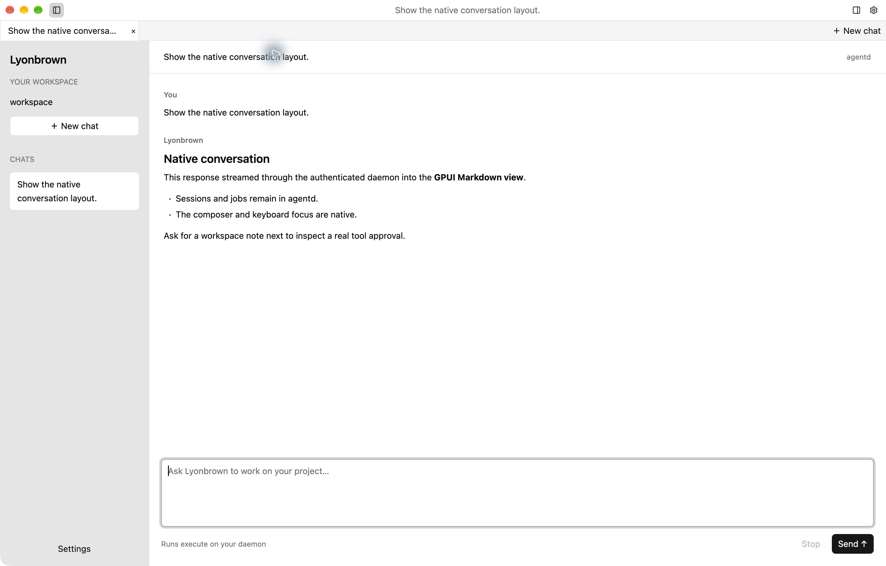

浅色窗口展示经 daemon 流式返回的合成回复、会话列表和原生输入区。右侧工作台已关闭；此图不作为 CEF 页面运行证据。

同一会话手动切换为深色；此截图不证明操作系统主题变化已自动同步。

## 标签页与面板开关

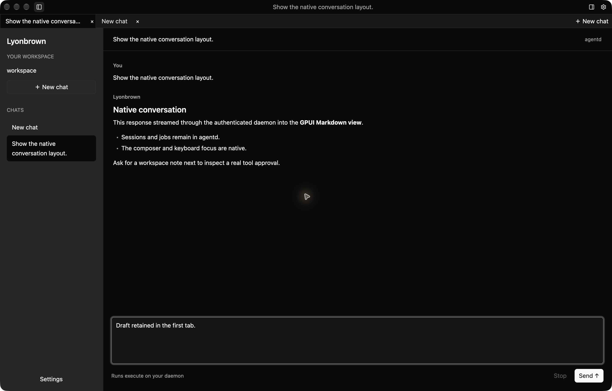

两个标签页分别输入不同草稿，再切回首个标签页，输入区恢复 `Draft retained in the first tab.`。另一个标签页恢复 `A separate draft in the second tab.` 的原生辅助功能观察记录保存在[原生截图记录](evidence/desktop-native-capture.json)；两个草稿均未提交给模型。

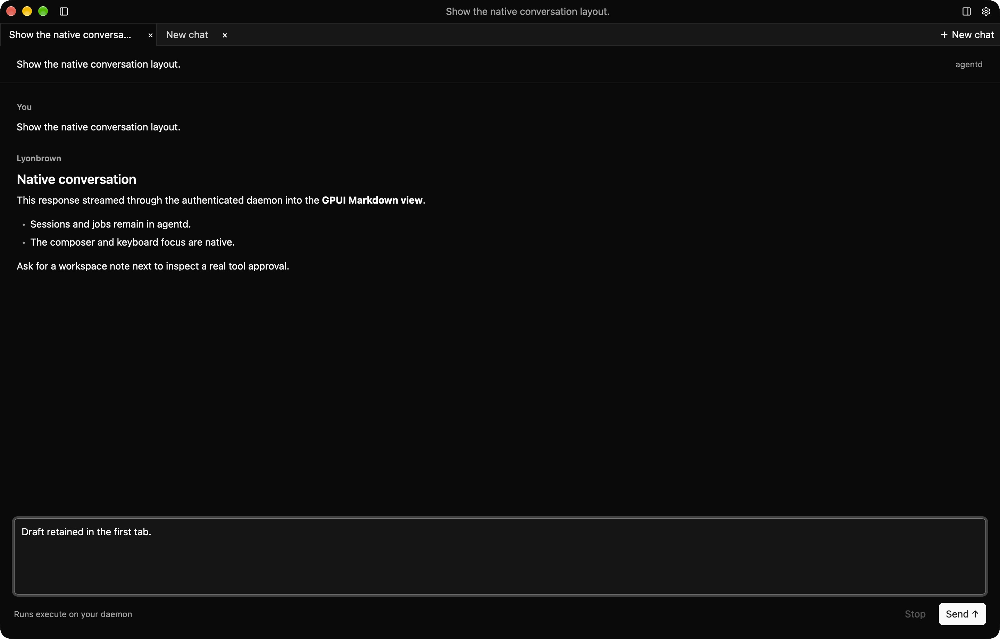

原生操作分别折叠和展开左右面板；图中两侧均已折叠，标题栏仍保留重新展开按钮。

## 审批与文件结果

真实 daemon 请求对 `notes.txt` 执行 `write_file`，窗口显示准确路径和内容以及单次允许、拒绝按钮。此次运行完成了单次批准，对应审批已持久化为 `consumed`，Run 已持久化为 `completed`；审批截图本身记录批准前状态。

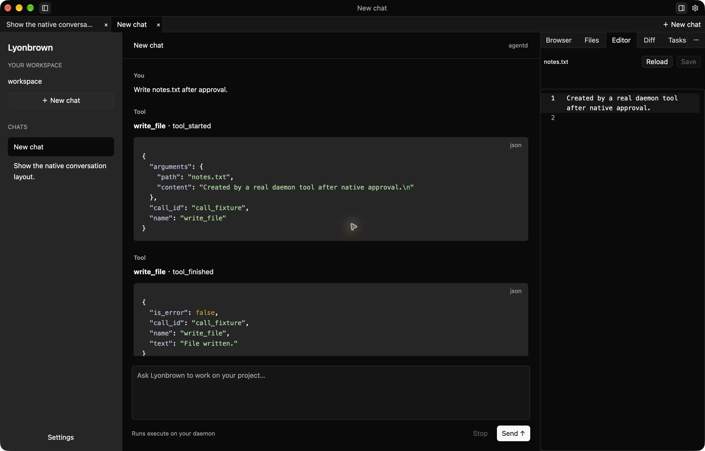

批准后，Editor 通过 daemon 的工作区接口读取 `notes.txt`，展示实际写入内容。此截图展示文件读取；编辑保存与冲突处理另由组件测试覆盖。

## Git 差异

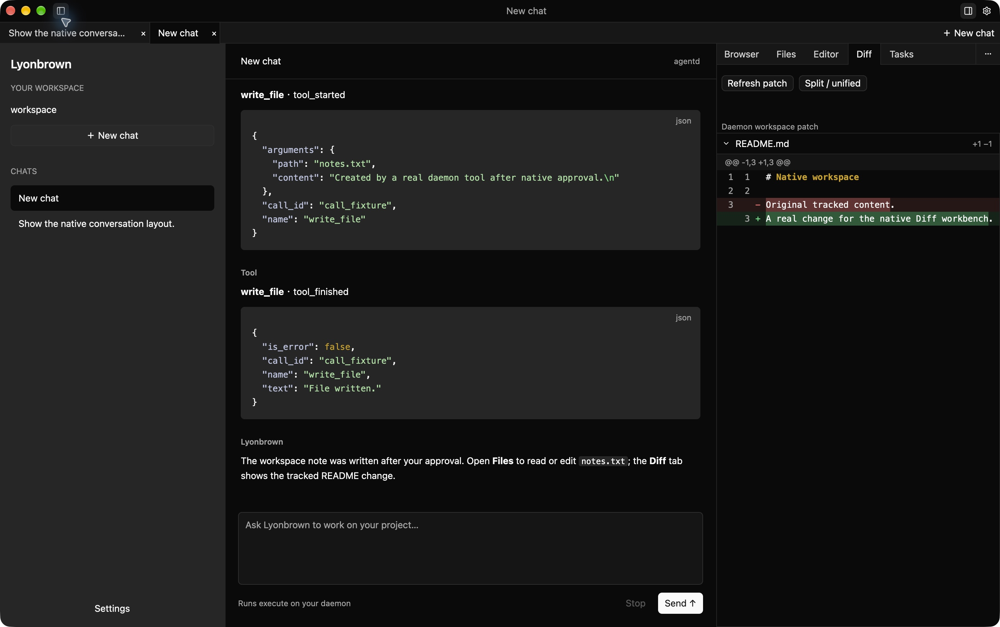

验收工作区先提交原始 `README.md`，再修改已跟踪内容。连接 daemon、创建会话并刷新 Diff 后，右侧在深色主题下显示实际 Git patch：删除 `Original tracked content.`，增加 `A real change for the native Diff workbench.`。左侧回复来自同一次原生窗口运行的本地模型 fixture。此图记录统一差异视图；未手工填入补丁内容。

[截图记录](evidence/desktop-diff-capture.json)包含程序与图片摘要、实际补丁以及已持久化为 `completed` 的 Run 标识。验收程序使用产品原生视图和本地 fixture，版本为 0.1.0；此图不作为最终安装包验收记录。

## 内嵌浏览器与人工接管

本节两张浏览器图片来自同一份独立原生验收构建，不属于上述八张图的构建摘要范围。[浏览器截图记录](evidence/desktop-browser-capture.json)保存了程序与源码摘要、图片摘要、已完成的 Run，以及已持久化的 Space 打开、接管、归还和关闭结果。

2026 年 10 月 19 日对安装包内正式 CLI 入口的[独立检查](evidence/browser-production-probe.json)首次未通过：CEF 已启动并返回画面与 AX，但目标页面在等待期间停留于 `about:blank`。同一程序随后在三个独立的新 Profile 中连续通过完整用例，验证页面 AX 与画面、语义填充和点击、指针聚焦与文字输入，以及 Profile 隔离和重启持久化。复测使用正式入口，`fixture_keychain=false`，期间未修改产品代码。首次失败原因仍未定位；复测通过不代表该问题已修复，也不构成全新用户环境的钥匙串授权或安装生命周期验收。

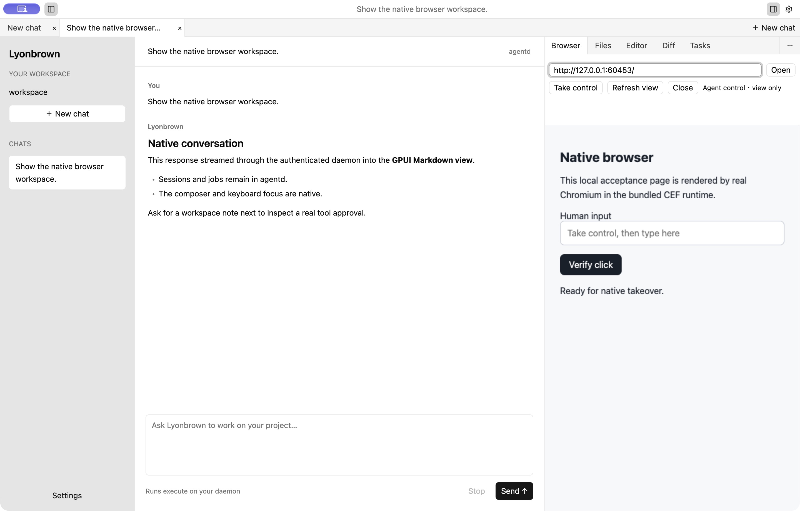

CEF Runtime 加载本地静态验收页面，通过 daemon 将真实 Chromium 像素帧传到 Browser 面板。此时界面处于 Agent control，只读展示。

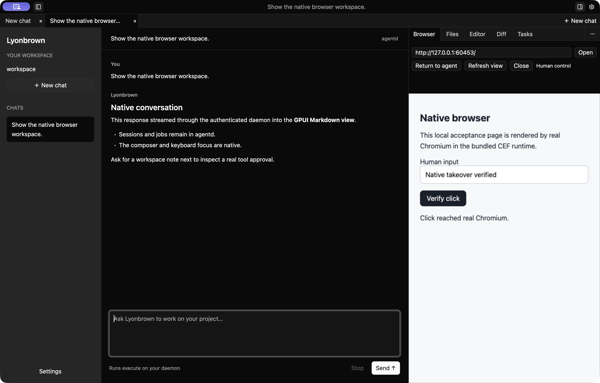

点击 Take control 后，界面进入 Human control。通过原生输入桥输入 `Native takeover verified`，随后点击页面按钮，页面显示 `Click reached real Chromium.`。再从 Settings 选择 Dark 并返回聊天，输入和点击结果仍保留，形成上图。随后实际执行了归还控制与 Space 关闭。此组图片使用调试测试钥匙串。

地址输入框保存导航输入，不能作为重定向后页面来源的可信显示。此组截图覆盖人工浏览器操作；模型自主操作的原生 CEF 验收使用独立合成页面，记录见[本地工具与浏览器操作](tools.md)。

另行执行的 GPUI 组件测试通过真实 daemon 和 CEF 检查了像素帧、指针坐标、文字输入、接管释放后的输入拒绝及 Space 关闭。测试使用 GPUI 测试窗口和调试验收程序的测试钥匙串；它验证组件调用与实际 Chromium 行为，不代替上面的原生窗口截图。

## 原生 Computer 目标与会话绑定

本节截图采集于 2026 年 10 月 19 日，使用启用 `native-computer` 的独立 GPUI 验收程序。用户在 macOS 设置中授予该测试 app 录屏和辅助功能权限后，通过 Computer 面板发现目标，并显式选择验收窗口挂接到已认证的 daemon 会话。

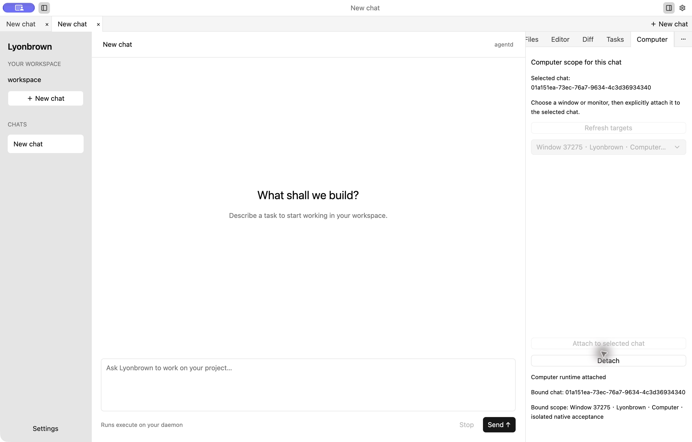

第二张图中，Selected chat 与 Bound chat 不同，原窗口仍绑定原会话。随后实际执行 Detach，界面恢复 detached，绑定会话与范围均清空。[Computer 截图记录](evidence/desktop-computer-capture.json)包含程序、相关源码及图片摘要；隔离数据库有两个会话，没有 Run、审批或操作记录。本次仅验证目标发现、挂接、聊天隔离和解除挂接，未请求 Harness 屏幕观察或原生输入。真实锁屏和用户切换尚未验收。

## 终端实际运行记录

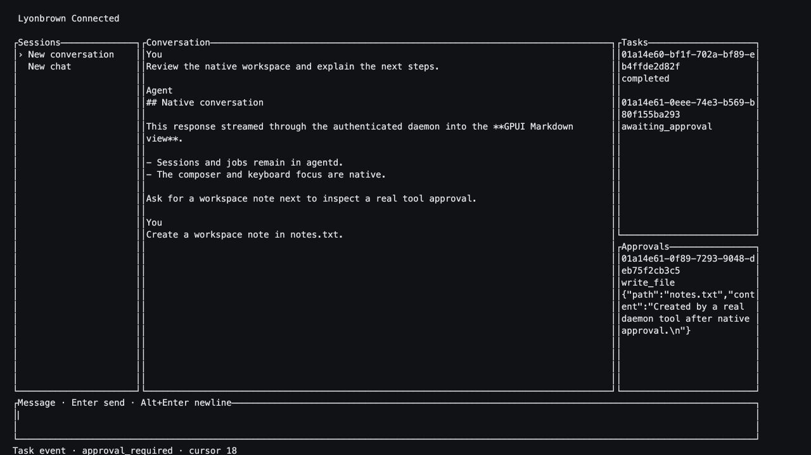

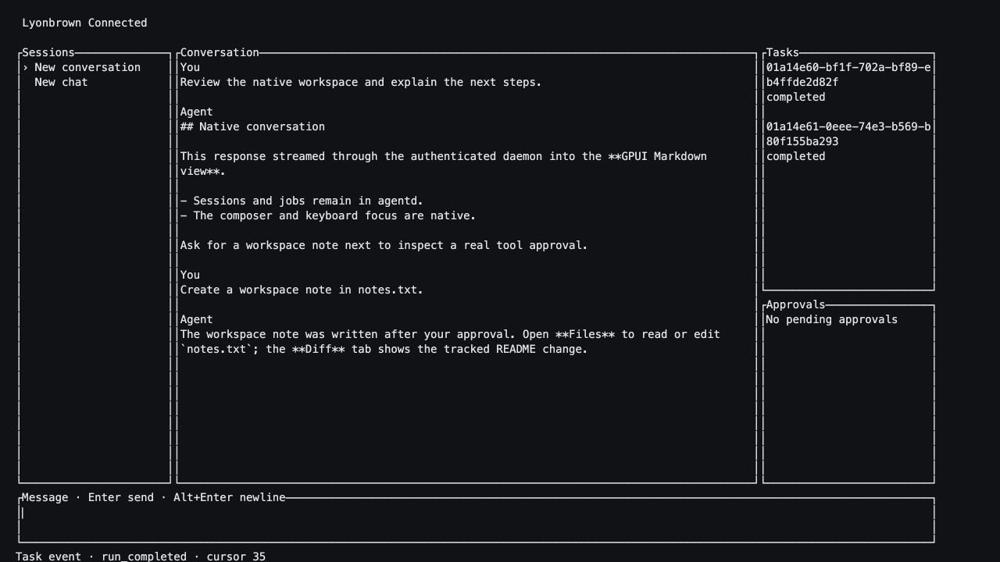

这两张图来自 macOS 上真实 `agent-cli` 进程的独立 PTY 记录，尺寸为 140 列、38 行。客户端经认证连接上述本地 daemon，创建会话、接收流式回复，并通过 `Ctrl+Y` 批准 `notes.txt` 的精确写入；第二次 Run 最终进入 `completed`，退出时恢复终端状态。

图片使用 pyte 0.8.2 解析实际 ANSI 输出后进行终端状态渲染，**不是操作系统 Terminal 窗口截图**。未手工填入会话、回复或审批内容。截图中的合成回复复用桌面 fixture，提及 GPUI、Files 和 Diff 不表示 TUI 内置这些桌面面板。

可核对[审批文本](evidence/tui-pty-approval.txt)、[完成文本](evidence/tui-pty-completed.txt)及[记录元数据](evidence/tui-pty-capture.json)。它们证明本次 PTY 工作流，不替代原生终端窗口的字体、颜色和输入法验收。

## macOS 安装包内容校验

0.1.0 的 ARM64 发布构建在 macOS 27.0.1 完成。客户端构建启用 `native-cef` 和 `native-computer`，agentd 包含 `local-llama` 和 `local-mistral` 两种 CPU 推理适配器。[安装包校验记录](evidence/native-packages-macos.json)列出构建配置、程序与打包工具摘要，以及五份产物的大小和 SHA-256。

| 格式 | 产物 | 实际检查 |
| --- | --- | --- |
| PKG | CLI、Desktop 各一份 | 组件元数据、完整应用目录、共享 agentd、入口链接和 BOM 文件清单 |
| tar.gz | CLI、Desktop 各一份 | 最终归档与打包目录的文件类型、权限、内容和链接逐项一致 |
| DMG | Desktop 一份 | 只读挂载后的应用目录与打包目录一致，检查后卸载 |

每个客户端的 5 个 Helper 均与对应主程序的摘要一致，232 个 CEF 文件与固定 SDK 一致。两份 PKG 未签名，产物未经过公证。这些记录覆盖生成与包内容校验；操作系统实际安装、原生服务生命周期、升级和回滚仍需单独运行验收。构建命令见[本地分发说明](https://github.com/lyonbrown4d/lyonbrown/blob/main/packaging/README.md)。

## AI Gateway 管理台与模型请求

本节采集于 2026 年 10 月 19 日，使用 macOS ARM64 上 0.1.0 的 SSR 服务端与 WASM hydration 调试构建。独立 `ai-gateway` 经 Rig HTTP 传输连接本机 `model-mock`；管理台使用 Leptos 组件，由 SSR 提供首屏，再由 WASM 接管交互。以下是在应用内浏览器实际操作采集的浅色主题截图。

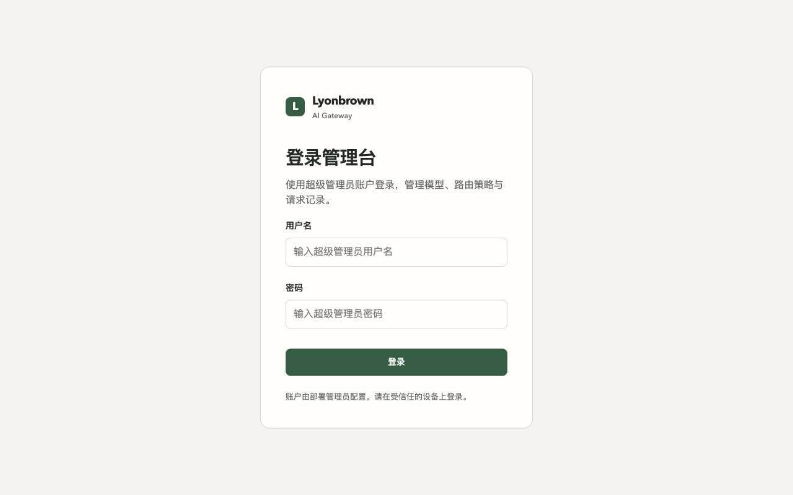

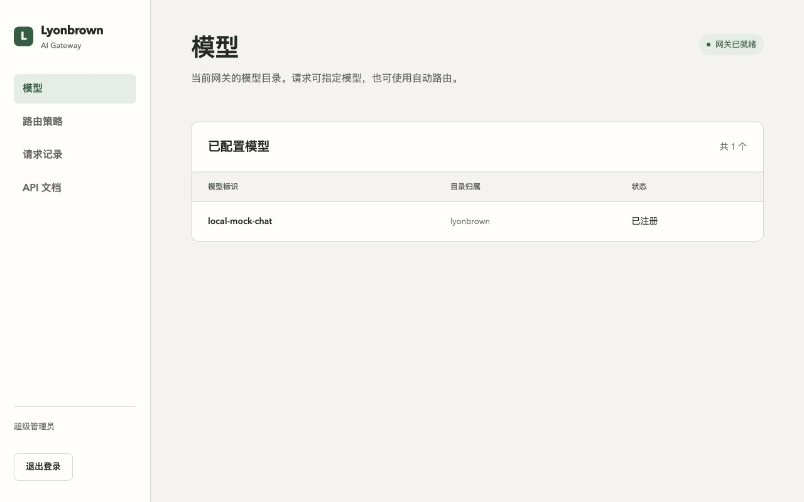

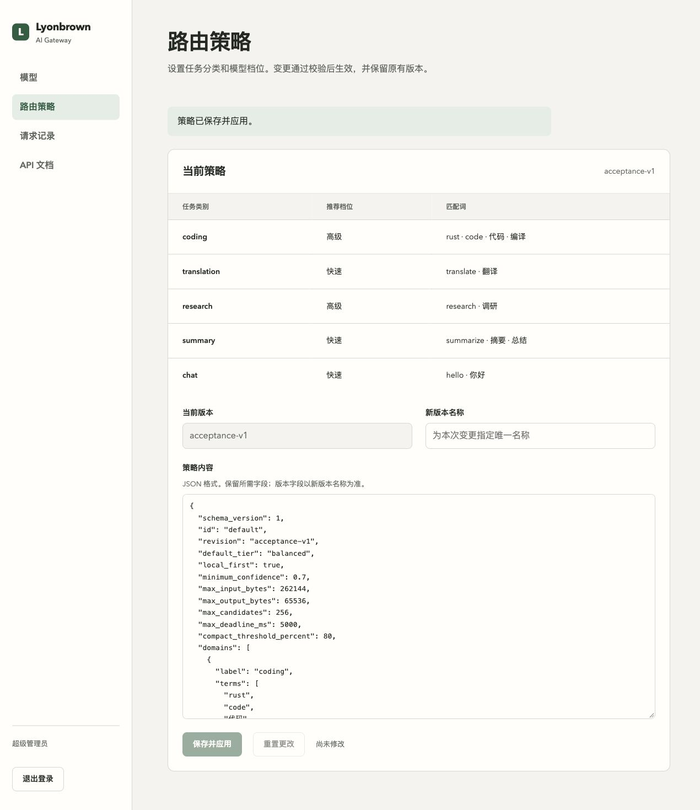

使用环境变量初始化的超级管理员用户名和密码，通过实际登录表单进入管理台后，将策略 revision 保存为 `acceptance-v1`。浏览器端共享校验拒绝无效 JSON，重置按钮恢复原始策略；含 HTML 标记的合成策略文本在 SSR 重载后仍作为文本保留，未生成额外页面节点。随后自动路由请求使用了新版本。退出登录后再次访问模型页会返回登录页，SQLite 中对应管理会话已撤销。

本轮发送四个合成模型请求，覆盖显式模型 JSON、自动路由 JSON、自动路由 SSE，以及策略更新后的自动路由。四条 SQLite 审计记录均为 Succeeded；SSE 包含结束标记。另行检查 API 与管理凭据隔离、未认证访问拒绝，以及数据库不包含凭据或 Prompt 字段。没有调用付费模型。

从管理台点击 API 文档进入 Swagger UI，加载内嵌规范与资源，实际通过 Try it out 执行健康检查，返回 `200` 和 `status: live`。

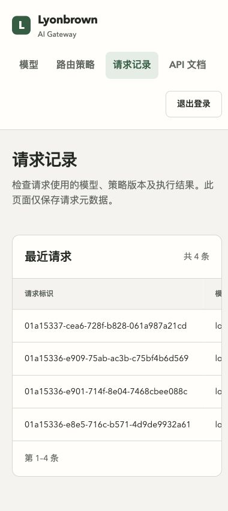

桌面布局以 1280 × 800 视口检查；窄窗口请求 390 × 844，扣除滚动条后的正文宽度为 380。正文没有横向溢出，请求表格在自身容器内滚动。[运行记录](evidence/gateway-web-macos.json)包含程序、WASM 与 JavaScript 资源、相关源码及图片摘要，以及 HTTP 和 SQLite 检查结果。本节不覆盖公网、Windows、Linux 或新版安装包验收。

## 尚未由本组截图覆盖的能力

本组截图未展示模型浏览器语义操作或原生终端窗口呈现。模型工具的合成 host 协议回归与真实 CEF 自主操作验收分别保留，见[本地工具与浏览器操作](tools.md)。
